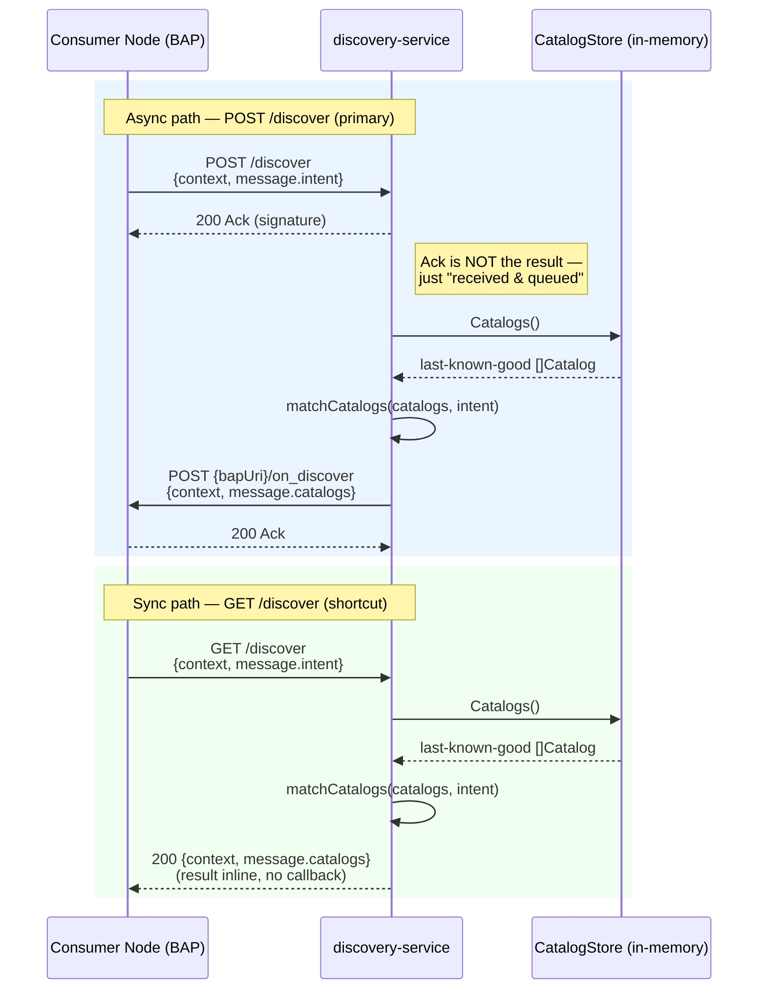

# discovery-service

A Go implementation of a Beckn **Discovery Service (DS)**: it serves
`POST /discover` requests and answers them asynchronously via
`POST /on_discover` to the caller's callback URL, per Beckn Protocol v2.0.0.

See [CONTEXT.md](CONTEXT.md) for the full architecture, decision log, and
protocol details.

## How it works

A Consumer Node (BAP) asks for products/services; this service matches its
in-memory catalog data against the request's `message.intent`
(`textSearch`/`filters`/`spatial` — see CONTEXT.md D18) and answers either
synchronously (`GET /discover`) or asynchronously via a callback
(`POST /discover` → `POST {bapUri}/on_discover`).



A malformed `filters` expression is rejected with `400` at the `Ack`/response
stage itself. `CatalogStore` is fed by `internal/catalogsource` (polling a
BPP's dashboard API, or the embedded demo catalog if unconfigured); a
catalog survives a query only if it passes every spatial constraint, then
its resources are narrowed by `textSearch`/`filters`, and offers referencing
a now-excluded resource are dropped.

## Quickstart

```bash
cp .env.example .env
docker compose up --build
```

The service listens on `HOST_PORT` (see `.env`), forwarded to `PORT` inside
the container.

## Development

```bash
go build ./...
go vet ./...
go test ./...
```

Run locally without Docker:

```bash
go run ./cmd/discovery
```
