# Architecture and data flow

How the ION Reference App is put together: what each service does, how they talk to each other, how data moves through every major flow, and how the whole thing is deployed locally and on GCP. Written for someone new to the system — start with [section 1](#1-the-big-picture) and the [glossary](#2-glossary), then jump to what you need.

Everything here is mapped from the code and config (`docker-compose.yml`, `config/`, `terraform/`, `.github/workflows/`, and each service's source). Local ports and hostnames are the Docker Compose ones unless a section says "cloud".

Related docs:

- Database schemas, every table and column → [db/README.md](db/README.md)
- Every HTTP endpoint (Swagger, generated with `task docs:api`) → [api/README.md](api/README.md)
- Step-by-step local setup → [INFRA_SETUP.md](../INFRA_SETUP.md); step-by-step cloud setup and gotchas → [terraform/README.md](../terraform/README.md); CI/CD setup → [deploy-github-actions.md](deploy-github-actions.md)

## Contents

1. [The big picture](#1-the-big-picture)
2. [Glossary](#2-glossary)
3. [Repository layout](#3-repository-layout)
4. [Services](#4-services)
5. [How services communicate](#5-how-services-communicate)
6. [Authentication: two separate layers](#6-authentication-two-separate-layers)
7. [Flows](#7-flows)
   - [7.1 Login and seller registration](#71-login-and-seller-registration)
   - [7.2 Catalog publish and how it becomes discoverable](#72-catalog-publish-and-how-it-becomes-discoverable)
   - [7.3 Buyer search (discover)](#73-buyer-search-discover)
   - [7.4 Placing an order: select → init → confirm](#74-placing-an-order-select--init--confirm)
   - [7.5 After the order: status, fulfillment, cancel, update, rate, support](#75-after-the-order-status-fulfillment-cancel-update-rate-support)
   - [7.6 Order status lifecycle](#76-order-status-lifecycle)
   - [7.7 Settlement reconciliation](#77-settlement-reconciliation)
8. [Who stores what](#8-who-stores-what)
9. [Deployment](#9-deployment)
   - [9.1 Local (Docker Compose)](#91-local-docker-compose)
   - [9.2 Cloud architecture (GCP)](#92-cloud-architecture-gcp)
   - [9.3 Deploying to a fresh GCP project](#93-deploying-to-a-fresh-gcp-project)
   - [9.4 Shipping code changes: redeploy and CI/CD](#94-shipping-code-changes-redeploy-and-cicd)
   - [9.5 Network identity: keys and DeDi files](#95-network-identity-keys-and-dedi-files)
10. [Configuration that wires services together](#10-configuration-that-wires-services-together)
11. [Observability and debugging](#11-observability-and-debugging)
12. [External dependencies](#12-external-dependencies)
13. [Known gaps](#13-known-gaps)

---

## 1. The big picture

The app is one **Network Participant** on ION (the Indonesia Open Network, a Beckn v2 network), playing both roles:

- **BAP** — the buyer side: a shop UI and its backend.
- **BPP** — the seller side: a seller dashboard and its backend.

The two backends never call each other directly. Everything between buyer and seller travels as **Beckn protocol messages** through the **onix adapters**, which sign, verify, validate and route them — exactly as it would between two different companies on the network. A seller's products reach buyers a different way: the seller **publishes** its catalog as signed files, and a **discovery service** crawls those files to answer searches.

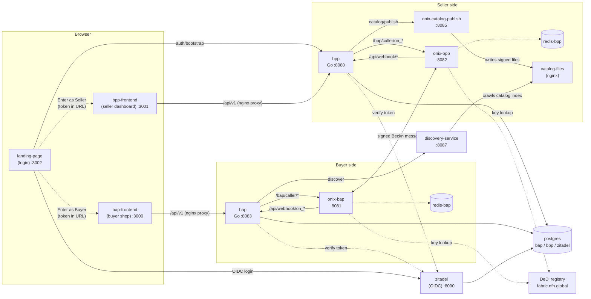

Solid arrows are API calls; dotted arrows are page navigation, caches, and key and token checks. Locally, `mock-cds` (:8086) can stand in for `discovery-service` — `bap` uses whichever `CDS_DISCOVER_URL` points at (see [7.3](#73-buyer-search-discover)). After login, `landing-page` opens the buyer or seller UI with the access token in the URL — see [7.1](#71-login-and-seller-registration).

---

## 2. Glossary

**Network and protocol**

| Term | Meaning |
|---|---|
| **ION** | Indonesia Open Network — the open commerce network this app participates in. |
| **Beckn** | The open protocol ION is built on (v2). Defines the actions (`discover`, `select`, `init`, `confirm`, …), the message format and the async request/callback model. |
| **Network Participant (NP)** | A company/app on the network. This repo is one NP acting as both BAP and BPP. |
| **BAP** | Beckn Application Platform — the **buyer**-side app. Here: `bap` + `bap-frontend`. |
| **BPP** | Beckn Provider Platform — the **seller**-side app. Here: `bpp` + `bpp-frontend`. |
| **CDS / Discovery Service** | Answers buyer searches (`discover`) from the catalogs sellers have published. Here: `discovery-service` (or `mock-cds` locally). |
| **ONIX (onix adapter)** | The Beckn adapter (`beckn-onix`, vendor image) placed in front of each app. It signs outgoing messages, verifies incoming ones, validates schemas and routes. |
| **Caller / Receiver** | The two halves of an onix adapter: **caller** takes the app's outgoing messages to the network; **receiver** takes network messages to the app. |
| **context / message** | Every Beckn request is `{context, message}`: `context` has the action, ids and addresses (`bapId`, `bapUri`, `bppId`, `bppUri`, `transactionId`, `messageId`); `message` has the action-specific payload. |
| **transactionId / messageId** | `transactionId` ties together every message of one order (select → … → rate); `messageId` identifies one request/callback pair. |
| **ACK / NACK** | The immediate "received / rejected" reply to every Beckn request. It carries no business data. |
| **on_\* callback** | The real answer to an action, sent later as a separate request (`select` → `on_select`). **Unsolicited**: an `on_*` the BPP sends without being asked (e.g. `on_status` when an order ships). |
| **Subscriber ID / keyId** | A participant's identity on the network and the id of its signing key. Other participants use them to look up its public key. |
| **Ed25519 signature** | How every Beckn message is signed, so the receiver can prove who sent it. |
| **DeDi / registry** | Decentralised Directory: where participants' public keys and endpoints are published. onix looks keys up in the DeDi registry at `fabric.nfh.global`. This app also publishes its own DeDi files (`.well-known/dedi.index.json` → registry file → catalog index). |

**Commerce data**

| Term | Meaning |
|---|---|
| **Provider** | A seller (one per seller account in `bpp`). |
| **Catalog / Resource / Offer** | A seller's published list; a **resource** is a product; an **offer** is the price and terms for one or more resources. |
| **Contract** | The order, as one JSON document both sides exchange and evolve (DRAFT → ACTIVE → COMPLETE / CANCELLED). |
| **Commitment** | A line of the contract: which resource/offer and how many. |
| **Consideration** | What the buyer pays (the price breakdown). |
| **Performance** | Fulfilment of the contract — e.g. delivery status (Packed, Shipped, Delivered) or a return. |
| **Settlement** | How the money moves: payment, the network's commission, the seller's payout. |
| **Reconciliation** | BAP and BPP agreeing on the settlement figures of confirmed orders (`reconcile` / `on_reconcile`). |
| **Snapshot** | A saved copy of the contract as received at one step (`bap` keeps every one). |

**Login**

| Term | Meaning |
|---|---|
| **Zitadel** | The identity provider used for human login. |
| **OIDC / PKCE** | The login standard (OpenID Connect) and the variant for browser apps without a client secret. |
| **JWT / JWKS** | The access token format, and Zitadel's published keys the backends use to verify it. |
| **Subject (`sub`)** | The user's id inside the token. |

---

## 3. Repository layout

| Path | What it is |
|---|---|
| `bap-application/` | Buyer backend (Go, Gin). `internal/clientsvc` = APIs for the frontend; `internal/on_*_svc` = Beckn callback handlers; `internal/reconcile_svc` = reconciliation; `internal/discoverwait` = joins async `on_discover` back to the search request; `internal/auth` = optional login check; `db/migrations` (tern), `db/queries` + `db/sqlc` (generated DB code). |
| `bpp-application/` | Seller backend (Go, Gin + `alya`). `internal/selectsvc`, `initsvc`, `confirmsvc`, `statussvc`, `updatesvc`, `cancelsvc`, `ratesvc`, `supportsvc` = Beckn action handlers; `internal/dashboardsvc` = seller dashboard API; `internal/catalog` = catalog publish; `internal/authsvc` = seller bootstrap; `internal/auth` = seller login check; `internal/reconsvc` = reconciliation; `postman/` = API collections. |
| `bap-frontend/`, `bpp-frontend/`, `landing-page/` | React (Vite) apps, each served by nginx. `env.sh` writes runtime config into the page. |
| `ion-landing-page/` | Static ION portal page; in the cloud also the path-based entry to the three UIs (`Dockerfile.cloud`). |
| `onix-bap/`, `onix-bpp/`, `onix-catalog-publish/` | Cloud images of the vendor onix adapters: config `templates/*.tmpl` rendered from env vars at start-up. (Locally Compose uses the vendor images directly with `config/`.) |
| `config/` | Local onix config: `local-simple-{bap,bpp}.yaml`, `catalog-publish.yaml` (rendered from `*.example` by `scripts/render-onix-config.sh`) and the routing files `local-simple-routing-*.yaml`. |
| `discovery-service/` | Go Discovery Service (in-memory, crawls catalog indexes). Own `README.md` and `CONTEXT.md`. |
| `dedi-static-server/` | Cloud-only nginx: serves the DeDi and catalog files from GCS and proxies the public domains to the right service. |
| `dedi-onboarding-files/` | This participant's DeDi files (`dedi.index.json`, `ion-scratch-registry.json`) and the `dedi-file-signer` tool. |
| `file-onboarding-and-catalog-publish/data/` | Local output of `onix-catalog-publish` (signed catalog files), served by `catalog-files`. Gitignored. |
| `catalog-seed/`, `catalog-uploader-go/` | Tools that publish a sample catalog (Indonesian snacks CSV) to `bpp`. |
| `otel-collector/` | OpenTelemetry Collector image that forwards onix telemetry to the ION network collector. |
| `postgres/init-dbs.sh` | Creates the `bap`, `bpp` and `zitadel` databases locally. |
| `scripts/` | `render-onix-config.sh`, `setup-zitadel.sh` / `setup-zitadel-cloud.sh`, `seed-secrets.sh`, `build-and-push.sh`, `zitadel-branding.sh`, `mock-cds.py`, `gen_crc_fields.py`, `merge-tbls-docs.sh`. |
| `terraform/` | Everything on GCP (see [9.2](#92-cloud-architecture-gcp)). |
| `docker-compose.yml` | The full local stack. |
| `Taskfile.yaml` | Shortcuts (`task <name>`): `local:up/down`, `deploy:*`, `redeploy:*`, `sign-dedi-files`, `deploy-dedi-files`, `docs:db`, `docs:api`. |
| `.github/workflows/deploy.yml` | CI/CD: deploys changed services on every push to `main`. |
| `docs/` | This document, `api/` (Swagger specs, `task docs:api`), `db/` (schema docs, `task docs:db`), `deploy-github-actions.md`, `specs/`. |

---

## 4. Services

| Service | Role | Tech | Local port | Talks to |
|---|---|---|---|---|
| `bap-frontend` | Buyer shop: search, cart, checkout, order history, message log, reconciliation page | React (Vite), served by nginx | 3000 | `bap` (via its nginx `/api/` proxy) |
| `bpp-frontend` | Seller dashboard: overview, catalogs, inventory, orders, messages, support, ratings, reconciliation | React (Vite), nginx | 3001 | `bpp` (via its nginx `/api/` proxy) |
| `landing-page` | Login / registration entry point; creates the seller profile; links into both frontends | React (Vite), nginx | 3002 | `zitadel` (OIDC), `bpp` (`/api/v1/auth/bootstrap`) |
| `ion-landing-page` | Static ION portal page; in the cloud also the path-based hub for the three UIs | static HTML, nginx | 3003 | links to `landing-page` |
| `bap` | Buyer backend: turns UI actions into Beckn requests, receives `on_*` callbacks, keeps order state | Go, Gin, sqlc, tern | 8083 | `onix-bap`, discovery (`discovery-service` / `mock-cds`), `postgres`, `zitadel` |
| `bpp` | Seller backend: catalog management, answers Beckn requests, sends `on_*` callbacks, fulfillment, reconciliation | Go, Gin + alya, sqlc, tern | 8080 | `onix-bpp`, `onix-catalog-publish`, `postgres`, `zitadel` |
| `onix-bap` | Beckn adapter for the BAP: signs outgoing, verifies incoming, validates schemas, routes | `fidedocker/onix-adapter:1.9.0` | 8081 | `bap`, `onix-bpp` / other BPPs, discovery, `redis-bap`, DeDi registry, `otel-collector-bap` |
| `onix-bpp` | Beckn adapter for the BPP (same image, seller-side config) | `fidedocker/onix-adapter:1.9.0` | 8082 | `bpp`, `onix-bap` / other BAPs, `redis-bpp`, DeDi registry, `otel-collector-bpp` |
| `onix-catalog-publish` | Turns a catalog into signed, versioned catalog files | `fidedocker/catalog-publisher` | 8085 | writes to the shared catalog directory (`/beckn`) |
| `catalog-files` | Serves those catalog files over HTTP (internal only, local only) | nginx | — | read by `discovery-service` |
| `discovery-service` | Beckn Discovery Service (CDS role): crawls published catalogs into memory and answers `discover` | Go | 8087 | `catalog-files`; calls back the BAP for async `discover` |
| `mock-cds` | Local stand-in for a Discovery Service, reads the catalog files directly | Python | 8086 | calls back the BAP for async `discover` |
| `zitadel` | Identity provider (OIDC) for human login | Zitadel | 8090 | `postgres` (`zitadel` DB) |
| `postgres` | One Postgres with three databases: `bap`, `bpp`, `zitadel` | Postgres 16 | 5435 | — |
| `migrate-bap` / `migrate-bpp` | One-shot jobs that apply the tern migrations before the apps start | tern | — | `postgres` |
| `redis-bap` / `redis-bpp` | Cache for each onix adapter | Redis | — | — |
| `otel-collector-bap` / `-bpp` | Receive onix telemetry and forward it to the ION network collector | OpenTelemetry Collector | — | `https://netcol.iontest.in` |
| `dedi-static-server` | **Cloud only.** Public front door of the BAP and BPP domains: serves DeDi + catalog files, proxies Beckn and API paths | nginx | — | GCS bucket, `bap`, `bpp`, `onix-bap`, `onix-bpp` |

---

## 5. How services communicate

There are five kinds of traffic.

### 5.1 Browser → frontend → backend (REST)

Each frontend is a static React build served by nginx. The UI calls relative URLs (`<base>/api/v1/...`) and nginx proxies `/api/` to its backend, so the browser never talks to `bap`/`bpp` directly.

| Frontend | nginx proxies `/api/` to (local) | Auth header |
|---|---|---|
| `bap-frontend` | `BAP_URL` = `http://bap:8083` | `Authorization: Bearer <token>` when logged in |
| `bpp-frontend` | `BPP_URL` = `http://bpp:8080` | `Authorization: Bearer <token>` (required) |

The one exception is `landing-page`, which calls `bpp`'s `POST /api/v1/auth/bootstrap` **directly and cross-origin** (`BPP_API_URL`); `bpp` allows exactly that origin with CORS (`LANDING_PAGE_ORIGIN`).

Order status is **pushed** to `bap-frontend`: while an order action is in flight it keeps `GET /api/v1/status/:id/stream` open (server-sent events). The `on_*` callback's write to `transactions` / `contract_snapshots` fires a Postgres `NOTIFY bap_transaction_status` (migration 017), and `bap`'s listener (`internal/statusstream`) sends the new state down every stream open for that transaction, on any `bap` instance. If the stream drops, the frontend polls `GET /api/v1/status/:id` every 500 ms until it reconnects. Live lists (orders, message log, reconciliation) still poll every 5 s; neither frontend uses websockets.

### 5.2 Backend ↔ its onix adapter (Beckn messages)

Each onix adapter has two modules:

| Module | Path | Direction | Pipeline |
|---|---|---|---|
| **Caller** | `/bap/caller/<action>`, `/bpp/caller/<action>` | own backend → network | `addRoute → sign → storePayload → validateSchema → validateAckSign` |
| **Receiver** | `/bap/receiver/<action>`, `/bpp/receiver/<action>` | network → own backend | `validateSign → addRoute → validateSchema → signAck` |

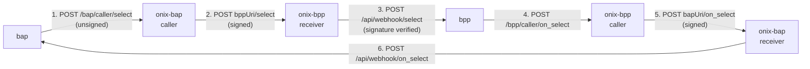

- `bap` and `bpp` **do not sign** these messages; the caller module does. They only build the Beckn JSON and post it to their own adapter.
- Where the caller sends a message is set by the routing files in `config/`:
  - `local-simple-routing-BAPCaller.yaml` — `select … support`, `reconcile`, `on_reconcile` go to the **BPP URI in the message context** (`targetType: bpp`); `discover` goes to a fixed discovery URL.
  - `local-simple-routing-BPPCaller.yaml` — every `on_*`, `reconcile`, `on_reconcile` go to the **BAP URI in the message context** (`targetType: bap`).
- Where the receiver delivers is also routing config:
  - `local-simple-routing-BAPReceiver.yaml` → `http://bap:8083/api/webhook/<action>`
  - `local-simple-routing-BPPReceiver.yaml` → `http://bpp:8080/api/webhook/<action>`
- In the cloud the same routing is rendered from `onix-*/templates/` and the adapter-to-adapter hop goes through the public domains — see [9.2](#92-cloud-architecture-gcp).

### 5.3 onix ↔ network (signing and trust)

- Every outgoing Beckn message gets an Ed25519 HTTP signature from the adapter's key manager.
- Every incoming message's signature is checked (`validateSign`) using the sender's public key, looked up through the **DeDi registry** plugin (`https://fabric.nfh.global/registry/dedi`). Results are cached in Redis.
- Messages are validated against the ION Release 1 Beckn schemas (`schema.ion.id`), plus `ion-additional.yaml` for `reconcile`/`on_reconcile`.
- The adapter replies to every request with a **signed ACK/NACK** immediately; the real answer always arrives later as a separate `on_<action>` request.
- Timeouts: onix waits up to 90 s; `bap`'s client times out at 90 s, `bpp`'s at 30 s.

### 5.4 Catalog publication (files, not messages)

The catalog does not travel as a Beckn request to buyers. Instead `bpp` sends it to `onix-catalog-publish`, which writes signed, versioned files; discovery services crawl those files. See [7.2](#72-catalog-publish-and-how-it-becomes-discoverable).

### 5.5 Telemetry

Only the onix adapters emit telemetry (OTLP gRPC to `otel-collector-bap` / `-bpp` on `:4317`). The collectors keep request-count metrics and spans carrying a `sender.id`, and forward them to the ION network collector (`NETWORK_COLLECTOR_ENDPOINT`, default `https://netcol.iontest.in`). `bap`, `bpp` and `discovery-service` only write logs — see [11](#11-observability-and-debugging).

---

## 6. Authentication: two separate layers

| | Human login | Network message signing |
|---|---|---|
| **Proves** | which person is using the UI | which network participant sent a Beckn message |
| **Mechanism** | Zitadel OIDC (authorization code + PKCE) → JWT access token | Ed25519 HTTP signatures |
| **Done by** | `landing-page` (login), `bap`/`bpp` `internal/auth` (verify) | onix adapters (sign/verify), DeDi registry (public keys) |
| **Used on** | `/api/v1/*` calls from the browsers | every Beckn message between adapters |

How each backend uses the login token:

- **`bpp`** — `RequireSeller` on every dashboard route: verifies the JWT, looks up the `users` row for the token's subject and puts that seller's `provider_id` on the request; every dashboard query is filtered by it. No `users` row → `403 NO_PROVIDER`. `/api/v1/auth/bootstrap` uses the lighter `RequireToken`, because its job is to create that row.
- **`bap`** — `OptionalAuth`: a request without a token is allowed; a valid token attaches the buyer's subject; an invalid token is rejected with 401. The subject is stored on the order (`transactions.buyer_subject`) and used to scope order history and the message log. There is no buyer registration and no users table on the buyer side.

Both backends verify tokens locally against Zitadel's published keys (JWKS). Locally they reach Zitadel at `http://zitadel:8080` while the token issuer is `http://localhost:8090` (`ZITADEL_INTERNAL_URL` vs `ZITADEL_ISSUER`). Both retry reaching Zitadel at start-up (10 tries, 3 s apart). If it stays unreachable, `bpp` exits, while `bap` keeps running without login checks (every buyer is anonymous).

The `providerId` that bootstrap returns is passed to both frontends in the URL, but only the buyer shop uses it — to show the logged-in seller's own products under "My Resources". It grants no access: the seller dashboard's data is scoped on the server from the token.

---

## 7. Flows

### 7.1 Login and seller registration

One Zitadel identity can act as buyer, seller, or both.

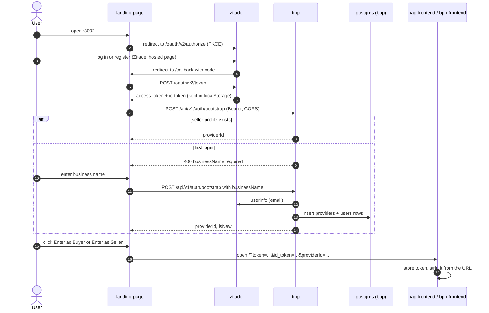

Logout: `landing-page` loads `<frontend>/logout` in hidden iframes to clear both frontends' stored tokens, then ends the Zitadel session.

### 7.2 Catalog publish and how it becomes discoverable

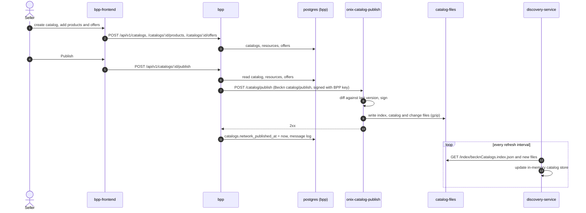

- `onix-catalog-publish` and `catalog-files` share one directory (`file-onboarding-and-catalog-publish/data/beckn/` locally; the `dedi-static` GCS bucket in the cloud). The publisher writes, nginx serves, `discovery-service` crawls (checking digests). `mock-cds` reads the same directory directly.
- **Deleting** a published catalog sends a `retire` directive to the same endpoint, then soft-deletes it.
- **Provider API alternative**: `POST /api/v1/catalog/publish` accepts a whole catalog in one call (used by `catalog-seed/`), saves it to the DB and forwards it the same way.

### 7.3 Buyer search (discover)

`bap` supports two ways to run `discover`, selected by `DISCOVER_METHOD`:

| | `GET` (default) | `POST` |
|---|---|---|
| Path | `bap` → discovery service directly | `bap` → `onix-bap` → discovery service → callback |
| Signed by | `bap` itself (`BAP_PRIVATE_KEY`) | `onix-bap` |
| Answer | inline in the HTTP response | async `on_discover` callback, which `bap` waits for (max 60 s) |
| Target | `CDS_DISCOVER_URL` (`discovery-service:8087/discover` or `mock-cds:8086`) | the `discover` route in `local-simple-routing-BAPCaller.yaml` |

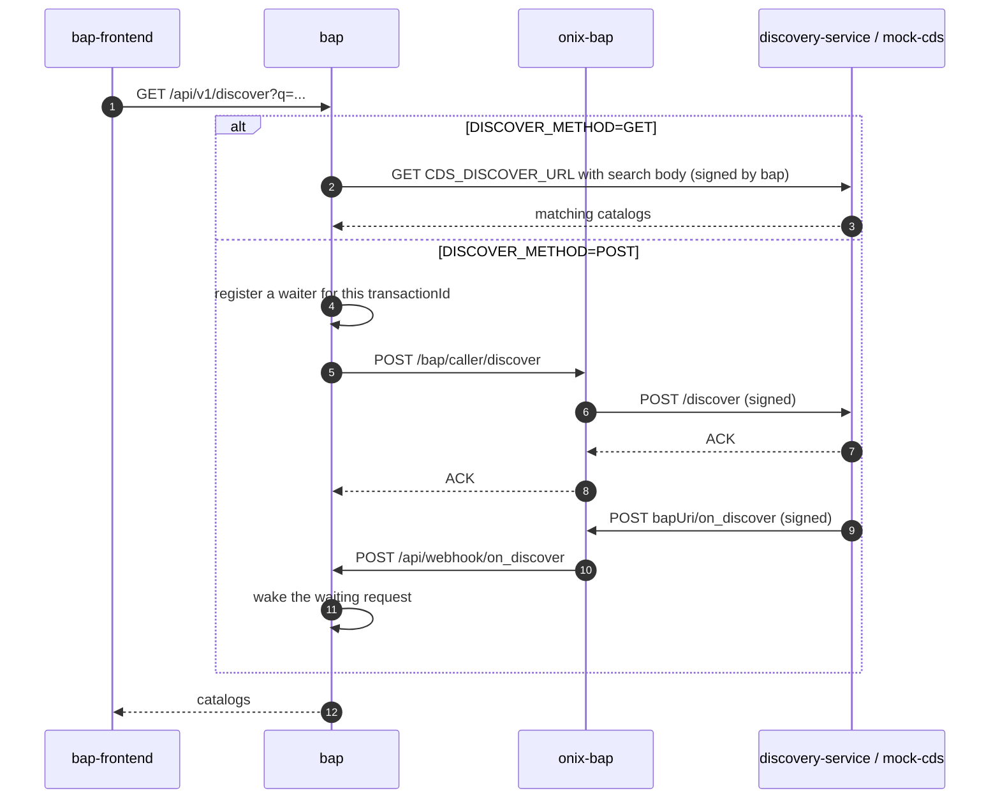

- In `POST` mode the waiter lives in `bap`'s memory (`internal/discoverwait`), so the callback must reach the same `bap` instance that sent the request.
- Every discover is written to `beckn_message_log`; if the buyer is logged in, also to `discover_requests` (so it shows in their message log).
- The buyer shop shows results in two groups: the logged-in seller's own products ("My Resources") and everyone else's.

### 7.4 Placing an order: select → init → confirm

Every order action has the same shape: the buyer's request gets a quick ACK, and the seller's answer comes back later as an `on_*` callback. The frontend gets the result pushed over `GET /api/v1/status/:id/stream` (SSE) the moment `bap` stores the callback (see 5.1).

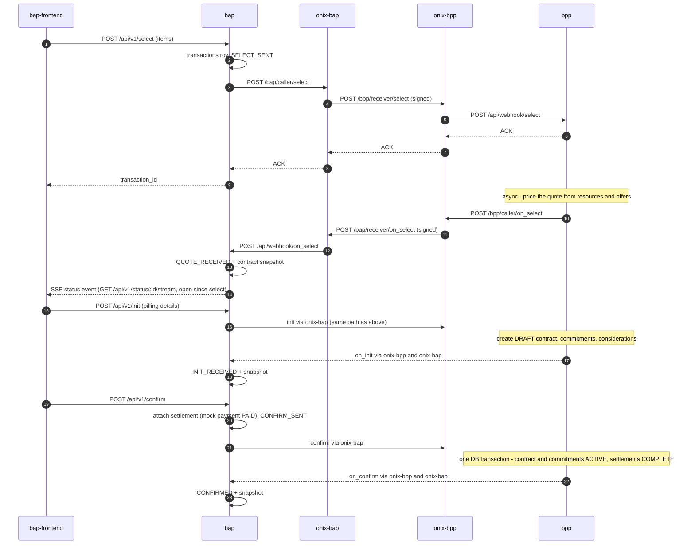

What each side records:

| Step | `bap` (database `bap`) | `bpp` (database `bpp`) |
|---|---|---|
| select | `transactions` (`SELECT_SENT` → `QUOTE_RECEIVED`), snapshot of the quote | message log only (quote is computed, not stored) |
| init | `INIT_SENT` → `INIT_RECEIVED`, snapshot | `contracts` (DRAFT), `contract_participants`, `commitments`, `commitment_offers`, `considerations`, `contract_performances` |
| confirm | `CONFIRM_SENT` → `CONFIRMED`, snapshot | contract and commitments → ACTIVE, `settlements` |

Both sides write every message in and out to `beckn_message_log`. `bap` keeps every version of the contract it receives in `contract_snapshots` and reads the latest one to build the next request. Payment is a **mock**: there is no payment gateway.

### 7.5 After the order: status, fulfillment, cancel, update, rate, support

**Buyer-initiated actions** follow the same path as 7.4:

| Buyer action (`POST /api/v1/...`) | Beckn action | `bpp` does | `bap` status |
|---|---|---|---|
| `request-status` | `status` | reads the contract (no writes) | `STATUS_SENT` → from `on_status` (ACTIVE → `CONFIRMED`, CANCELLED, COMPLETE) |
| `cancel`, `cancel-items` (all items) | `cancel` | cancels contract / commitments | `CANCEL_SENT` → `CANCELLED` |
| `cancel-items` (some items), `return-items`, `update` | `update` | partial cancel / return, or updates contract attributes | `UPDATE_SENT` → from `on_update` |
| `rate` | `rate` | `ratings` row | `RATE_SENT` |
| `support` | `support` | `support_tickets` row | `SUPPORT_SENT` |

`GET /api/v1/status/:id` reads `bap`'s own database only; `request-status` is what actually asks the seller.

**Seller-initiated updates** are unsolicited `on_status` messages sent from `bpp` without a buyer request:

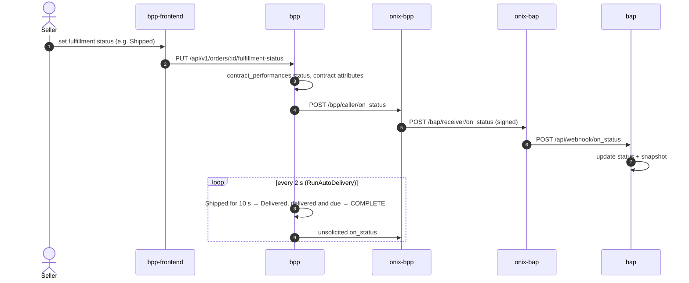

### 7.6 Order status lifecycle

The buyer side's `transactions.status`, as set by `bap`'s actions (`*_SENT`) and by the callbacks:

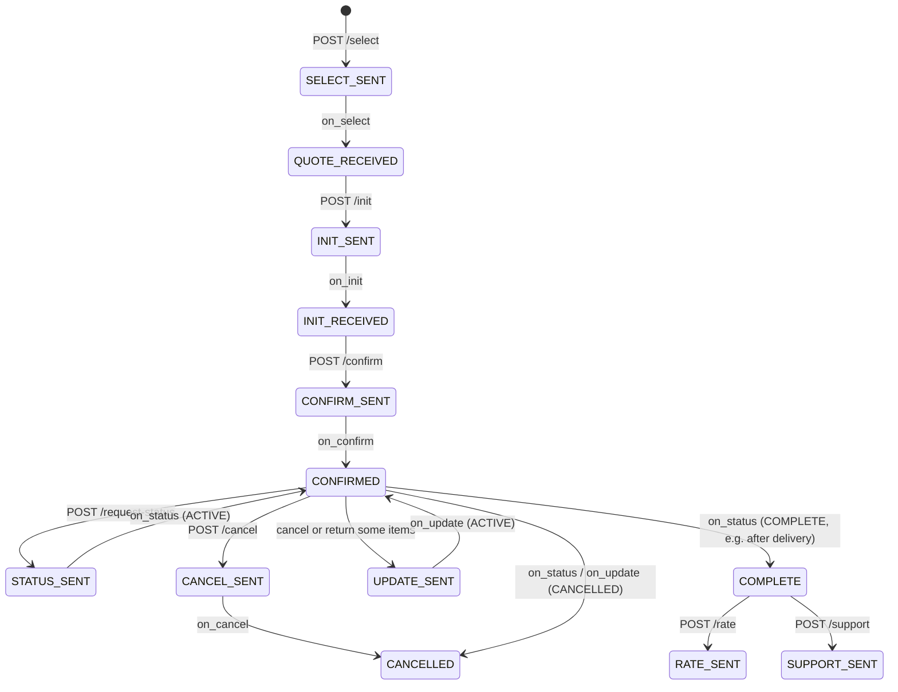

- `on_status` and `on_update` only change the status when the contract's state is ACTIVE, CANCELLED or COMPLETE; anything else leaves it unchanged. They can arrive in any state (the seller sends them unasked).
- `on_rate` and `on_support` don't change the status, so an order stays at `RATE_SENT` / `SUPPORT_SENT` after rating or a support request.
- On the seller side the contract itself goes **DRAFT** (init) → **ACTIVE** (confirm) → **COMPLETE** (delivered and past the completion window) or **CANCELLED**; fulfilment progress (Packed, Shipped, Delivered, returns) is tracked separately in `contract_performances`.

### 7.7 Settlement reconciliation

Either side can start a reconciliation round for its confirmed contracts with one counterparty. The message is `reconcile`, the answer is `on_reconcile`, and both travel through the adapters like any other Beckn action.

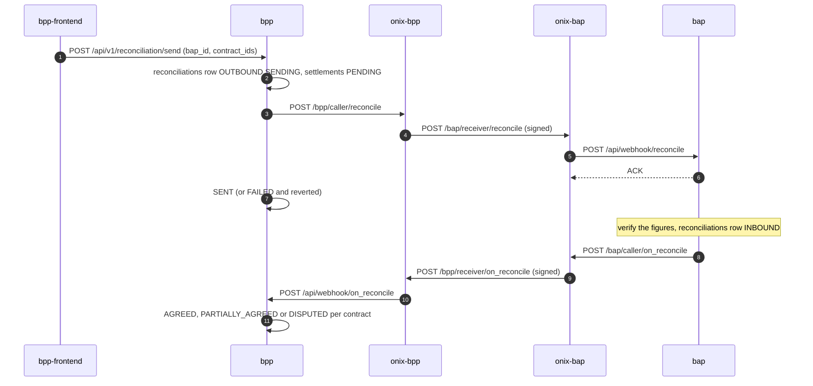

The BAP-initiated direction is the mirror image: `bap-frontend`'s reconciliation page → `POST /api/v1/reconciliation/send` on `bap` → `reconcile` via `onix-bap` → `bpp` answers with `on_reconcile`. Sending is manual on both sides (no scheduled job yet). Two settings control timing: `SETTLEMENT_WINDOW` (on `bpp`) and `RECONCILE_WAIT_FOR_SETTLEMENT_WINDOW` (on both; `false` lets contracts be reconciled before their window ends).

---

## 8. Who stores what

| Store | Owner | Holds |
|---|---|---|
| Postgres `bap` | `bap` | `bap_identities`, `transactions` (one per order, with status and `buyer_subject`), `contract_snapshots` (every contract version received), `beckn_message_log`, `discover_requests`, `reconciliations` — see [db/bap.md](db/bap.md) |
| Postgres `bpp` | `bpp` | identities and keys, `users`, `providers`, `catalogs`, `resources`, `offers`, `contracts` and their commitments/considerations/performances/settlements, `ratings`, `support_tickets`, `beckn_message_log`, `reconciliations` — see [db/bpp.md](db/bpp.md) |
| Postgres `zitadel` | `zitadel` | user accounts, the `reference-app` project and the `landing-page` OIDC app |
| Catalog directory / bucket | `onix-catalog-publish` | signed catalog index, full catalogs, change files |
| `discovery-service` memory | `discovery-service` | crawled catalogs (rebuilt on restart; no database) |
| Redis | onix adapters | cache (registry lookups etc.) |
| Browser `localStorage` | frontends | the access and id token (`bap.*`, `bpp.*`, `landing.*` keys) |

Nothing is shared between `bap` and `bpp` except through Beckn messages: each side has its own copy of the contract. Schemas are created and changed only by tern migrations (`<app>/db/migrations/`), applied by the `migrate-*` jobs.

---

## 9. Deployment

The same container images run in both environments:

| | Local | Cloud (GCP) |
|---|---|---|
| Runs on | Docker Compose, one network (`beckn`) | Cloud Run (each service scales 0–3) |
| Started by | `task local:up` | Terraform + `task deploy:*`, then GitHub Actions for code changes |
| Database | Postgres container (`bap`, `bpp`, `zitadel`) | Cloud SQL Postgres 15, private IP (`trade_bap`, `trade_bpp`, `zitadel`) |
| Redis | `redis-bap`, `redis-bpp` | One Memorystore instance shared by the onix services |
| Catalog files | Local folder + `catalog-files` nginx | `dedi-static` GCS bucket + `dedi-static-server` |
| Secrets / keys | `.env` | Secret Manager |
| Services reach each other by | Docker hostnames (`http://bap:8083`) | Public custom domains via `dedi-static-server`, or Cloud Run URLs |
| Discovery | `discovery-service` or `mock-cds` | `discovery-service` (or an external one via `cds_discover_url`) |

### 9.1 Local (Docker Compose)

**Prerequisites** (details in [INFRA_SETUP.md](../INFRA_SETUP.md)):

- Docker + Compose, `envsubst` (gettext), `curl`, `jq`, and [Task](https://taskfile.dev).
- A Beckn identity for the BAP and for the BPP, registered on the network registry: subscriber ID, keyId, Ed25519 signing keypair and encryption keypair. These can't be self-generated — the registry administrator issues them (see [9.5](#95-network-identity-keys-and-dedi-files)).
- `.env` copied from `.env.example` and filled in: network id, the BAP and BPP identities (`BAP_*`, `BPP_*`, `*_ONIX_*` keys — the app keys and the onix keys must be the same identity), discovery settings, DB user/password, Zitadel admin and master key, settlement settings.

**`task local:up` does four things:**

1. `scripts/render-onix-config.sh` — fills the keys from `.env` into `config/local-simple-bap.yaml`, `local-simple-bpp.yaml` and `catalog-publish.yaml` (from the `*.example` templates).
2. Starts `postgres` and `zitadel`. Postgres creates the three databases; Zitadel creates a machine user and writes its access token to `.zitadel-machinekey/pat.txt`.
3. `scripts/setup-zitadel.sh` — uses that token to create the `reference-app` project and the `landing-page` OIDC app, and writes `ZITADEL_CLIENT_ID` into `.env`.
4. `docker compose up -d --build` — builds and starts everything else, in dependency order:

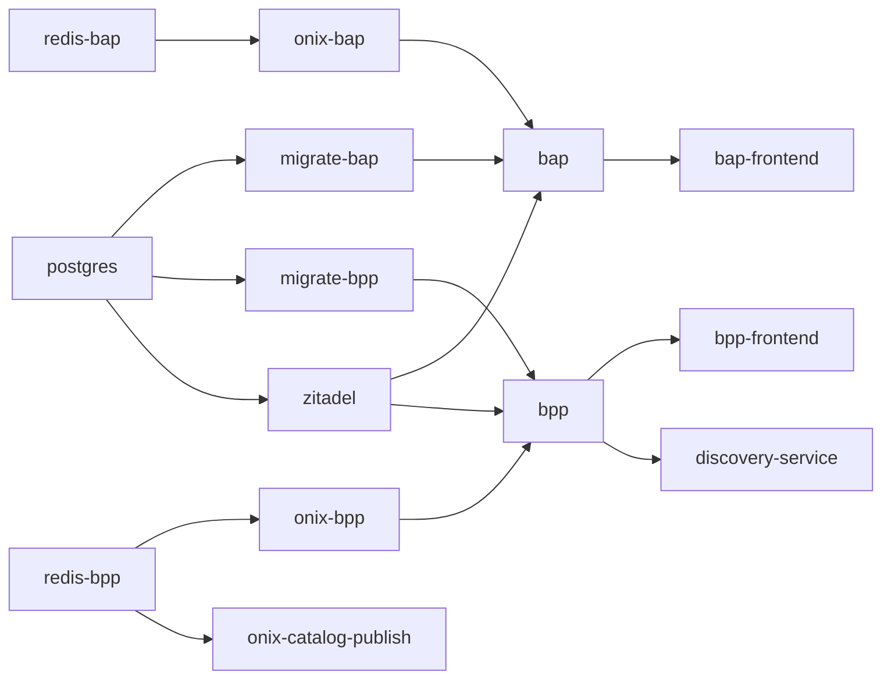

`bap` and `bpp` start only after their migration job has **completed successfully**, so a fresh database always has the schema. The migration jobs are safe to re-run (tern skips migrations already applied).

**Day to day:**

| Task | Command |
|---|---|
| Start / rebuild everything | `task local:up` (safe to re-run) |
| Stop (data kept) | `task local:down` |
| Wipe all data and start fresh | `docker compose down -v`, then `task local:up` |
| Check it's up | `curl localhost:8083/health` (bap), `curl localhost:8080/health` (bpp), open `http://localhost:3002` |
| Regenerate DB docs / API docs | `task docs:db` / `task docs:api` |

After rebuilding a backend, restart its frontend too (`docker compose restart frontend bpp-frontend`), otherwise nginx returns 502.

### 9.2 Cloud architecture (GCP)

Everything is created by `terraform/` in one GCP project (default region `asia-southeast2`). There are three kinds of public entry point:

- **`ion_landing_page_domain`** → `ion-landing-page`, which serves the portal and routes by path to the three UIs.
- **`bap_domain`** and **`bpp_domain`** → `dedi-static-server`, the network-facing front door: it serves the DeDi and catalog files and proxies Beckn and API traffic to the right service.
- **`zitadel_domain`** → `zitadel`.

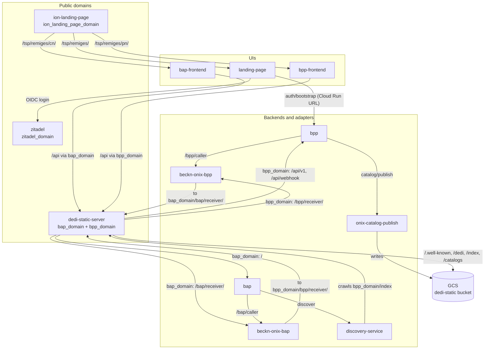

What to notice:

- **The adapters reach each other over the public domains.** `bap` puts `https://<bpp_domain>/bpp/receiver/` in its messages, so `onix-bap` sends to `dedi-static-server`, which proxies to `onix-bpp` — the same way an outside participant would reach this BPP. Callbacks go the other way through `bap_domain`.
- **The frontends reach their backends through the same domains**: `bap-frontend`'s nginx proxies `/api` to `https://<bap_domain>`, `bpp-frontend`'s to `https://<bpp_domain>`. `landing-page` calls `bpp`'s Cloud Run URL directly for bootstrap.
- **Callers are not public.** Only the receiver paths are exposed through `dedi-static-server`; `bap`/`bpp` reach their adapter's caller on its Cloud Run URL.
- **The discovery service crawls the public catalog index**, exactly as another network's discovery service would.

**GCP resources behind it:**

| Resource | What and why |
|---|---|
| **Cloud Run services** | `bap`, `bpp`, `beckn-onix-bap`, `beckn-onix-bpp`, `onix-catalog-publish`, `discovery-service`, `dedi-static-server`, `bap-frontend`, `bpp-frontend`, `landing-page`, `ion-landing-page`, `zitadel`. Scale 0–3, publicly invokable (`allUsers`). |
| **Sidecars** | `bap`, `bpp`, `zitadel` and the migrate jobs each run a **Cloud SQL proxy** next to the app (the app connects to `127.0.0.1:5432`). The two onix services each run an **OTel collector** sidecar. |
| **Cloud Run jobs** | `migrate-bap`, `migrate-bpp` — run the tern migrations. |
| **Cloud SQL** | `beckn-app-postgres`, Postgres 15, **private IP only** (no public access); databases `trade_bap`, `trade_bpp`, `zitadel`; user `trade`. Open it via Cloud SQL Studio. |
| **Memorystore** | `beckn-app-redis` (Redis 7, 1 GB), shared by the onix services. |
| **VPC** | `beckn-app-vpc` with Private Services Access; services that need the DB or Redis use Direct VPC egress (private ranges only). |
| **GCS buckets** | `<project>-dedi-static` (public: DeDi + catalog files), `<project>-ion-landing-page-static` (public: portal page), `<project>-zitadel-machinekey` (private: Zitadel automation token). |
| **Secret Manager** | 16 secrets seeded by hand (the BAP, BPP, onix and discovery-service keys) + 3 generated by Terraform (DB password, Zitadel master key and admin password). Mounted as env vars. |
| **Artifact Registry** | `beckn-app`: the 14 images (apps, migrate images, frontends, onix, discovery, otel, dedi-static-server), plus mirrored Cloud SQL proxy and Zitadel images. |
| **Domain mappings** | One per public domain; each must be verified in Google Search Console, and its DNS records created at the registrar. |
| **Service account** | `beckn-app-run-sa`, the identity all services run as. |

**Wiring after deploy.** `bap` needs `onix-bap`'s URL and `onix-bap` needs `bap`'s (same for the BPP pair) — a cycle Terraform can't express. So the services are created with placeholder URLs, and `terraform/cloud-run-wiring.tf` patches the real ones in with `gcloud run services update` on every `terraform apply`. The machine running Terraform therefore needs an authenticated `gcloud`.

### 9.3 Deploying to a fresh GCP project

Full instructions and gotchas: [terraform/README.md](../terraform/README.md). The order matters:

| Step | Task | What it does |
|---|---|---|
| 0 | edit `terraform/backend.tf` | Point Terraform state at your project's bucket |
| 1 | `task deploy:state-bucket PROJECT_ID=… REGION=…` | Create the state bucket |
| 2 | write `terraform/terraform.tfvars` | Project, region, BAP/BPP ids, network id, Zitadel admin, the 7 domains |
| 3 | `task deploy:bootstrap-apis` | Enable APIs, create Artifact Registry and empty secrets |
| 4 | `task deploy:seed-secrets PROJECT_ID=…` | Load the keys from `scripts/seed-secrets.env` into Secret Manager |
| 5 | `task deploy:build-all PROJECT_ID=… REGION=…` | Build and push all images |
| 6 | `task deploy:infra` | VPC, Cloud SQL, Redis, IAM (5–10 min) |
| 6b | `task deploy:zitadel-infra` → create DNS → `task deploy:wait-zitadel-dns` → `task deploy:setup-zitadel` | Zitadel up on its domain, OIDC app created, client id saved |
| 7 | `task deploy:full-apply` | Everything else (`bap`/`bpp` fail here — no schema yet; expected) |
| 8 | `task deploy:migrate` | Run the migration jobs |
| 9 | `task deploy:full-apply` | Apply again; now everything starts |
| then | `task deploy:dedi-bucket`, `task deploy-dedi-files`, `task deploy:dedi-server` | Publish the DeDi files and bring up `dedi-static-server` |

Shortcuts: `task deploy:phase1 PROJECT_ID=… REGION=…` runs steps 3–6b up to the Zitadel DNS record and stops; after creating that record, `task deploy:phase2` runs the rest and prints the remaining DNS records to create. The portal page (`ion-landing-page`) has its own tasks (`deploy:ion-landing-page-bucket`, `deploy-ion-landing-page-files`, `deploy:ion-landing-page-server`).

Manual steps you can't skip: `backend.tf`, `terraform.tfvars`, `seed-secrets.env`, signing the DeDi files, verifying each domain in Search Console, and creating the DNS records.

### 9.4 Shipping code changes: redeploy and CI/CD

Terraform creates services but **does not redeploy new code**: every service ignores image changes in Terraform (`lifecycle { ignore_changes = [image] }`), so a plain `terraform apply` won't roll out a new build. Code is shipped by building an image tagged with the git commit and pointing the service at it (`gcloud run services update --image`).

- **Automatically — GitHub Actions** (`.github/workflows/deploy.yml`, setup in [deploy-github-actions.md](deploy-github-actions.md)):
  - Runs on every push to `main` (or manually), one run at a time.
  - Works out which services changed since the last push and redeploys only those.
  - If a migration changed, runs the migration job **first**; services deploy only if it succeeded.
  - Uploads the portal page to its bucket and applies the settlement settings from repository variables.
  - Authenticates to GCP with Workload Identity Federation (no stored key).
  - Terraform changes are still applied by hand.
- **By hand — `task redeploy:<service>`** (e.g. `redeploy:bap`, `redeploy:bpp-frontend`), `task redeploy:migrate-bap` / `migrate-bpp` (update and run the migration job), or `task redeploy:all` (every service, not the migration jobs).
- Zitadel is the exception: its version is pinned in Terraform and changed there.

### 9.5 Network identity: keys and DeDi files

To take part in the network, each role needs an identity that other participants can verify:

1. **Get the identity.** The BAP and the BPP each need a subscriber ID, a keyId, an Ed25519 signing keypair and an encryption keypair, registered by the network registry's administrator. They go into `.env` locally and Secret Manager in the cloud. The app's own keys (`BAP_PRIVATE_KEY`/`BAP_KEY_ID`, used by `bap` to sign direct discover calls and by `bpp` to sign catalog publish) must be the same identity as the onix keys (`*_ONIX_*`).
2. **How others verify you.** When a message arrives, the receiving onix adapter looks up the sender's public key in the DeDi registry (`fabric.nfh.global`) and checks the signature.
3. **Publish your own DeDi files.** This app also publishes a self-hosted discovery chain on its BPP domain, served by `dedi-static-server`:
   ```
   https://<bpp_domain>/.well-known/dedi.index.json   (manifest, signed)
     → /dedi/ion-scratch-registry.json                 (this participant's record: subscriber id, receiver URL, public keys, catalog index URL)
       → /index/becknCatalogs.index.json               (catalog index, written by onix-catalog-publish)
         → /catalogs/*.json.gz                          (the catalogs)
   ```
   `task sign-dedi-files` signs the registry file and the manifest (keys in `dedi-onboarding-files/.env.local`); `task deploy-dedi-files` uploads them to the bucket.

---

## 10. Configuration that wires services together

The environment variables that point one service at another (Compose values; the cloud values are set by Terraform):

| Service | Variable | Local value | Meaning |
|---|---|---|---|
| `bap` | `ADAPTER_URL` (or `BAP_CALLER_URL`) | `http://onix-bap:8081/bap/caller` | where `bap` sends outgoing Beckn requests |
| `bap` | `BAP_URI` | `http://onix-bap:8081/bap/receiver` | the address put in messages for callbacks to this BAP |
| `bap` | `BPP_URI` | `http://onix-bpp:8082/bpp/receiver` | fallback seller address when a catalog item doesn't carry one |
| `bap` | `DISCOVER_METHOD`, `CDS_DISCOVER_URL` | `GET`, discovery URL | see [7.3](#73-buyer-search-discover) |
| `bpp` | `BPP_URI` | `http://onix-bpp:8082/bpp/receiver` | the address put in messages for requests to this BPP |
| `bpp` | `BPP_CALLER_URL` | `http://onix-bpp:8082/bpp/caller` | where `bpp` sends `on_*`, `reconcile`, `on_reconcile` |
| `bpp` | `CDS_PUBLISH_URL` | `http://onix-catalog-publish:8085/catalog/publish` | catalog publishing |
| `bpp` | `LANDING_PAGE_ORIGIN` | `http://localhost:3002` | the one origin allowed by CORS (auth bootstrap) |
| `bap`, `bpp` | `ZITADEL_ISSUER`, `ZITADEL_INTERNAL_URL` | `http://localhost:8090`, `http://zitadel:8080` | token issuer, and how to reach it inside Docker |
| `bap-frontend` | `BAP_URL`, `LANDING_PAGE_URL` | `http://bap:8083`, `http://localhost:3002` | nginx proxy target, login redirect |
| `bpp-frontend` | `BPP_URL`, `LANDING_PAGE_URL` | `http://bpp:8080`, `http://localhost:3002` | nginx proxy target, login redirect |
| `landing-page` | `BAP_URL`, `BPP_URL`, `BPP_API_URL`, `ZITADEL_ISSUER`, `ZITADEL_CLIENT_ID` | `:3000`, `:3001`, `:8080`, `:8090`, set by `scripts/setup-zitadel.sh` | links, bootstrap API, OIDC |
| `discovery-service` | `CATALOG_INDEX_URLS` | `http://catalog-files/index/becknCatalogs.index.json` | which catalogs to crawl |
| onix adapters | routing files in `config/` | see [5.2](#52-backend--its-onix-adapter-beckn-messages) | where caller/receiver send each action |

In the cloud, `onix-bap`, `onix-bpp` and `onix-catalog-publish` render their config and routing files from `templates/*.tmpl` at start-up using env vars (`BAP_URL`, `BPP_URL`, `DISCOVERY_SERVICE_URL`, `CATALOG_BASE_URL`, …).

---

## 11. Observability and debugging

**Where to look when something goes wrong:**

| Symptom | First place to look |
|---|---|
| An order is stuck (e.g. stays `SELECT_SENT`) | `beckn_message_log` on both sides: was the request sent, ACKed or NACKed, and did the `on_*` arrive? The buyer can see their own via `GET /api/v1/messages` (Messages panel); the seller via the dashboard's Messages page. |
| Message rejected with NACK | The onix adapter logs (`docker logs onix-bap` / `onix-bpp`): signature or schema validation errors appear there. |
| Dashboard says "no provider" (`403 NO_PROVIDER`) | The seller never completed bootstrap; log in again through `landing-page`. |
| Login fails / 401 everywhere | `docker logs zitadel`; in the `bpp` log look for "Zitadel token verifier ready". |
| Search returns nothing | Has the catalog been published (`catalogs.network_published_at`)? Is `discovery-service` crawling the right index (`CATALOG_INDEX_URLS`)? |

**Logs.** `bap`, `bpp` and `discovery-service` write structured logs to stdout (`logharbour`); locally read them with `docker logs <container>`, in the cloud in Cloud Logging, e.g. `gcloud logging read 'resource.type="cloud_run_revision" AND resource.labels.service_name="bap"'`. Migration runs: `gcloud run jobs executions list --job=migrate-bap`.

**Health checks.** `bap` and `bpp`: `GET /health`; `discovery-service`: `GET /healthz`; Zitadel: `/debug/healthz`. The onix adapters and frontends have none.

**Telemetry.** onix → OTel collector → ION network collector (see [5.5](#55-telemetry)).

**Debugging in an IDE.** `.vscode/launch.json` has "Debug BAP Application" / "Debug BPP Application", which run the Go service against the Compose database and adapters.

---

## 12. External dependencies

What the system needs from outside this repo at runtime:

| Dependency | Used by | Configured in |
|---|---|---|
| DeDi registry `https://fabric.nfh.global/registry/dedi` | onix adapters (look up senders' public keys) | `config/*.yaml`, `onix-*/templates/` |
| ION schemas `https://schema.ion.id/release1/...` | onix adapters (validate every message) | same |
| Network collector `https://netcol.iontest.in` | OTel collectors | `NETWORK_COLLECTOR_ENDPOINT` |
| Network registry administrator | issues the BAP/BPP identities and keys | — (manual) |
| Vendor images: `fidedocker/onix-adapter:1.9.0`, `fidedocker/catalog-publisher`, `otel/opentelemetry-collector-contrib`, Zitadel, Cloud SQL proxy | the onix, telemetry and identity services | `docker-compose.yml`, `terraform/images.tf` |
| An external discovery service (optional) | `bap` instead of the bundled one | `CDS_DISCOVER_URL` / `cds_discover_url` |
| SMTP server (optional) | Zitadel's emails | `ZITADEL_SMTP_*` |

---

## 13. Known gaps

Things in the schema or code that a reader might assume work, but currently don't:

- **No delivery retries.** `bpp` sends each `on_*` callback once; a failure is only logged. The `outbox_events` / `dead_letter_events` tables exist but no code uses them. `catalog_publish_results` and `catalog_subscriptions` are also unused.
- **Stubs.** `bpp`'s `/api/webhook/track` returns success without data or an `on_track`; `/api/webhook/catalog/on_publish` does nothing.
- **Unauthenticated endpoints.** `bpp`'s provider API `POST /api/v1/catalog/publish` and `bap`'s `/api/v1/reconciliation` routes have no login check. On `bap`, `GET /api/v1/status/:id` and the order actions that take a `transaction_id` aren't scoped to the logged-in buyer (only `/orders` and `/messages` are).
- **Single-instance discover.** In `POST` mode the discover waiter is in-memory, so it needs one `bap` instance.
- **`catalog-uploader-go`** posts to `/catalog/publish` without the `/api/v1` prefix, which `bpp` doesn't serve.
- **Older docs are partly out of date.** Where they disagree with this document, the code agrees with this one:
  - `INFRA_SETUP.md` says migrations must be run by hand with tern — Compose now runs them automatically.
  - `INFRA_SETUP.md` / `terraform/README.md` say `landing-page` and Zitadel are local-only — Terraform deploys both.
  - `terraform/README.md` says 14 secrets and 12 images — there are 16 seeded secrets (+3 generated) and 14 images; it also says `BAP_URI` uses `bpp_domain` — it uses `bap_domain`.
  - `TECHNICAL_ARTIFACT.md` describes discover as a direct call to an external CDS — see [7.3](#73-buyer-search-discover) for the current two modes.
