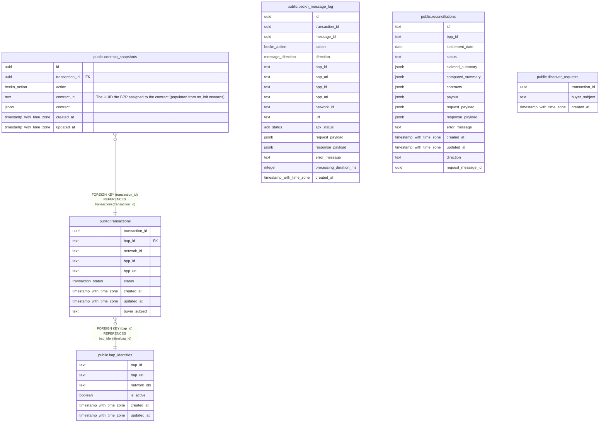
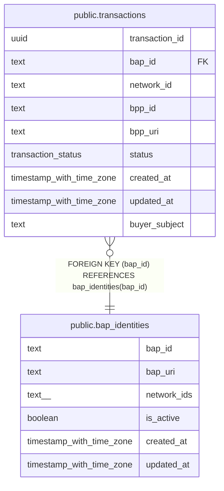
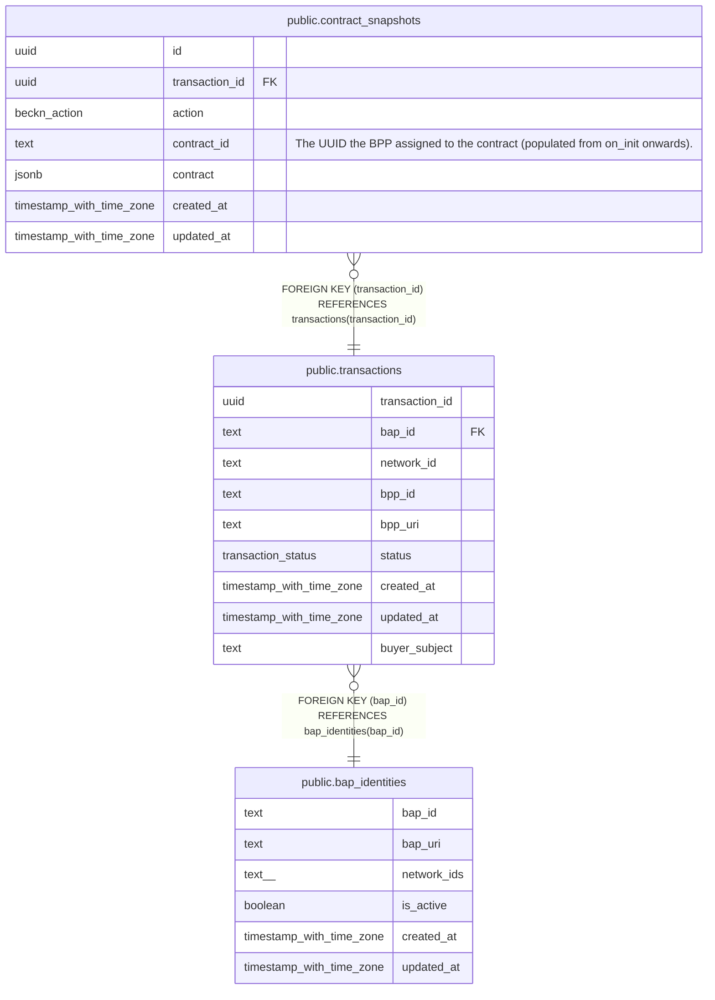
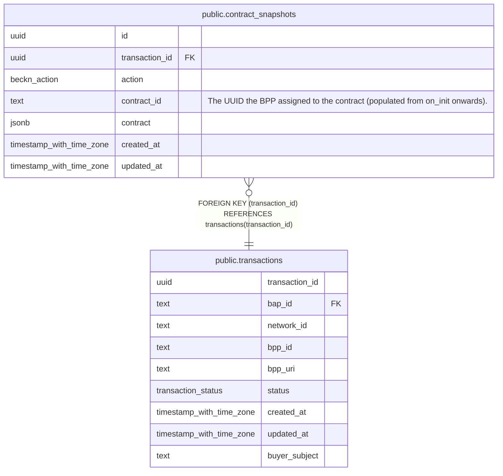
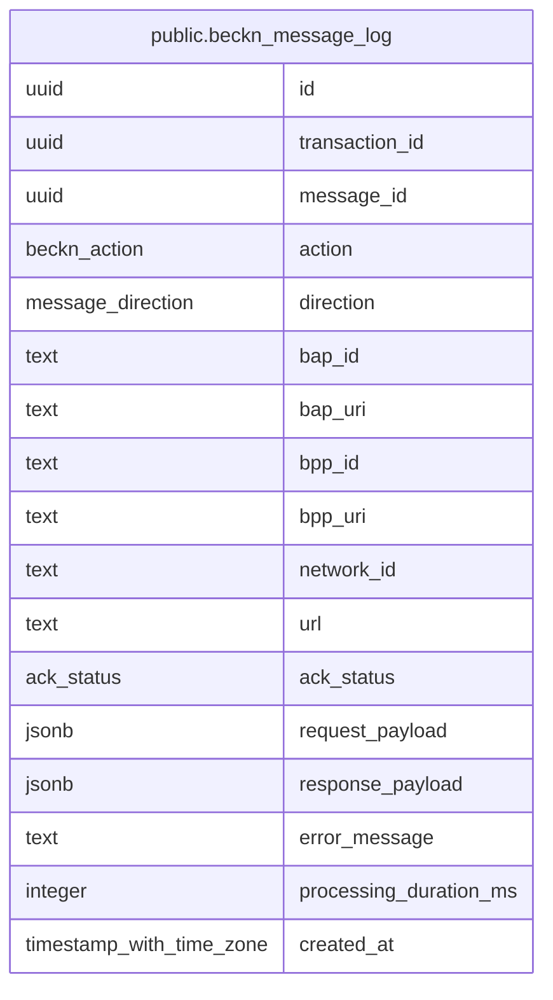
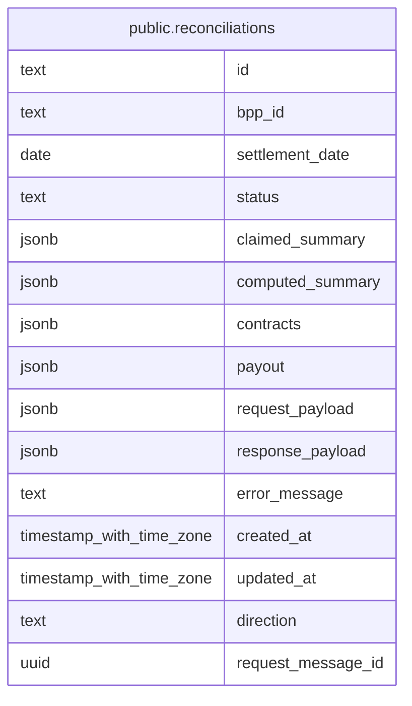
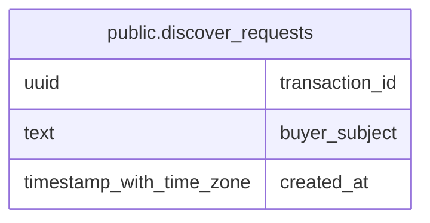

# bap

## Tables

| Name                                                      | Columns | Comment                                                                                                                                                        | Type       |
| --------------------------------------------------------- | ------- | -------------------------------------------------------------------------------------------------------------------------------------------------------------- | ---------- |
| [public.bap_identities](#publicbap_identities)         | 6       | Registered BAP subscribers. Seeded at startup from BAP_ID / BAP_URI env vars.                                                                                  | BASE TABLE |
| [public.transactions](#publictransactions)             | 9       | One row per Beckn transactionId initiated by this BAP. Status advances as select → init → confirm actions progress.                                            | BASE TABLE |
| [public.contract_snapshots](#publiccontract_snapshots) | 7       | Stores the full contract JSON received from the BPP at each on_* callback. The BAP uses this to track the evolving contract state through the Beckn lifecycle. | BASE TABLE |
| [public.beckn_message_log](#publicbeckn_message_log)   | 17      | Immutable audit log of all Beckn protocol messages received or sent by this BAP.                                                                               | BASE TABLE |
| [public.reconciliations](#publicreconciliations)       | 15      |                                                                                                                                                                | BASE TABLE |
| [public.discover_requests](#publicdiscover_requests)   | 3       |                                                                                                                                                                | BASE TABLE |

## Stored procedures and functions

| Name                                             | ReturnType | Arguments                                                                 | Type     |
| ------------------------------------------------ | ---------- | ------------------------------------------------------------------------- | -------- |
| public.uuid_nil                                  | uuid       |                                                                           | FUNCTION |
| public.uuid_ns_dns                               | uuid       |                                                                           | FUNCTION |
| public.uuid_ns_url                               | uuid       |                                                                           | FUNCTION |
| public.uuid_ns_oid                               | uuid       |                                                                           | FUNCTION |
| public.uuid_ns_x500                              | uuid       |                                                                           | FUNCTION |
| public.uuid_generate_v1                          | uuid       |                                                                           | FUNCTION |
| public.uuid_generate_v1mc                        | uuid       |                                                                           | FUNCTION |
| public.uuid_generate_v3                          | uuid       | namespace uuid, name text                                                 | FUNCTION |
| public.uuid_generate_v4                          | uuid       |                                                                           | FUNCTION |
| public.uuid_generate_v5                          | uuid       | namespace uuid, name text                                                 | FUNCTION |
| public.set_limit                                 | float4     | real                                                                      | FUNCTION |
| public.show_limit                                | float4     |                                                                           | FUNCTION |
| public.show_trgm                                 | _text      | text                                                                      | FUNCTION |
| public.similarity                                | float4     | text, text                                                                | FUNCTION |
| public.similarity_op                             | bool       | text, text                                                                | FUNCTION |
| public.word_similarity                           | float4     | text, text                                                                | FUNCTION |
| public.word_similarity_op                        | bool       | text, text                                                                | FUNCTION |
| public.word_similarity_commutator_op             | bool       | text, text                                                                | FUNCTION |
| public.similarity_dist                           | float4     | text, text                                                                | FUNCTION |
| public.word_similarity_dist_op                   | float4     | text, text                                                                | FUNCTION |
| public.word_similarity_dist_commutator_op        | float4     | text, text                                                                | FUNCTION |
| public.gtrgm_in                                  | gtrgm      | cstring                                                                   | FUNCTION |
| public.gtrgm_out                                 | cstring    | gtrgm                                                                     | FUNCTION |
| public.gtrgm_consistent                          | bool       | internal, text, smallint, oid, internal                                   | FUNCTION |
| public.gtrgm_distance                            | float8     | internal, text, smallint, oid, internal                                   | FUNCTION |
| public.gtrgm_compress                            | internal   | internal                                                                  | FUNCTION |
| public.gtrgm_decompress                          | internal   | internal                                                                  | FUNCTION |
| public.gtrgm_penalty                             | internal   | internal, internal, internal                                              | FUNCTION |
| public.gtrgm_picksplit                           | internal   | internal, internal                                                        | FUNCTION |
| public.gtrgm_union                               | gtrgm      | internal, internal                                                        | FUNCTION |
| public.gtrgm_same                                | internal   | gtrgm, gtrgm, internal                                                    | FUNCTION |
| public.gin_extract_value_trgm                    | internal   | text, internal                                                            | FUNCTION |
| public.gin_extract_query_trgm                    | internal   | text, internal, smallint, internal, internal, internal, internal          | FUNCTION |
| public.gin_trgm_consistent                       | bool       | internal, smallint, text, integer, internal, internal, internal, internal | FUNCTION |
| public.gin_trgm_triconsistent                    | char       | internal, smallint, text, integer, internal, internal, internal           | FUNCTION |
| public.strict_word_similarity                    | float4     | text, text                                                                | FUNCTION |
| public.strict_word_similarity_op                 | bool       | text, text                                                                | FUNCTION |
| public.strict_word_similarity_commutator_op      | bool       | text, text                                                                | FUNCTION |
| public.strict_word_similarity_dist_op            | float4     | text, text                                                                | FUNCTION |
| public.strict_word_similarity_dist_commutator_op | float4     | text, text                                                                | FUNCTION |
| public.gtrgm_options                             | void       | internal                                                                  | FUNCTION |

## Enums

| Name                      | Values                                                                                                                                                                                                              |
| ------------------------- | ------------------------------------------------------------------------------------------------------------------------------------------------------------------------------------------------------------------- |
| public.ack_status         | ACK, NACK                                                                                                                                                                                                           |
| public.beckn_action       | cancel, confirm, discover, init, on_cancel, on_confirm, on_discover, on_init, on_rate, on_reconcile, on_select, on_status, on_support, on_track, on_update, rate, reconcile, select, status, support, track, update |
| public.message_direction  | INBOUND, OUTBOUND                                                                                                                                                                                                   |
| public.transaction_status | CANCELLED, CANCEL_SENT, COMPLETE, CONFIRMED, CONFIRM_SENT, DISCOVER_RECEIVED, DISCOVER_SENT, INIT_RECEIVED, INIT_SENT, QUOTE_RECEIVED, RATE_SENT, SELECT_SENT, STATUS_SENT, SUPPORT_SENT, UPDATE_SENT               |

## Relations

---

## public.bap_identities

### Description

Registered BAP subscribers. Seeded at startup from BAP_ID / BAP_URI env vars.

### Columns

| Name        | Type                     | Default      | Nullable | Children                                      | Parents | Comment |
| ----------- | ------------------------ | ------------ | -------- | --------------------------------------------- | ------- | ------- |
| bap_id      | text                     |              | false    | [public.transactions](#publictransactions) |         |         |
| bap_uri     | text                     |              | false    |                                               |         |         |
| network_ids | text[]                   | '{}'::text[] | false    |                                               |         |         |
| is_active   | boolean                  | true         | false    |                                               |         |         |
| created_at  | timestamp with time zone | now()        | false    |                                               |         |         |
| updated_at  | timestamp with time zone | now()        | false    |                                               |         |         |

### Constraints

| Name                | Type        | Definition           |
| ------------------- | ----------- | -------------------- |
| bap_identities_pkey | PRIMARY KEY | PRIMARY KEY (bap_id) |

### Indexes

| Name                | Definition                                                                            |
| ------------------- | ------------------------------------------------------------------------------------- |
| bap_identities_pkey | CREATE UNIQUE INDEX bap_identities_pkey ON public.bap_identities USING btree (bap_id) |

### Relations

---

## public.transactions

### Description

One row per Beckn transactionId initiated by this BAP. Status advances as select → init → confirm actions progress.

### Columns

| Name           | Type                     | Default                           | Nullable | Children                                                  | Parents                                           | Comment |
| -------------- | ------------------------ | --------------------------------- | -------- | --------------------------------------------------------- | ------------------------------------------------- | ------- |
| transaction_id | uuid                     |                                   | false    | [public.contract_snapshots](#publiccontract_snapshots) |                                                   |         |
| bap_id         | text                     |                                   | false    |                                                           | [public.bap_identities](#publicbap_identities) |         |
| network_id     | text                     |                                   | true     |                                                           |                                                   |         |
| bpp_id         | text                     |                                   | true     |                                                           |                                                   |         |
| bpp_uri        | text                     |                                   | true     |                                                           |                                                   |         |
| status         | transaction_status       | 'SELECT_SENT'::transaction_status | false    |                                                           |                                                   |         |
| created_at     | timestamp with time zone | now()                             | false    |                                                           |                                                   |         |
| updated_at     | timestamp with time zone | now()                             | false    |                                                           |                                                   |         |
| buyer_subject  | text                     |                                   | true     |                                                           |                                                   |         |

### Constraints

| Name                     | Type        | Definition                                             |
| ------------------------ | ----------- | ------------------------------------------------------ |
| transactions_bap_id_fkey | FOREIGN KEY | FOREIGN KEY (bap_id) REFERENCES bap_identities(bap_id) |
| transactions_pkey        | PRIMARY KEY | PRIMARY KEY (transaction_id)                           |

### Indexes

| Name                           | Definition                                                                                                                       |
| ------------------------------ | -------------------------------------------------------------------------------------------------------------------------------- |
| transactions_pkey              | CREATE UNIQUE INDEX transactions_pkey ON public.transactions USING btree (transaction_id)                                        |
| idx_transactions_buyer_subject | CREATE INDEX idx_transactions_buyer_subject ON public.transactions USING btree (buyer_subject) WHERE (buyer_subject IS NOT NULL) |

### Relations

---

## public.contract_snapshots

### Description

Stores the full contract JSON received from the BPP at each on_* callback. The BAP uses this to track the evolving contract state through the Beckn lifecycle.

### Columns

| Name           | Type                     | Default           | Nullable | Children | Parents                                       | Comment                                                                     |
| -------------- | ------------------------ | ----------------- | -------- | -------- | --------------------------------------------- | --------------------------------------------------------------------------- |
| id             | uuid                     | gen_random_uuid() | false    |          |                                               |                                                                             |
| transaction_id | uuid                     |                   | false    |          | [public.transactions](#publictransactions) |                                                                             |
| action         | beckn_action             |                   | false    |          |                                               |                                                                             |
| contract_id    | text                     |                   | true     |          |                                               | The UUID the BPP assigned to the contract (populated from on_init onwards). |
| contract       | jsonb                    |                   | false    |          |                                               |                                                                             |
| created_at     | timestamp with time zone | now()             | false    |          |                                               |                                                                             |
| updated_at     | timestamp with time zone | now()             | false    |          |                                               |                                                                             |

### Constraints

| Name                                   | Type        | Definition                                                           |
| -------------------------------------- | ----------- | -------------------------------------------------------------------- |
| contract_snapshots_transaction_id_fkey | FOREIGN KEY | FOREIGN KEY (transaction_id) REFERENCES transactions(transaction_id) |
| contract_snapshots_pkey                | PRIMARY KEY | PRIMARY KEY (id)                                                     |

### Indexes

| Name                    | Definition                                                                                |
| ----------------------- | ----------------------------------------------------------------------------------------- |
| contract_snapshots_pkey | CREATE UNIQUE INDEX contract_snapshots_pkey ON public.contract_snapshots USING btree (id) |

### Relations

---

## public.beckn_message_log

### Description

Immutable audit log of all Beckn protocol messages received or sent by this BAP.

### Columns

| Name                   | Type                     | Default           | Nullable | Children | Parents | Comment |
| ---------------------- | ------------------------ | ----------------- | -------- | -------- | ------- | ------- |
| id                     | uuid                     | gen_random_uuid() | false    |          |         |         |
| transaction_id         | uuid                     |                   | true     |          |         |         |
| message_id             | uuid                     |                   | false    |          |         |         |
| action                 | beckn_action             |                   | false    |          |         |         |
| direction              | message_direction        |                   | false    |          |         |         |
| bap_id                 | text                     |                   | true     |          |         |         |
| bap_uri                | text                     |                   | true     |          |         |         |
| bpp_id                 | text                     |                   | true     |          |         |         |
| bpp_uri                | text                     |                   | true     |          |         |         |
| network_id             | text                     |                   | true     |          |         |         |
| url                    | text                     |                   | true     |          |         |         |
| ack_status             | ack_status               |                   | true     |          |         |         |
| request_payload        | jsonb                    |                   | true     |          |         |         |
| response_payload       | jsonb                    |                   | true     |          |         |         |
| error_message          | text                     |                   | true     |          |         |         |
| processing_duration_ms | integer                  |                   | true     |          |         |         |
| created_at             | timestamp with time zone | now()             | false    |          |         |         |

### Constraints

| Name                   | Type        | Definition                   |
| ---------------------- | ----------- | ---------------------------- |
| beckn_message_log_pkey | PRIMARY KEY | PRIMARY KEY (id, created_at) |

### Indexes

| Name                   | Definition                                                                                               |
| ---------------------- | -------------------------------------------------------------------------------------------------------- |
| beckn_message_log_pkey | CREATE UNIQUE INDEX beckn_message_log_pkey ON ONLY public.beckn_message_log USING btree (id, created_at) |

### Relations

---

## public.reconciliations

### Columns

| Name               | Type                     | Default         | Nullable | Children | Parents | Comment |
| ------------------ | ------------------------ | --------------- | -------- | -------- | ------- | ------- |
| id                 | text                     |                 | false    |          |         |         |
| bpp_id             | text                     |                 | false    |          |         |         |
| settlement_date    | date                     |                 | false    |          |         |         |
| status             | text                     |                 | false    |          |         |         |
| claimed_summary    | jsonb                    |                 | false    |          |         |         |
| computed_summary   | jsonb                    |                 | true     |          |         |         |
| contracts          | jsonb                    |                 | true     |          |         |         |
| payout             | jsonb                    |                 | true     |          |         |         |
| request_payload    | jsonb                    |                 | false    |          |         |         |
| response_payload   | jsonb                    |                 | true     |          |         |         |
| error_message      | text                     |                 | true     |          |         |         |
| created_at         | timestamp with time zone | now()           | false    |          |         |         |
| updated_at         | timestamp with time zone | now()           | false    |          |         |         |
| direction          | text                     | 'INBOUND'::text | false    |          |         |         |
| request_message_id | uuid                     |                 | true     |          |         |         |

### Constraints

| Name                 | Type        | Definition       |
| -------------------- | ----------- | ---------------- |
| reconciliations_pkey | PRIMARY KEY | PRIMARY KEY (id) |

### Indexes

| Name                 | Definition                                                                          |
| -------------------- | ----------------------------------------------------------------------------------- |
| reconciliations_pkey | CREATE UNIQUE INDEX reconciliations_pkey ON public.reconciliations USING btree (id) |

### Relations

---

## public.discover_requests

### Columns

| Name           | Type                     | Default | Nullable | Children | Parents | Comment |
| -------------- | ------------------------ | ------- | -------- | -------- | ------- | ------- |
| transaction_id | uuid                     |         | false    |          |         |         |
| buyer_subject  | text                     |         | false    |          |         |         |
| created_at     | timestamp with time zone | now()   | false    |          |         |         |

### Constraints

| Name                   | Type        | Definition                   |
| ---------------------- | ----------- | ---------------------------- |
| discover_requests_pkey | PRIMARY KEY | PRIMARY KEY (transaction_id) |

### Indexes

| Name                        | Definition                                                                                                        |
| --------------------------- | ----------------------------------------------------------------------------------------------------------------- |
| discover_requests_pkey      | CREATE UNIQUE INDEX discover_requests_pkey ON public.discover_requests USING btree (transaction_id)               |
| discover_requests_buyer_idx | CREATE INDEX discover_requests_buyer_idx ON public.discover_requests USING btree (buyer_subject, created_at DESC) |

### Relations

---

---

> Generated by [tbls](https://github.com/k1LoW/tbls)
