# bpp

## Tables

| Name                                                                | Columns | Comment                                                                                                                                                            | Type       |
| ------------------------------------------------------------------- | ------- | ------------------------------------------------------------------------------------------------------------------------------------------------------------------ | ---------- |
| [public.bpp_identities](#publicbpp_identities)                   | 8       | Canonical BPP subscriber identities. bpp_id is the unique subscriber ID as registered on dedi.global.                                                              | BASE TABLE |
| [public.bpp_signing_keys](#publicbpp_signing_keys)               | 10      | Ed25519 signing key registry for each BPP. Supports zero-downtime key rotation. Multiple keys may be active simultaneously during transition windows.              | BASE TABLE |
| [public.providers](#publicproviders)                             | 16      | Beckn Provider entities. Each provider belongs to one BPP and may appear in multiple catalogs.                                                                     | BASE TABLE |
| [public.provider_locations](#publicprovider_locations)           | 12      | Physical locations where a provider operates. Maps to Provider.availableAt[].                                                                                      | BASE TABLE |
| [public.catalogs](#publiccatalogs)                               | 23      | Beckn Catalog objects published by the BPP. Versioned — each publish call increments version.                                                                      | BASE TABLE |
| [public.catalog_publish_results](#publiccatalog_publish_results) | 8       | Processing results returned by the CDS for each catalog publish attempt.                                                                                           | BASE TABLE |
| [public.resources](#publicresources)                             | 19      | Beckn Resource entities. Domain-neutral unit of value discoverable and committable on the network.                                                                 | BASE TABLE |
| [public.offers](#publicoffers)                                   | 21      | Beckn Offer entities. Defines the terms and value proposition for committing one or more resources.                                                                | BASE TABLE |
| [public.offer_considerations](#publicoffer_considerations)       | 10      | Proposed value exchange terms attached to an Offer (price, credits, service exchange, etc.).                                                                       | BASE TABLE |
| [public.offer_available_to](#publicoffer_available_to)           | 6       | Visibility constraints on an Offer. When absent the offer is visible to all network participants.                                                                  | BASE TABLE |
| [public.contracts](#publiccontracts)                             | 22      | Beckn Contract — the central transaction object binding commitments, consideration, performance, settlements, and participants across the full protocol lifecycle. | BASE TABLE |
| [public.commitments](#publiccommitments)                         | 8       | Structured sub-agreements within a Contract. Each commitment binds resources to an offer.                                                                          | BASE TABLE |
| [public.commitment_resources](#publiccommitment_resources)       | 9       | Resources selected within a commitment. Quantity is domain-agnostic JSONB.                                                                                         | BASE TABLE |
| [public.commitment_offers](#publiccommitment_offers)             | 8       | The single Offer selected for a commitment. Stored as a snapshot to preserve agreed terms.                                                                         | BASE TABLE |
| [public.considerations](#publicconsiderations)                   | 9       | Value promised to be exchanged under a Contract. Use PriceSpecification attributes for monetary; generic Attributes for other types.                               | BASE TABLE |
| [public.contract_participants](#publiccontract_participants)     | 11      | Parties involved in a Contract. Role is expressed via participant_attributes @type.                                                                                | BASE TABLE |
| [public.contract_performances](#publiccontract_performances)     | 11      | Generalized fulfillment execution units for a Contract. Each row represents one delivery/service/activation plan. Tracking and support interactions link here.     | BASE TABLE |
| [public.settlements](#publicsettlements)                         | 9       | Discharge records for consideration agreed in a Contract. Carries payment gateway references or other proof of value transfer.                                     | BASE TABLE |
| [public.ratings](#publicratings)                                 | 11      | Rating inputs from BAPs for any ratable entity within a completed contract.                                                                                        | BASE TABLE |
| [public.support_tickets](#publicsupport_tickets)                 | 14      | Support tickets raised by BAPs against contracts or other entities. Channels carry JSON-LD contact descriptors (email, phone, chat, etc.).                         | BASE TABLE |
| [public.contract_tracking](#publiccontract_tracking)             | 11      | Real-time tracking handles for active contract fulfillment. Not for contract state changes (use on_status for that).                                               | BASE TABLE |
| [public.beckn_message_log](#publicbeckn_message_log)             | 20      | Immutable, partitioned audit log of all Beckn protocol messages. Provides non-repudiation — never update or delete rows.                                           | BASE TABLE |
| [public.outbox_events](#publicoutbox_events)                     | 17      | Transactional outbox for reliable Beckn callback delivery. Written in the same transaction as state changes; consumed by the async delivery worker.                | BASE TABLE |
| [public.dead_letter_events](#publicdead_letter_events)           | 16      | Beckn callbacks that exhausted the retry budget. Requires manual review and replay by the operations team.                                                         | BASE TABLE |
| [public.catalog_subscriptions](#publiccatalog_subscriptions)     | 11      | BAP subscriptions to catalog update events. Drives which on_discover callbacks are pushed when catalogs are published or updated.                                  | BASE TABLE |
| [public.users](#publicusers)                                     | 7       | Seller login accounts. One user owns exactly one provider (self-service registration).                                                                             | BASE TABLE |
| [public.reconciliations](#publicreconciliations)                 | 15      |                                                                                                                                                                    | BASE TABLE |

## Stored procedures and functions

| Name                                                | ReturnType | Arguments                 | Type     |
| --------------------------------------------------- | ---------- | ------------------------- | -------- |
| public.uuid_nil                                     | uuid       |                           | FUNCTION |
| public.uuid_ns_dns                                  | uuid       |                           | FUNCTION |
| public.uuid_ns_url                                  | uuid       |                           | FUNCTION |
| public.uuid_ns_oid                                  | uuid       |                           | FUNCTION |
| public.uuid_ns_x500                                 | uuid       |                           | FUNCTION |
| public.uuid_generate_v1                             | uuid       |                           | FUNCTION |
| public.uuid_generate_v1mc                           | uuid       |                           | FUNCTION |
| public.uuid_generate_v3                             | uuid       | namespace uuid, name text | FUNCTION |
| public.uuid_generate_v4                             | uuid       |                           | FUNCTION |
| public.uuid_generate_v5                             | uuid       | namespace uuid, name text | FUNCTION |
| public.fn_set_updated_at                            | trigger    |                           | FUNCTION |
| public.fn_resources_search_vector_update            | trigger    |                           | FUNCTION |
| public.fn_resources_set_provider_id                 | trigger    |                           | FUNCTION |
| public.fn_contracts_set_provider_id_from_commitment | trigger    |                           | FUNCTION |

## Enums

| Name                         | Values                                                                                                                                                                                                                                                                                                       |
| ---------------------------- | ------------------------------------------------------------------------------------------------------------------------------------------------------------------------------------------------------------------------------------------------------------------------------------------------------------ |
| public.ack_status            | ACK, NACK                                                                                                                                                                                                                                                                                                    |
| public.beckn_action          | cancel, catalog_on_publish, catalog_publish, catalog_pull, catalog_retire, catalog_subscription, confirm, discover, init, on_cancel, on_confirm, on_discover, on_init, on_rate, on_reconcile, on_select, on_status, on_support, on_track, on_update, rate, reconcile, select, status, support, track, update |
| public.catalog_type          | master, regular                                                                                                                                                                                                                                                                                              |
| public.catalog_update_mode   | FULL, MERGE                                                                                                                                                                                                                                                                                                  |
| public.commitment_status     | ACTIVE, CLOSED, DRAFT                                                                                                                                                                                                                                                                                        |
| public.contract_status       | ACTIVE, CANCELLED, COMPLETE, DRAFT                                                                                                                                                                                                                                                                           |
| public.message_direction     | INBOUND, OUTBOUND                                                                                                                                                                                                                                                                                            |
| public.outbox_status         | DEAD_LETTERED, DELIVERED, FAILED, PENDING, PROCESSING                                                                                                                                                                                                                                                        |
| public.settlement_status     | COMMITTED, COMPLETE, DRAFT                                                                                                                                                                                                                                                                                   |
| public.subscription_status   | ACTIVE, DELETED, INACTIVE                                                                                                                                                                                                                                                                                    |
| public.support_ticket_status | CLOSED, IN_PROGRESS, OPEN, RESOLVED                                                                                                                                                                                                                                                                          |
| public.tracking_status       | ACTIVE, INACTIVE                                                                                                                                                                                                                                                                                             |

## Relations

```mermaid
erDiagram

"public.bpp_signing_keys" }o--|| "public.bpp_identities" : "FOREIGN KEY (bpp_id) REFERENCES bpp_identities(bpp_id) ON DELETE CASCADE"
"public.providers" }o--|| "public.bpp_identities" : "FOREIGN KEY (bpp_id) REFERENCES bpp_identities(bpp_id)"
"public.provider_locations" }o--|| "public.providers" : "FOREIGN KEY (provider_id, bpp_id) REFERENCES providers(id, bpp_id) ON DELETE CASCADE"
"public.catalogs" }o--|| "public.bpp_identities" : "FOREIGN KEY (bpp_id) REFERENCES bpp_identities(bpp_id)"
"public.catalogs" }o--|| "public.providers" : "FOREIGN KEY (provider_id, bpp_id) REFERENCES providers(id, bpp_id)"
"public.catalog_publish_results" }o--|| "public.catalogs" : "FOREIGN KEY (catalog_id, bpp_id) REFERENCES catalogs(id, bpp_id)"
"public.resources" }o--|| "public.catalogs" : "FOREIGN KEY (catalog_id, bpp_id) REFERENCES catalogs(id, bpp_id) ON DELETE CASCADE"
"public.offers" }o--|| "public.catalogs" : "FOREIGN KEY (catalog_id, bpp_id) REFERENCES catalogs(id, bpp_id) ON DELETE CASCADE"
"public.offer_considerations" }o--|| "public.offers" : "FOREIGN KEY (offer_id, catalog_id, bpp_id) REFERENCES offers(id, catalog_id, bpp_id) ON DELETE CASCADE"
"public.offer_available_to" }o--|| "public.offers" : "FOREIGN KEY (offer_id, catalog_id, bpp_id) REFERENCES offers(id, catalog_id, bpp_id) ON DELETE CASCADE"
"public.contracts" }o--|| "public.bpp_identities" : "FOREIGN KEY (bpp_id) REFERENCES bpp_identities(bpp_id)"
"public.commitments" }o--|| "public.contracts" : "FOREIGN KEY (contract_id) REFERENCES contracts(id) ON DELETE CASCADE"
"public.commitment_resources" }o--|| "public.commitments" : "FOREIGN KEY (commitment_id, contract_id) REFERENCES commitments(id, contract_id) ON DELETE CASCADE"
"public.commitment_offers" |o--|| "public.commitments" : "FOREIGN KEY (commitment_id, contract_id) REFERENCES commitments(id, contract_id) ON DELETE CASCADE"
"public.considerations" }o--|| "public.contracts" : "FOREIGN KEY (contract_id) REFERENCES contracts(id) ON DELETE CASCADE"
"public.contract_participants" }o--|| "public.contracts" : "FOREIGN KEY (contract_id) REFERENCES contracts(id) ON DELETE CASCADE"
"public.contract_performances" }o--|| "public.contracts" : "FOREIGN KEY (contract_id) REFERENCES contracts(id) ON DELETE CASCADE"
"public.settlements" }o--|| "public.contracts" : "FOREIGN KEY (contract_id) REFERENCES contracts(id) ON DELETE CASCADE"
"public.ratings" }o--|| "public.contracts" : "FOREIGN KEY (contract_id) REFERENCES contracts(id)"
"public.support_tickets" }o--o| "public.contracts" : "FOREIGN KEY (contract_id) REFERENCES contracts(id)"
"public.contract_tracking" }o--|| "public.contracts" : "FOREIGN KEY (contract_id) REFERENCES contracts(id) ON DELETE CASCADE"
"public.outbox_events" }o--o| "public.contracts" : "FOREIGN KEY (contract_id) REFERENCES contracts(id)"
"public.dead_letter_events" }o--o| "public.contracts" : "FOREIGN KEY (contract_id) REFERENCES contracts(id)"
"public.users" |o--|| "public.providers" : "FOREIGN KEY (provider_id, bpp_id) REFERENCES providers(id, bpp_id)"

"public.bpp_identities" {
  text bpp_id ""
  text bpp_uri ""
  text__ network_ids ""
  text__ domains ""
  boolean is_active ""
  timestamp_with_time_zone registered_at ""
  timestamp_with_time_zone created_at ""
  timestamp_with_time_zone updated_at ""
}
"public.bpp_signing_keys" {
  uuid id ""
  text bpp_id FK ""
  text key_id "The uniqueKeyId segment in the Signature keyId: {bppId}|{uniqueKeyId}|ed25519"
  text signing_public_key ""
  text encryption_public_key ""
  boolean is_active ""
  timestamp_with_time_zone valid_from ""
  timestamp_with_time_zone valid_until ""
  timestamp_with_time_zone created_at ""
  timestamp_with_time_zone updated_at ""
}
"public.providers" {
  text id ""
  text bpp_id FK ""
  text descriptor_name ""
  text descriptor_code ""
  text descriptor_short_desc ""
  text descriptor_long_desc ""
  text descriptor_thumbnail_image ""
  jsonb descriptor_docs ""
  jsonb descriptor_media_files ""
  jsonb provider_attributes "JSON-LD attributes bag for domain-specific provider extensions. Must include @context and @type."
  text provider_attributes_context ""
  text provider_attributes_type ""
  boolean is_active ""
  timestamp_with_time_zone created_at ""
  timestamp_with_time_zone updated_at ""
  timestamp_with_time_zone deleted_at ""
}
"public.provider_locations" {
  uuid id ""
  text provider_id FK ""
  text bpp_id FK ""
  jsonb geo "Full GeoJSON geometry object (RFC 7946). Type and coordinates are stored verbatim."
  text address_street ""
  text address_locality ""
  text address_region ""
  text address_country ""
  text address_postal_code ""
  text address_extended ""
  timestamp_with_time_zone created_at ""
  timestamp_with_time_zone updated_at ""
}
"public.catalogs" {
  text id ""
  text bpp_id FK ""
  text bpp_uri ""
  text provider_id FK ""
  text descriptor_name ""
  text descriptor_code ""
  text descriptor_short_desc ""
  text descriptor_long_desc ""
  text descriptor_thumbnail_image ""
  jsonb descriptor_docs ""
  jsonb descriptor_media_files ""
  boolean is_active ""
  catalog_type catalog_type ""
  catalog_update_mode update_mode ""
  timestamp_with_time_zone validity_start ""
  timestamp_with_time_zone validity_end ""
  integer version ""
  jsonb schema_context "Array of JSON-LD context URIs for the schemas used by resources in this catalog."
  timestamp_with_time_zone created_at ""
  timestamp_with_time_zone updated_at ""
  timestamp_with_time_zone deleted_at ""
  timestamp_with_time_zone network_published_at ""
  text crc ""
}
"public.catalog_publish_results" {
  uuid id ""
  text catalog_id FK ""
  text bpp_id FK ""
  integer catalog_version ""
  text status ""
  jsonb errors ""
  jsonb stats ""
  timestamp_with_time_zone published_at ""
}
"public.resources" {
  text id ""
  text catalog_id FK ""
  text bpp_id FK ""
  text descriptor_name ""
  text descriptor_code ""
  text descriptor_short_desc ""
  text descriptor_long_desc ""
  text descriptor_thumbnail_image ""
  jsonb descriptor_docs ""
  jsonb descriptor_media_files ""
  jsonb resource_attributes "JSON-LD attributes bag. MUST contain @context and @type per the Beckn Attributes schema."
  text resource_attributes_context ""
  text resource_attributes_type ""
  text master_resource_id ""
  tsvector search_vector "PostgreSQL tsvector for full-text search across name, shortDesc, longDesc, and attributes. Updated automatically by trigger on insert/update."
  timestamp_with_time_zone created_at ""
  timestamp_with_time_zone updated_at ""
  timestamp_with_time_zone deleted_at ""
  text provider_id ""
}
"public.offers" {
  text id ""
  text catalog_id FK ""
  text bpp_id FK ""
  text provider_id ""
  text descriptor_name ""
  text descriptor_code ""
  text descriptor_short_desc ""
  text descriptor_long_desc ""
  text descriptor_thumbnail_image ""
  jsonb descriptor_docs ""
  jsonb descriptor_media_files ""
  text__ resource_ids ""
  jsonb add_ons ""
  jsonb offer_attributes ""
  text offer_attributes_context ""
  text offer_attributes_type ""
  timestamp_with_time_zone validity_start ""
  timestamp_with_time_zone validity_end ""
  timestamp_with_time_zone created_at ""
  timestamp_with_time_zone updated_at ""
  timestamp_with_time_zone deleted_at ""
}
"public.offer_considerations" {
  uuid id ""
  text offer_id FK ""
  text catalog_id FK ""
  text bpp_id FK ""
  text consideration_id ""
  text status_code ""
  text status_name ""
  jsonb consideration_attributes ""
  text consideration_attributes_context ""
  text consideration_attributes_type ""
}
"public.offer_available_to" {
  uuid id ""
  text offer_id FK ""
  text catalog_id FK ""
  text bpp_id FK ""
  text scope_type ""
  text scope_id ""
}
"public.contracts" {
  uuid id ""
  text bpp_id FK ""
  text bap_id ""
  text bap_uri ""
  uuid transaction_id "Persists across discover→confirm for a single user session (from Context.transactionId)."
  text network_id ""
  text domain ""
  contract_status status ""
  text descriptor_name ""
  text descriptor_code ""
  text descriptor_short_desc ""
  text descriptor_long_desc ""
  jsonb descriptor_docs ""
  jsonb descriptor_media_files ""
  jsonb contract_attributes "JSON-LD extension attributes for domain-specific contract data. Must carry @context and @type when populated."
  text contract_attributes_context ""
  text contract_attributes_type ""
  timestamp_with_time_zone created_at ""
  timestamp_with_time_zone updated_at ""
  timestamp_with_time_zone deleted_at ""
  text provider_id ""
  timestamp_with_time_zone delivered_at ""
}
"public.commitments" {
  text id ""
  uuid contract_id FK ""
  commitment_status status ""
  jsonb commitment_attributes ""
  text commitment_attributes_context ""
  text commitment_attributes_type ""
  timestamp_with_time_zone created_at ""
  timestamp_with_time_zone updated_at ""
}
"public.commitment_resources" {
  uuid id ""
  text commitment_id FK ""
  uuid contract_id FK ""
  text resource_id ""
  jsonb resource_descriptor ""
  jsonb resource_attributes ""
  jsonb quantity ""
  timestamp_with_time_zone created_at ""
  timestamp_with_time_zone updated_at ""
}
"public.commitment_offers" {
  uuid id ""
  text commitment_id FK ""
  uuid contract_id FK ""
  text offer_id ""
  jsonb offer_descriptor ""
  jsonb offer_attributes ""
  text__ resource_ids ""
  timestamp_with_time_zone created_at ""
}
"public.considerations" {
  text id ""
  uuid contract_id FK ""
  text status_code ""
  text status_name ""
  jsonb consideration_attributes ""
  text consideration_attributes_context ""
  text consideration_attributes_type ""
  timestamp_with_time_zone created_at ""
  timestamp_with_time_zone updated_at ""
}
"public.contract_participants" {
  text id ""
  uuid contract_id FK ""
  text descriptor_name ""
  text descriptor_code ""
  text descriptor_short_desc ""
  text descriptor_long_desc ""
  jsonb participant_attributes ""
  text participant_attributes_context ""
  text participant_attributes_type ""
  timestamp_with_time_zone created_at ""
  timestamp_with_time_zone updated_at ""
}
"public.contract_performances" {
  text id ""
  uuid contract_id FK ""
  text status_code ""
  text status_name ""
  text status_short_desc ""
  text__ commitment_ids "IDs of commitments being executed by this performance unit."
  jsonb performance_attributes ""
  text performance_attributes_context ""
  text performance_attributes_type ""
  timestamp_with_time_zone created_at ""
  timestamp_with_time_zone updated_at ""
}
"public.settlements" {
  text id ""
  uuid contract_id FK ""
  text consideration_id ""
  settlement_status status ""
  jsonb settlement_attributes ""
  text settlement_attributes_context ""
  text settlement_attributes_type ""
  timestamp_with_time_zone created_at ""
  timestamp_with_time_zone updated_at ""
}
"public.ratings" {
  uuid id ""
  uuid contract_id FK ""
  text bap_id ""
  text bap_uri ""
  text target_id ""
  jsonb target_descriptor ""
  jsonb target_attributes ""
  jsonb range "Score expressed as JSONB (min, max, value) to support any rating scale."
  jsonb feedback_form_submission "Serialized FormSubmission including form URI, submission ID, and field responses."
  boolean is_preview ""
  timestamp_with_time_zone created_at ""
}
"public.support_tickets" {
  uuid id ""
  uuid contract_id FK ""
  text bap_id ""
  text bap_uri ""
  text descriptor_name ""
  text descriptor_code ""
  text descriptor_short_desc ""
  text descriptor_long_desc ""
  jsonb channels ""
  support_ticket_status status ""
  timestamp_with_time_zone resolved_at ""
  boolean is_preview ""
  timestamp_with_time_zone created_at ""
  timestamp_with_time_zone updated_at ""
}
"public.contract_tracking" {
  uuid id ""
  uuid contract_id FK ""
  text performance_id ""
  tracking_status status ""
  text url ""
  jsonb tracking_attributes ""
  text tracking_attributes_context ""
  text tracking_attributes_type ""
  timestamp_with_time_zone expires_at ""
  timestamp_with_time_zone created_at ""
  timestamp_with_time_zone updated_at ""
}
"public.beckn_message_log" {
  uuid id ""
  uuid transaction_id ""
  uuid message_id ""
  beckn_action action ""
  message_direction direction ""
  text bap_id ""
  text bap_uri ""
  text bpp_id ""
  text bpp_uri ""
  text network_id ""
  text domain ""
  ack_status ack_status ""
  jsonb request_payload "Full JSON request body. Enables replay and dispute resolution."
  jsonb response_payload ""
  text error_code ""
  text error_message ""
  integer processing_duration_ms ""
  text request_signature "Raw Authorization header value for signature re-verification."
  timestamp_with_time_zone created_at ""
  text url ""
}
"public.outbox_events" {
  uuid id ""
  beckn_action action ""
  uuid transaction_id ""
  uuid message_id ""
  text target_url ""
  text bap_id ""
  text bap_uri ""
  jsonb payload ""
  outbox_status status ""
  integer attempt_count ""
  integer max_attempts ""
  timestamp_with_time_zone next_attempt_at "Earliest time the worker should next attempt delivery. Backoff is applied by the worker after each failure."
  timestamp_with_time_zone last_attempted_at ""
  text last_error ""
  uuid contract_id FK ""
  timestamp_with_time_zone created_at ""
  timestamp_with_time_zone updated_at ""
}
"public.dead_letter_events" {
  uuid id ""
  uuid outbox_event_id ""
  beckn_action action ""
  uuid transaction_id ""
  uuid message_id ""
  text target_url ""
  text bap_id ""
  jsonb payload ""
  integer total_attempts ""
  text last_error ""
  uuid contract_id FK ""
  boolean reviewed ""
  timestamp_with_time_zone reviewed_at ""
  text reviewed_by ""
  text resolution_note ""
  timestamp_with_time_zone created_at ""
}
"public.catalog_subscriptions" {
  uuid id ""
  text subscriber_id ""
  text bap_id ""
  text bap_uri ""
  text__ network_ids ""
  text__ schema_types "JSON-LD schema type URIs for filtering. Empty array is treated as wildcard."
  text callback_url ""
  subscription_status status ""
  jsonb delivery_policy "Retry and timeout policy per Beckn DeliveryPolicy schema."
  timestamp_with_time_zone created_at ""
  timestamp_with_time_zone updated_at ""
}
"public.users" {
  uuid id ""
  text zitadel_subject "The #quot;sub#quot; claim from Zitadel-issued tokens — resolves an authenticated request to its provider_id."
  text email ""
  text provider_id FK ""
  text bpp_id FK ""
  timestamp_with_time_zone created_at ""
  timestamp_with_time_zone updated_at ""
}
"public.reconciliations" {
  text id ""
  text bpp_id ""
  text bap_id ""
  text provider_id ""
  date settlement_date ""
  text status ""
  uuid__ contract_ids ""
  jsonb summary ""
  uuid request_message_id ""
  jsonb request_payload ""
  jsonb response_payload ""
  text error_message ""
  timestamp_with_time_zone created_at ""
  timestamp_with_time_zone updated_at ""
  text direction ""
}
```

---

## public.bpp_identities

### Description

Canonical BPP subscriber identities. bpp_id is the unique subscriber ID as registered on dedi.global.

### Columns

| Name          | Type                     | Default      | Nullable | Children                                                                                                                                                                    | Parents | Comment |
| ------------- | ------------------------ | ------------ | -------- | --------------------------------------------------------------------------------------------------------------------------------------------------------------------------- | ------- | ------- |
| bpp_id        | text                     |              | false    | [public.bpp_signing_keys](#publicbpp_signing_keys) [public.providers](#publicproviders) [public.catalogs](#publiccatalogs) [public.contracts](#publiccontracts) |         |         |
| bpp_uri       | text                     |              | false    |                                                                                                                                                                             |         |         |
| network_ids   | text[]                   | '{}'::text[] | false    |                                                                                                                                                                             |         |         |
| domains       | text[]                   | '{}'::text[] | false    |                                                                                                                                                                             |         |         |
| is_active     | boolean                  | true         | false    |                                                                                                                                                                             |         |         |
| registered_at | timestamp with time zone | now()        | false    |                                                                                                                                                                             |         |         |
| created_at    | timestamp with time zone | now()        | false    |                                                                                                                                                                             |         |         |
| updated_at    | timestamp with time zone | now()        | false    |                                                                                                                                                                             |         |         |

### Constraints

| Name                | Type        | Definition           |
| ------------------- | ----------- | -------------------- |
| bpp_identities_pkey | PRIMARY KEY | PRIMARY KEY (bpp_id) |

### Indexes

| Name                           | Definition                                                                                                               |
| ------------------------------ | ------------------------------------------------------------------------------------------------------------------------ |
| bpp_identities_pkey            | CREATE UNIQUE INDEX bpp_identities_pkey ON public.bpp_identities USING btree (bpp_id)                                    |
| idx_bpp_identities_active      | CREATE INDEX idx_bpp_identities_active ON public.bpp_identities USING btree (bpp_id, is_active) WHERE (is_active = true) |
| idx_bpp_identities_network_ids | CREATE INDEX idx_bpp_identities_network_ids ON public.bpp_identities USING gin (network_ids)                             |

### Triggers

| Name                          | Definition                                                                                                                            |
| ----------------------------- | ------------------------------------------------------------------------------------------------------------------------------------- |
| trg_bpp_identities_updated_at | CREATE TRIGGER trg_bpp_identities_updated_at BEFORE UPDATE ON public.bpp_identities FOR EACH ROW EXECUTE FUNCTION fn_set_updated_at() |

### Relations

```mermaid
erDiagram

"public.bpp_signing_keys" }o--|| "public.bpp_identities" : "FOREIGN KEY (bpp_id) REFERENCES bpp_identities(bpp_id) ON DELETE CASCADE"
"public.providers" }o--|| "public.bpp_identities" : "FOREIGN KEY (bpp_id) REFERENCES bpp_identities(bpp_id)"
"public.catalogs" }o--|| "public.bpp_identities" : "FOREIGN KEY (bpp_id) REFERENCES bpp_identities(bpp_id)"
"public.contracts" }o--|| "public.bpp_identities" : "FOREIGN KEY (bpp_id) REFERENCES bpp_identities(bpp_id)"

"public.bpp_identities" {
  text bpp_id ""
  text bpp_uri ""
  text__ network_ids ""
  text__ domains ""
  boolean is_active ""
  timestamp_with_time_zone registered_at ""
  timestamp_with_time_zone created_at ""
  timestamp_with_time_zone updated_at ""
}
"public.bpp_signing_keys" {
  uuid id ""
  text bpp_id FK ""
  text key_id "The uniqueKeyId segment in the Signature keyId: {bppId}|{uniqueKeyId}|ed25519"
  text signing_public_key ""
  text encryption_public_key ""
  boolean is_active ""
  timestamp_with_time_zone valid_from ""
  timestamp_with_time_zone valid_until ""
  timestamp_with_time_zone created_at ""
  timestamp_with_time_zone updated_at ""
}
"public.providers" {
  text id ""
  text bpp_id FK ""
  text descriptor_name ""
  text descriptor_code ""
  text descriptor_short_desc ""
  text descriptor_long_desc ""
  text descriptor_thumbnail_image ""
  jsonb descriptor_docs ""
  jsonb descriptor_media_files ""
  jsonb provider_attributes "JSON-LD attributes bag for domain-specific provider extensions. Must include @context and @type."
  text provider_attributes_context ""
  text provider_attributes_type ""
  boolean is_active ""
  timestamp_with_time_zone created_at ""
  timestamp_with_time_zone updated_at ""
  timestamp_with_time_zone deleted_at ""
}
"public.catalogs" {
  text id ""
  text bpp_id FK ""
  text bpp_uri ""
  text provider_id FK ""
  text descriptor_name ""
  text descriptor_code ""
  text descriptor_short_desc ""
  text descriptor_long_desc ""
  text descriptor_thumbnail_image ""
  jsonb descriptor_docs ""
  jsonb descriptor_media_files ""
  boolean is_active ""
  catalog_type catalog_type ""
  catalog_update_mode update_mode ""
  timestamp_with_time_zone validity_start ""
  timestamp_with_time_zone validity_end ""
  integer version ""
  jsonb schema_context "Array of JSON-LD context URIs for the schemas used by resources in this catalog."
  timestamp_with_time_zone created_at ""
  timestamp_with_time_zone updated_at ""
  timestamp_with_time_zone deleted_at ""
  timestamp_with_time_zone network_published_at ""
  text crc ""
}
"public.contracts" {
  uuid id ""
  text bpp_id FK ""
  text bap_id ""
  text bap_uri ""
  uuid transaction_id "Persists across discover→confirm for a single user session (from Context.transactionId)."
  text network_id ""
  text domain ""
  contract_status status ""
  text descriptor_name ""
  text descriptor_code ""
  text descriptor_short_desc ""
  text descriptor_long_desc ""
  jsonb descriptor_docs ""
  jsonb descriptor_media_files ""
  jsonb contract_attributes "JSON-LD extension attributes for domain-specific contract data. Must carry @context and @type when populated."
  text contract_attributes_context ""
  text contract_attributes_type ""
  timestamp_with_time_zone created_at ""
  timestamp_with_time_zone updated_at ""
  timestamp_with_time_zone deleted_at ""
  text provider_id ""
  timestamp_with_time_zone delivered_at ""
}
```

---

## public.bpp_signing_keys

### Description

Ed25519 signing key registry for each BPP. Supports zero-downtime key rotation. Multiple keys may be active simultaneously during transition windows.

### Columns

| Name                  | Type                     | Default           | Nullable | Children | Parents                                           | Comment                                                                         |
| --------------------- | ------------------------ | ----------------- | -------- | -------- | ------------------------------------------------- | ------------------------------------------------------------------------------- |
| id                    | uuid                     | gen_random_uuid() | false    |          |                                                   |                                                                                 |
| bpp_id                | text                     |                   | false    |          | [public.bpp_identities](#publicbpp_identities) |                                                                                 |
| key_id                | text                     |                   | false    |          |                                                   | The uniqueKeyId segment in the Signature keyId: {bppId}\|{uniqueKeyId}\|ed25519 |
| signing_public_key    | text                     |                   | false    |          |                                                   |                                                                                 |
| encryption_public_key | text                     |                   | true     |          |                                                   |                                                                                 |
| is_active             | boolean                  | true              | false    |          |                                                   |                                                                                 |
| valid_from            | timestamp with time zone | now()             | false    |          |                                                   |                                                                                 |
| valid_until           | timestamp with time zone |                   | true     |          |                                                   |                                                                                 |
| created_at            | timestamp with time zone | now()             | false    |          |                                                   |                                                                                 |
| updated_at            | timestamp with time zone | now()             | false    |          |                                                   |                                                                                 |

### Constraints

| Name                            | Type        | Definition                                                               |
| ------------------------------- | ----------- | ------------------------------------------------------------------------ |
| bpp_signing_keys_bpp_id_fkey    | FOREIGN KEY | FOREIGN KEY (bpp_id) REFERENCES bpp_identities(bpp_id) ON DELETE CASCADE |
| bpp_signing_keys_pkey           | PRIMARY KEY | PRIMARY KEY (id)                                                         |
| bpp_signing_keys_bpp_key_unique | UNIQUE      | UNIQUE (bpp_id, key_id)                                                  |

### Indexes

| Name                            | Definition                                                                                                                           |
| ------------------------------- | ------------------------------------------------------------------------------------------------------------------------------------ |
| bpp_signing_keys_pkey           | CREATE UNIQUE INDEX bpp_signing_keys_pkey ON public.bpp_signing_keys USING btree (id)                                                |
| bpp_signing_keys_bpp_key_unique | CREATE UNIQUE INDEX bpp_signing_keys_bpp_key_unique ON public.bpp_signing_keys USING btree (bpp_id, key_id)                          |
| idx_bpp_signing_keys_lookup     | CREATE INDEX idx_bpp_signing_keys_lookup ON public.bpp_signing_keys USING btree (bpp_id, key_id, is_active) WHERE (is_active = true) |

### Triggers

| Name                            | Definition                                                                                                                                |
| ------------------------------- | ----------------------------------------------------------------------------------------------------------------------------------------- |
| trg_bpp_signing_keys_updated_at | CREATE TRIGGER trg_bpp_signing_keys_updated_at BEFORE UPDATE ON public.bpp_signing_keys FOR EACH ROW EXECUTE FUNCTION fn_set_updated_at() |

### Relations

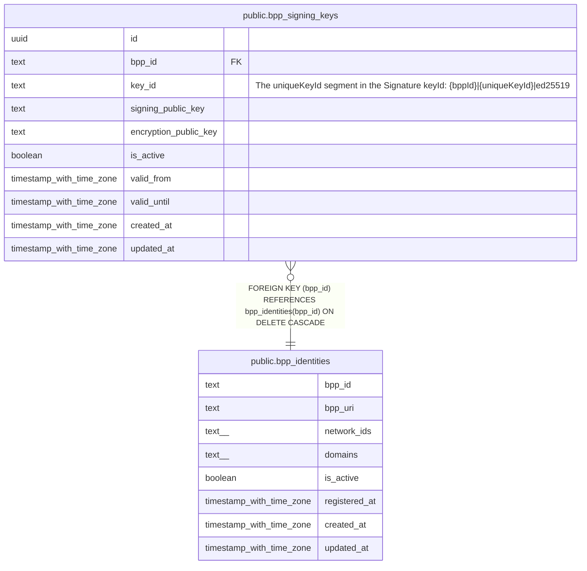

---

## public.providers

### Description

Beckn Provider entities. Each provider belongs to one BPP and may appear in multiple catalogs.

### Columns

| Name                        | Type                     | Default     | Nullable | Children                                                                                                                        | Parents                                           | Comment                                                                                          |
| --------------------------- | ------------------------ | ----------- | -------- | ------------------------------------------------------------------------------------------------------------------------------- | ------------------------------------------------- | ------------------------------------------------------------------------------------------------ |
| id                          | text                     |             | false    | [public.provider_locations](#publicprovider_locations) [public.catalogs](#publiccatalogs) [public.users](#publicusers) |                                                   |                                                                                                  |
| bpp_id                      | text                     |             | false    | [public.provider_locations](#publicprovider_locations) [public.catalogs](#publiccatalogs) [public.users](#publicusers) | [public.bpp_identities](#publicbpp_identities) |                                                                                                  |
| descriptor_name             | text                     |             | false    |                                                                                                                                 |                                                   |                                                                                                  |
| descriptor_code             | text                     |             | true     |                                                                                                                                 |                                                   |                                                                                                  |
| descriptor_short_desc       | text                     |             | true     |                                                                                                                                 |                                                   |                                                                                                  |
| descriptor_long_desc        | text                     |             | true     |                                                                                                                                 |                                                   |                                                                                                  |
| descriptor_thumbnail_image  | text                     |             | true     |                                                                                                                                 |                                                   |                                                                                                  |
| descriptor_docs             | jsonb                    | '[]'::jsonb | false    |                                                                                                                                 |                                                   |                                                                                                  |
| descriptor_media_files      | jsonb                    | '[]'::jsonb | false    |                                                                                                                                 |                                                   |                                                                                                  |
| provider_attributes         | jsonb                    |             | true     |                                                                                                                                 |                                                   | JSON-LD attributes bag for domain-specific provider extensions. Must include @context and @type. |
| provider_attributes_context | text                     |             | true     |                                                                                                                                 |                                                   |                                                                                                  |
| provider_attributes_type    | text                     |             | true     |                                                                                                                                 |                                                   |                                                                                                  |
| is_active                   | boolean                  | true        | false    |                                                                                                                                 |                                                   |                                                                                                  |
| created_at                  | timestamp with time zone | now()       | false    |                                                                                                                                 |                                                   |                                                                                                  |
| updated_at                  | timestamp with time zone | now()       | false    |                                                                                                                                 |                                                   |                                                                                                  |
| deleted_at                  | timestamp with time zone |             | true     |                                                                                                                                 |                                                   |                                                                                                  |

### Constraints

| Name                  | Type        | Definition                                             |
| --------------------- | ----------- | ------------------------------------------------------ |
| providers_bpp_id_fkey | FOREIGN KEY | FOREIGN KEY (bpp_id) REFERENCES bpp_identities(bpp_id) |
| providers_pkey        | PRIMARY KEY | PRIMARY KEY (id, bpp_id)                               |

### Indexes

| Name                 | Definition                                                                                                                                |
| -------------------- | ----------------------------------------------------------------------------------------------------------------------------------------- |
| providers_pkey       | CREATE UNIQUE INDEX providers_pkey ON public.providers USING btree (id, bpp_id)                                                           |
| idx_providers_bpp_id | CREATE INDEX idx_providers_bpp_id ON public.providers USING btree (bpp_id)                                                                |
| idx_providers_active | CREATE INDEX idx_providers_active ON public.providers USING btree (bpp_id, is_active) WHERE ((is_active = true) AND (deleted_at IS NULL)) |

### Triggers

| Name                     | Definition                                                                                                                  |
| ------------------------ | --------------------------------------------------------------------------------------------------------------------------- |
| trg_providers_updated_at | CREATE TRIGGER trg_providers_updated_at BEFORE UPDATE ON public.providers FOR EACH ROW EXECUTE FUNCTION fn_set_updated_at() |

### Relations

```mermaid
erDiagram

"public.provider_locations" }o--|| "public.providers" : "FOREIGN KEY (provider_id, bpp_id) REFERENCES providers(id, bpp_id) ON DELETE CASCADE"
"public.catalogs" }o--|| "public.providers" : "FOREIGN KEY (provider_id, bpp_id) REFERENCES providers(id, bpp_id)"
"public.users" |o--|| "public.providers" : "FOREIGN KEY (provider_id, bpp_id) REFERENCES providers(id, bpp_id)"
"public.providers" }o--|| "public.bpp_identities" : "FOREIGN KEY (bpp_id) REFERENCES bpp_identities(bpp_id)"

"public.providers" {
  text id ""
  text bpp_id FK ""
  text descriptor_name ""
  text descriptor_code ""
  text descriptor_short_desc ""
  text descriptor_long_desc ""
  text descriptor_thumbnail_image ""
  jsonb descriptor_docs ""
  jsonb descriptor_media_files ""
  jsonb provider_attributes "JSON-LD attributes bag for domain-specific provider extensions. Must include @context and @type."
  text provider_attributes_context ""
  text provider_attributes_type ""
  boolean is_active ""
  timestamp_with_time_zone created_at ""
  timestamp_with_time_zone updated_at ""
  timestamp_with_time_zone deleted_at ""
}
"public.provider_locations" {
  uuid id ""
  text provider_id FK ""
  text bpp_id FK ""
  jsonb geo "Full GeoJSON geometry object (RFC 7946). Type and coordinates are stored verbatim."
  text address_street ""
  text address_locality ""
  text address_region ""
  text address_country ""
  text address_postal_code ""
  text address_extended ""
  timestamp_with_time_zone created_at ""
  timestamp_with_time_zone updated_at ""
}
"public.catalogs" {
  text id ""
  text bpp_id FK ""
  text bpp_uri ""
  text provider_id FK ""
  text descriptor_name ""
  text descriptor_code ""
  text descriptor_short_desc ""
  text descriptor_long_desc ""
  text descriptor_thumbnail_image ""
  jsonb descriptor_docs ""
  jsonb descriptor_media_files ""
  boolean is_active ""
  catalog_type catalog_type ""
  catalog_update_mode update_mode ""
  timestamp_with_time_zone validity_start ""
  timestamp_with_time_zone validity_end ""
  integer version ""
  jsonb schema_context "Array of JSON-LD context URIs for the schemas used by resources in this catalog."
  timestamp_with_time_zone created_at ""
  timestamp_with_time_zone updated_at ""
  timestamp_with_time_zone deleted_at ""
  timestamp_with_time_zone network_published_at ""
  text crc ""
}
"public.users" {
  uuid id ""
  text zitadel_subject "The #quot;sub#quot; claim from Zitadel-issued tokens — resolves an authenticated request to its provider_id."
  text email ""
  text provider_id FK ""
  text bpp_id FK ""
  timestamp_with_time_zone created_at ""
  timestamp_with_time_zone updated_at ""
}
"public.bpp_identities" {
  text bpp_id ""
  text bpp_uri ""
  text__ network_ids ""
  text__ domains ""
  boolean is_active ""
  timestamp_with_time_zone registered_at ""
  timestamp_with_time_zone created_at ""
  timestamp_with_time_zone updated_at ""
}
```

---

## public.provider_locations

### Description

Physical locations where a provider operates. Maps to Provider.availableAt[].

### Columns

| Name                | Type                     | Default           | Nullable | Children | Parents                                 | Comment                                                                            |
| ------------------- | ------------------------ | ----------------- | -------- | -------- | --------------------------------------- | ---------------------------------------------------------------------------------- |
| id                  | uuid                     | gen_random_uuid() | false    |          |                                         |                                                                                    |
| provider_id         | text                     |                   | false    |          | [public.providers](#publicproviders) |                                                                                    |
| bpp_id              | text                     |                   | false    |          | [public.providers](#publicproviders) |                                                                                    |
| geo                 | jsonb                    |                   | false    |          |                                         | Full GeoJSON geometry object (RFC 7946). Type and coordinates are stored verbatim. |
| address_street      | text                     |                   | true     |          |                                         |                                                                                    |
| address_locality    | text                     |                   | true     |          |                                         |                                                                                    |
| address_region      | text                     |                   | true     |          |                                         |                                                                                    |
| address_country     | text                     |                   | true     |          |                                         |                                                                                    |
| address_postal_code | text                     |                   | true     |          |                                         |                                                                                    |
| address_extended    | text                     |                   | true     |          |                                         |                                                                                    |
| created_at          | timestamp with time zone | now()             | false    |          |                                         |                                                                                    |
| updated_at          | timestamp with time zone | now()             | false    |          |                                         |                                                                                    |

### Constraints

| Name                                       | Type        | Definition                                                                           |
| ------------------------------------------ | ----------- | ------------------------------------------------------------------------------------ |
| provider_locations_provider_id_bpp_id_fkey | FOREIGN KEY | FOREIGN KEY (provider_id, bpp_id) REFERENCES providers(id, bpp_id) ON DELETE CASCADE |
| provider_locations_pkey                    | PRIMARY KEY | PRIMARY KEY (id)                                                                     |

### Indexes

| Name                            | Definition                                                                                                                                    |
| ------------------------------- | --------------------------------------------------------------------------------------------------------------------------------------------- |
| provider_locations_pkey         | CREATE UNIQUE INDEX provider_locations_pkey ON public.provider_locations USING btree (id)                                                     |
| idx_provider_locations_provider | CREATE INDEX idx_provider_locations_provider ON public.provider_locations USING btree (provider_id, bpp_id)                                   |
| idx_provider_locations_geo      | CREATE INDEX idx_provider_locations_geo ON public.provider_locations USING gin (geo jsonb_path_ops)                                           |
| idx_provider_locations_locality | CREATE INDEX idx_provider_locations_locality ON public.provider_locations USING btree (address_locality) WHERE (address_locality IS NOT NULL) |
| idx_provider_locations_country  | CREATE INDEX idx_provider_locations_country ON public.provider_locations USING btree (address_country) WHERE (address_country IS NOT NULL)    |

### Triggers

| Name                              | Definition                                                                                                                                    |
| --------------------------------- | --------------------------------------------------------------------------------------------------------------------------------------------- |
| trg_provider_locations_updated_at | CREATE TRIGGER trg_provider_locations_updated_at BEFORE UPDATE ON public.provider_locations FOR EACH ROW EXECUTE FUNCTION fn_set_updated_at() |

### Relations

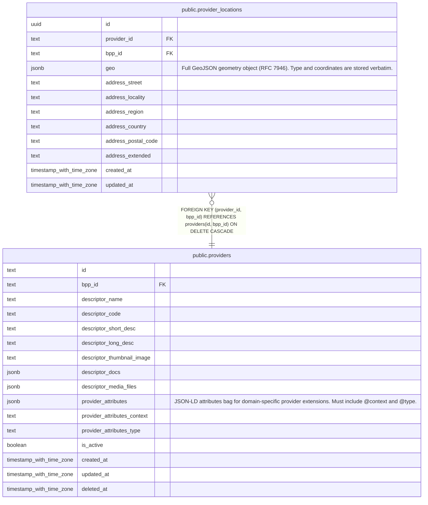

---

## public.catalogs

### Description

Beckn Catalog objects published by the BPP. Versioned — each publish call increments version.

### Columns

| Name                       | Type                     | Default                     | Nullable | Children                                                                                                                                      | Parents                                                                                   | Comment                                                                          |
| -------------------------- | ------------------------ | --------------------------- | -------- | --------------------------------------------------------------------------------------------------------------------------------------------- | ----------------------------------------------------------------------------------------- | -------------------------------------------------------------------------------- |
| id                         | text                     |                             | false    | [public.catalog_publish_results](#publiccatalog_publish_results) [public.resources](#publicresources) [public.offers](#publicoffers) |                                                                                           |                                                                                  |
| bpp_id                     | text                     |                             | false    | [public.catalog_publish_results](#publiccatalog_publish_results) [public.resources](#publicresources) [public.offers](#publicoffers) | [public.bpp_identities](#publicbpp_identities) [public.providers](#publicproviders) |                                                                                  |
| bpp_uri                    | text                     |                             | false    |                                                                                                                                               |                                                                                           |                                                                                  |
| provider_id                | text                     |                             | false    |                                                                                                                                               | [public.providers](#publicproviders)                                                   |                                                                                  |
| descriptor_name            | text                     |                             | false    |                                                                                                                                               |                                                                                           |                                                                                  |
| descriptor_code            | text                     |                             | true     |                                                                                                                                               |                                                                                           |                                                                                  |
| descriptor_short_desc      | text                     |                             | true     |                                                                                                                                               |                                                                                           |                                                                                  |
| descriptor_long_desc       | text                     |                             | true     |                                                                                                                                               |                                                                                           |                                                                                  |
| descriptor_thumbnail_image | text                     |                             | true     |                                                                                                                                               |                                                                                           |                                                                                  |
| descriptor_docs            | jsonb                    | '[]'::jsonb                 | false    |                                                                                                                                               |                                                                                           |                                                                                  |
| descriptor_media_files     | jsonb                    | '[]'::jsonb                 | false    |                                                                                                                                               |                                                                                           |                                                                                  |
| is_active                  | boolean                  | true                        | false    |                                                                                                                                               |                                                                                           |                                                                                  |
| catalog_type               | catalog_type             |                             | true     |                                                                                                                                               |                                                                                           |                                                                                  |
| update_mode                | catalog_update_mode      | 'FULL'::catalog_update_mode | false    |                                                                                                                                               |                                                                                           |                                                                                  |
| validity_start             | timestamp with time zone |                             | true     |                                                                                                                                               |                                                                                           |                                                                                  |
| validity_end               | timestamp with time zone |                             | true     |                                                                                                                                               |                                                                                           |                                                                                  |
| version                    | integer                  | 1                           | false    |                                                                                                                                               |                                                                                           |                                                                                  |
| schema_context             | jsonb                    | '[]'::jsonb                 | false    |                                                                                                                                               |                                                                                           | Array of JSON-LD context URIs for the schemas used by resources in this catalog. |
| created_at                 | timestamp with time zone | now()                       | false    |                                                                                                                                               |                                                                                           |                                                                                  |
| updated_at                 | timestamp with time zone | now()                       | false    |                                                                                                                                               |                                                                                           |                                                                                  |
| deleted_at                 | timestamp with time zone |                             | true     |                                                                                                                                               |                                                                                           |                                                                                  |
| network_published_at       | timestamp with time zone |                             | true     |                                                                                                                                               |                                                                                           |                                                                                  |
| crc                        | text                     |                             | true     |                                                                                                                                               |                                                                                           |                                                                                  |

### Constraints

| Name                             | Type        | Definition                                                         |
| -------------------------------- | ----------- | ------------------------------------------------------------------ |
| catalogs_bpp_id_fkey             | FOREIGN KEY | FOREIGN KEY (bpp_id) REFERENCES bpp_identities(bpp_id)             |
| catalogs_provider_id_bpp_id_fkey | FOREIGN KEY | FOREIGN KEY (provider_id, bpp_id) REFERENCES providers(id, bpp_id) |
| catalogs_pkey                    | PRIMARY KEY | PRIMARY KEY (id, bpp_id)                                           |

### Indexes

| Name                    | Definition                                                                                                                                  |
| ----------------------- | ------------------------------------------------------------------------------------------------------------------------------------------- |
| catalogs_pkey           | CREATE UNIQUE INDEX catalogs_pkey ON public.catalogs USING btree (id, bpp_id)                                                               |
| idx_catalogs_bpp_active | CREATE INDEX idx_catalogs_bpp_active ON public.catalogs USING btree (bpp_id, is_active) WHERE ((is_active = true) AND (deleted_at IS NULL)) |
| idx_catalogs_provider   | CREATE INDEX idx_catalogs_provider ON public.catalogs USING btree (provider_id, bpp_id)                                                     |
| idx_catalogs_validity   | CREATE INDEX idx_catalogs_validity ON public.catalogs USING btree (validity_start, validity_end) WHERE (deleted_at IS NULL)                 |

### Triggers

| Name                    | Definition                                                                                                                |
| ----------------------- | ------------------------------------------------------------------------------------------------------------------------- |
| trg_catalogs_updated_at | CREATE TRIGGER trg_catalogs_updated_at BEFORE UPDATE ON public.catalogs FOR EACH ROW EXECUTE FUNCTION fn_set_updated_at() |

### Relations

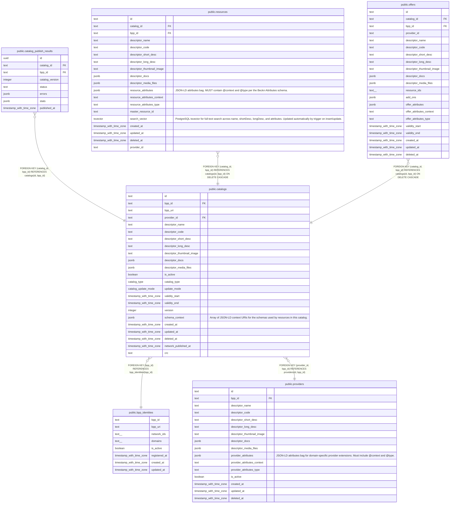

---

## public.catalog_publish_results

### Description

Processing results returned by the CDS for each catalog publish attempt.

### Columns

| Name            | Type                     | Default           | Nullable | Children | Parents                               | Comment |
| --------------- | ------------------------ | ----------------- | -------- | -------- | ------------------------------------- | ------- |
| id              | uuid                     | gen_random_uuid() | false    |          |                                       |         |
| catalog_id      | text                     |                   | false    |          | [public.catalogs](#publiccatalogs) |         |
| bpp_id          | text                     |                   | false    |          | [public.catalogs](#publiccatalogs) |         |
| catalog_version | integer                  |                   | false    |          |                                       |         |
| status          | text                     |                   | false    |          |                                       |         |
| errors          | jsonb                    | '[]'::jsonb       | false    |          |                                       |         |
| stats           | jsonb                    |                   | true     |          |                                       |         |
| published_at    | timestamp with time zone | now()             | false    |          |                                       |         |

### Constraints

| Name                                           | Type        | Definition                                                                          |
| ---------------------------------------------- | ----------- | ----------------------------------------------------------------------------------- |
| catalog_publish_results_status_check           | CHECK       | CHECK ((status = ANY (ARRAY['ACCEPTED'::text, 'REJECTED'::text, 'PARTIAL'::text]))) |
| catalog_publish_results_catalog_id_bpp_id_fkey | FOREIGN KEY | FOREIGN KEY (catalog_id, bpp_id) REFERENCES catalogs(id, bpp_id)                    |
| catalog_publish_results_pkey                   | PRIMARY KEY | PRIMARY KEY (id)                                                                    |

### Indexes

| Name                         | Definition                                                                                          |
| ---------------------------- | --------------------------------------------------------------------------------------------------- |
| catalog_publish_results_pkey | CREATE UNIQUE INDEX catalog_publish_results_pkey ON public.catalog_publish_results USING btree (id) |

### Relations

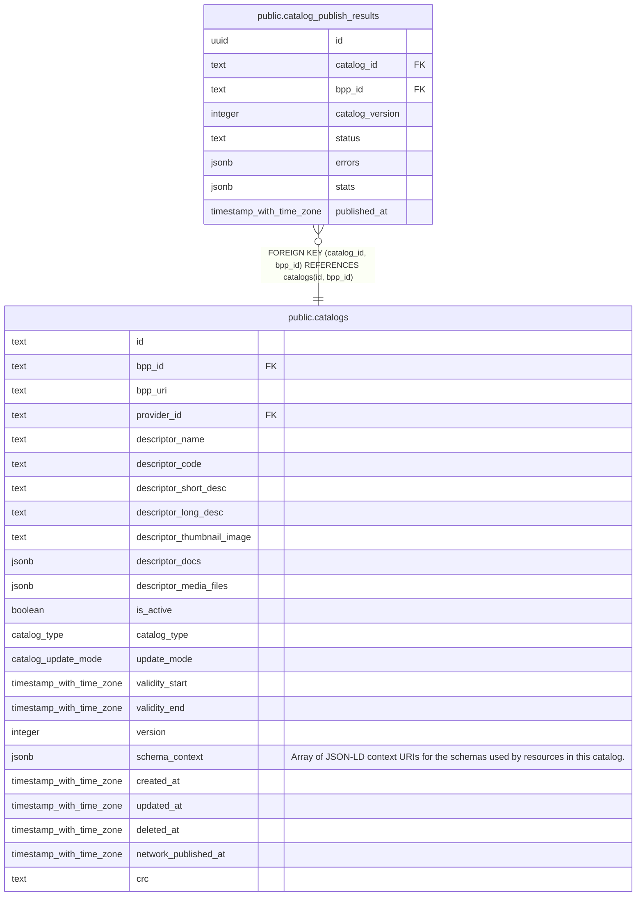

---

## public.resources

### Description

Beckn Resource entities. Domain-neutral unit of value discoverable and committable on the network.

### Columns

| Name                        | Type                     | Default     | Nullable | Children | Parents                               | Comment                                                                                                                                       |
| --------------------------- | ------------------------ | ----------- | -------- | -------- | ------------------------------------- | --------------------------------------------------------------------------------------------------------------------------------------------- |
| id                          | text                     |             | false    |          |                                       |                                                                                                                                               |
| catalog_id                  | text                     |             | false    |          | [public.catalogs](#publiccatalogs) |                                                                                                                                               |
| bpp_id                      | text                     |             | false    |          | [public.catalogs](#publiccatalogs) |                                                                                                                                               |
| descriptor_name             | text                     |             | true     |          |                                       |                                                                                                                                               |
| descriptor_code             | text                     |             | true     |          |                                       |                                                                                                                                               |
| descriptor_short_desc       | text                     |             | true     |          |                                       |                                                                                                                                               |
| descriptor_long_desc        | text                     |             | true     |          |                                       |                                                                                                                                               |
| descriptor_thumbnail_image  | text                     |             | true     |          |                                       |                                                                                                                                               |
| descriptor_docs             | jsonb                    | '[]'::jsonb | false    |          |                                       |                                                                                                                                               |
| descriptor_media_files      | jsonb                    | '[]'::jsonb | false    |          |                                       |                                                                                                                                               |
| resource_attributes         | jsonb                    |             | true     |          |                                       | JSON-LD attributes bag. MUST contain @context and @type per the Beckn Attributes schema.                                                      |
| resource_attributes_context | text                     |             | true     |          |                                       |                                                                                                                                               |
| resource_attributes_type    | text                     |             | true     |          |                                       |                                                                                                                                               |
| master_resource_id          | text                     |             | true     |          |                                       |                                                                                                                                               |
| search_vector               | tsvector                 |             | true     |          |                                       | PostgreSQL tsvector for full-text search across name, shortDesc, longDesc, and attributes. Updated automatically by trigger on insert/update. |
| created_at                  | timestamp with time zone | now()       | false    |          |                                       |                                                                                                                                               |
| updated_at                  | timestamp with time zone | now()       | false    |          |                                       |                                                                                                                                               |
| deleted_at                  | timestamp with time zone |             | true     |          |                                       |                                                                                                                                               |
| provider_id                 | text                     |             | false    |          |                                       |                                                                                                                                               |

### Constraints

| Name                             | Type        | Definition                                                                         |
| -------------------------------- | ----------- | ---------------------------------------------------------------------------------- |
| resources_catalog_id_bpp_id_fkey | FOREIGN KEY | FOREIGN KEY (catalog_id, bpp_id) REFERENCES catalogs(id, bpp_id) ON DELETE CASCADE |
| resources_pkey                   | PRIMARY KEY | PRIMARY KEY (id, catalog_id, bpp_id)                                               |

### Indexes

| Name                        | Definition                                                                                                         |
| --------------------------- | ------------------------------------------------------------------------------------------------------------------ |
| resources_pkey              | CREATE UNIQUE INDEX resources_pkey ON public.resources USING btree (id, catalog_id, bpp_id)                        |
| idx_resources_search_vector | CREATE INDEX idx_resources_search_vector ON public.resources USING gin (search_vector)                             |
| idx_resources_attributes    | CREATE INDEX idx_resources_attributes ON public.resources USING gin (resource_attributes jsonb_path_ops)           |
| idx_resources_catalog       | CREATE INDEX idx_resources_catalog ON public.resources USING btree (catalog_id, bpp_id) WHERE (deleted_at IS NULL) |
| idx_resources_provider_id   | CREATE INDEX idx_resources_provider_id ON public.resources USING btree (provider_id, bpp_id)                       |

### Triggers

| Name                          | Definition                                                                                                                                                                                                                                                          |
| ----------------------------- | ------------------------------------------------------------------------------------------------------------------------------------------------------------------------------------------------------------------------------------------------------------------- |
| trg_resources_updated_at      | CREATE TRIGGER trg_resources_updated_at BEFORE UPDATE ON public.resources FOR EACH ROW EXECUTE FUNCTION fn_set_updated_at()                                                                                                                                         |
| trg_resources_search_vector   | CREATE TRIGGER trg_resources_search_vector BEFORE INSERT OR UPDATE OF descriptor_name, descriptor_short_desc, descriptor_long_desc, descriptor_code, resource_attributes_type ON public.resources FOR EACH ROW EXECUTE FUNCTION fn_resources_search_vector_update() |
| trg_resources_set_provider_id | CREATE TRIGGER trg_resources_set_provider_id BEFORE INSERT OR UPDATE OF catalog_id, bpp_id ON public.resources FOR EACH ROW EXECUTE FUNCTION fn_resources_set_provider_id()                                                                                         |

### Relations

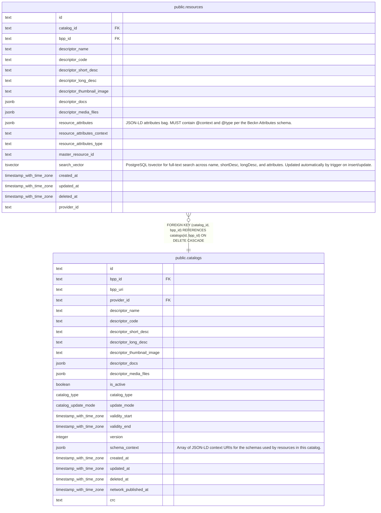

---

## public.offers

### Description

Beckn Offer entities. Defines the terms and value proposition for committing one or more resources.

### Columns

| Name                       | Type                     | Default      | Nullable | Children                                                                                                                | Parents                               | Comment |
| -------------------------- | ------------------------ | ------------ | -------- | ----------------------------------------------------------------------------------------------------------------------- | ------------------------------------- | ------- |
| id                         | text                     |              | false    | [public.offer_considerations](#publicoffer_considerations) [public.offer_available_to](#publicoffer_available_to) |                                       |         |
| catalog_id                 | text                     |              | false    | [public.offer_considerations](#publicoffer_considerations) [public.offer_available_to](#publicoffer_available_to) | [public.catalogs](#publiccatalogs) |         |
| bpp_id                     | text                     |              | false    | [public.offer_considerations](#publicoffer_considerations) [public.offer_available_to](#publicoffer_available_to) | [public.catalogs](#publiccatalogs) |         |
| provider_id                | text                     |              | true     |                                                                                                                         |                                       |         |
| descriptor_name            | text                     |              | true     |                                                                                                                         |                                       |         |
| descriptor_code            | text                     |              | true     |                                                                                                                         |                                       |         |
| descriptor_short_desc      | text                     |              | true     |                                                                                                                         |                                       |         |
| descriptor_long_desc       | text                     |              | true     |                                                                                                                         |                                       |         |
| descriptor_thumbnail_image | text                     |              | true     |                                                                                                                         |                                       |         |
| descriptor_docs            | jsonb                    | '[]'::jsonb  | false    |                                                                                                                         |                                       |         |
| descriptor_media_files     | jsonb                    | '[]'::jsonb  | false    |                                                                                                                         |                                       |         |
| resource_ids               | text[]                   | '{}'::text[] | false    |                                                                                                                         |                                       |         |
| add_ons                    | jsonb                    | '[]'::jsonb  | false    |                                                                                                                         |                                       |         |
| offer_attributes           | jsonb                    |              | true     |                                                                                                                         |                                       |         |
| offer_attributes_context   | text                     |              | true     |                                                                                                                         |                                       |         |
| offer_attributes_type      | text                     |              | true     |                                                                                                                         |                                       |         |
| validity_start             | timestamp with time zone |              | true     |                                                                                                                         |                                       |         |
| validity_end               | timestamp with time zone |              | true     |                                                                                                                         |                                       |         |
| created_at                 | timestamp with time zone | now()        | false    |                                                                                                                         |                                       |         |
| updated_at                 | timestamp with time zone | now()        | false    |                                                                                                                         |                                       |         |
| deleted_at                 | timestamp with time zone |              | true     |                                                                                                                         |                                       |         |

### Constraints

| Name                          | Type        | Definition                                                                         |
| ----------------------------- | ----------- | ---------------------------------------------------------------------------------- |
| offers_catalog_id_bpp_id_fkey | FOREIGN KEY | FOREIGN KEY (catalog_id, bpp_id) REFERENCES catalogs(id, bpp_id) ON DELETE CASCADE |
| offers_pkey                   | PRIMARY KEY | PRIMARY KEY (id, catalog_id, bpp_id)                                               |

### Indexes

| Name                    | Definition                                                                                                              |
| ----------------------- | ----------------------------------------------------------------------------------------------------------------------- |
| offers_pkey             | CREATE UNIQUE INDEX offers_pkey ON public.offers USING btree (id, catalog_id, bpp_id)                                   |
| idx_offers_resource_ids | CREATE INDEX idx_offers_resource_ids ON public.offers USING gin (resource_ids)                                          |
| idx_offers_catalog      | CREATE INDEX idx_offers_catalog ON public.offers USING btree (catalog_id, bpp_id) WHERE (deleted_at IS NULL)            |
| idx_offers_validity     | CREATE INDEX idx_offers_validity ON public.offers USING btree (validity_start, validity_end) WHERE (deleted_at IS NULL) |

### Triggers

| Name                  | Definition                                                                                                            |
| --------------------- | --------------------------------------------------------------------------------------------------------------------- |
| trg_offers_updated_at | CREATE TRIGGER trg_offers_updated_at BEFORE UPDATE ON public.offers FOR EACH ROW EXECUTE FUNCTION fn_set_updated_at() |

### Relations

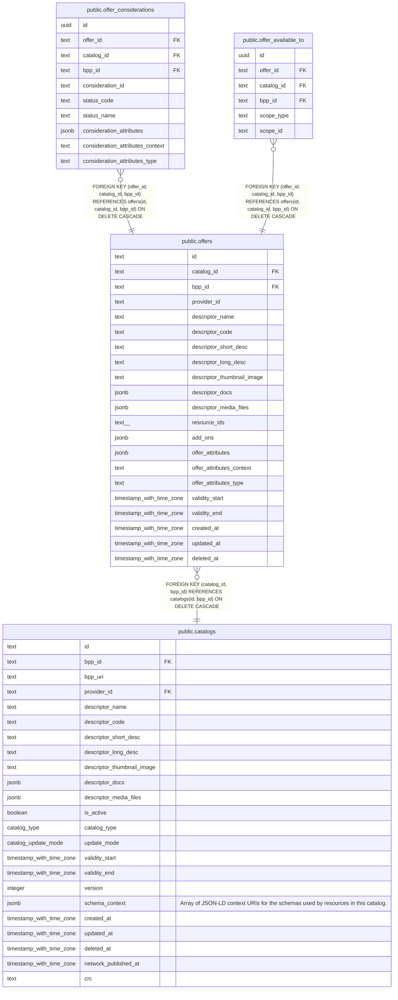

---

## public.offer_considerations

### Description

Proposed value exchange terms attached to an Offer (price, credits, service exchange, etc.).

### Columns

| Name                             | Type  | Default           | Nullable | Children | Parents                           | Comment |
| -------------------------------- | ----- | ----------------- | -------- | -------- | --------------------------------- | ------- |
| id                               | uuid  | gen_random_uuid() | false    |          |                                   |         |
| offer_id                         | text  |                   | false    |          | [public.offers](#publicoffers) |         |
| catalog_id                       | text  |                   | false    |          | [public.offers](#publicoffers) |         |
| bpp_id                           | text  |                   | false    |          | [public.offers](#publicoffers) |         |
| consideration_id                 | text  |                   | false    |          |                                   |         |
| status_code                      | text  |                   | false    |          |                                   |         |
| status_name                      | text  |                   | true     |          |                                   |         |
| consideration_attributes         | jsonb |                   | true     |          |                                   |         |
| consideration_attributes_context | text  |                   | true     |          |                                   |         |
| consideration_attributes_type    | text  |                   | true     |          |                                   |         |

### Constraints

| Name                                                 | Type        | Definition                                                                                             |
| ---------------------------------------------------- | ----------- | ------------------------------------------------------------------------------------------------------ |
| offer_considerations_offer_id_catalog_id_bpp_id_fkey | FOREIGN KEY | FOREIGN KEY (offer_id, catalog_id, bpp_id) REFERENCES offers(id, catalog_id, bpp_id) ON DELETE CASCADE |
| offer_considerations_pkey                            | PRIMARY KEY | PRIMARY KEY (id)                                                                                       |

### Indexes

| Name                      | Definition                                                                                    |
| ------------------------- | --------------------------------------------------------------------------------------------- |
| offer_considerations_pkey | CREATE UNIQUE INDEX offer_considerations_pkey ON public.offer_considerations USING btree (id) |

### Relations

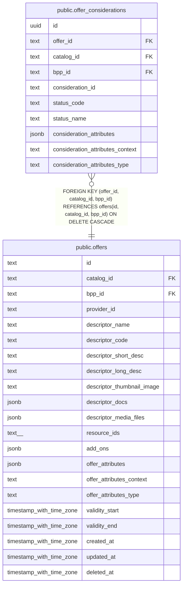

---

## public.offer_available_to

### Description

Visibility constraints on an Offer. When absent the offer is visible to all network participants.

### Columns

| Name       | Type | Default           | Nullable | Children | Parents                           | Comment |
| ---------- | ---- | ----------------- | -------- | -------- | --------------------------------- | ------- |
| id         | uuid | gen_random_uuid() | false    |          |                                   |         |
| offer_id   | text |                   | false    |          | [public.offers](#publicoffers) |         |
| catalog_id | text |                   | false    |          | [public.offers](#publicoffers) |         |
| bpp_id     | text |                   | false    |          | [public.offers](#publicoffers) |         |
| scope_type | text |                   | false    |          |                                   |         |
| scope_id   | text |                   | false    |          |                                   |         |

### Constraints

| Name                                               | Type        | Definition                                                                                             |
| -------------------------------------------------- | ----------- | ------------------------------------------------------------------------------------------------------ |
| offer_available_to_scope_type_check                | CHECK       | CHECK ((scope_type = ANY (ARRAY['NETWORK'::text, 'PARTICIPANT'::text, 'ROLE'::text])))                 |
| offer_available_to_offer_id_catalog_id_bpp_id_fkey | FOREIGN KEY | FOREIGN KEY (offer_id, catalog_id, bpp_id) REFERENCES offers(id, catalog_id, bpp_id) ON DELETE CASCADE |
| offer_available_to_pkey                            | PRIMARY KEY | PRIMARY KEY (id)                                                                                       |

### Indexes

| Name                    | Definition                                                                                |
| ----------------------- | ----------------------------------------------------------------------------------------- |
| offer_available_to_pkey | CREATE UNIQUE INDEX offer_available_to_pkey ON public.offer_available_to USING btree (id) |

### Relations

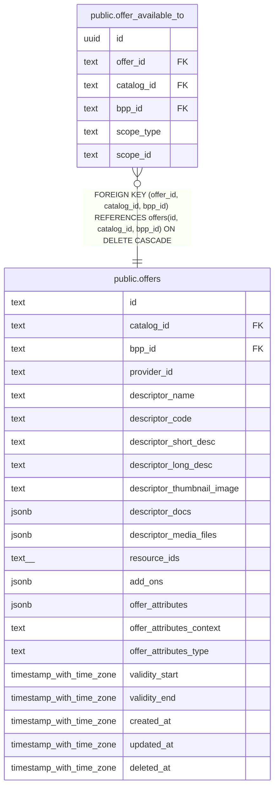

---

## public.contracts

### Description

Beckn Contract — the central transaction object binding commitments, consideration, performance, settlements, and participants across the full protocol lifecycle.

### Columns

| Name                        | Type                     | Default                  | Nullable | Children                                                                                                                                                                                                                                                                                                                                                                                                                                                                                                                            | Parents                                           | Comment                                                                                                       |
| --------------------------- | ------------------------ | ------------------------ | -------- | ----------------------------------------------------------------------------------------------------------------------------------------------------------------------------------------------------------------------------------------------------------------------------------------------------------------------------------------------------------------------------------------------------------------------------------------------------------------------------------------------------------------------------------- | ------------------------------------------------- | ------------------------------------------------------------------------------------------------------------- |
| id                          | uuid                     |                          | false    | [public.commitments](#publiccommitments) [public.considerations](#publicconsiderations) [public.contract_participants](#publiccontract_participants) [public.contract_performances](#publiccontract_performances) [public.settlements](#publicsettlements) [public.ratings](#publicratings) [public.support_tickets](#publicsupport_tickets) [public.contract_tracking](#publiccontract_tracking) [public.outbox_events](#publicoutbox_events) [public.dead_letter_events](#publicdead_letter_events) |                                                   |                                                                                                               |
| bpp_id                      | text                     |                          | false    |                                                                                                                                                                                                                                                                                                                                                                                                                                                                                                                                     | [public.bpp_identities](#publicbpp_identities) |                                                                                                               |
| bap_id                      | text                     |                          | false    |                                                                                                                                                                                                                                                                                                                                                                                                                                                                                                                                     |                                                   |                                                                                                               |
| bap_uri                     | text                     |                          | false    |                                                                                                                                                                                                                                                                                                                                                                                                                                                                                                                                     |                                                   |                                                                                                               |
| transaction_id              | uuid                     |                          | false    |                                                                                                                                                                                                                                                                                                                                                                                                                                                                                                                                     |                                                   | Persists across discover→confirm for a single user session (from Context.transactionId).                      |
| network_id                  | text                     |                          | true     |                                                                                                                                                                                                                                                                                                                                                                                                                                                                                                                                     |                                                   |                                                                                                               |
| domain                      | text                     |                          | true     |                                                                                                                                                                                                                                                                                                                                                                                                                                                                                                                                     |                                                   |                                                                                                               |
| status                      | contract_status          | 'DRAFT'::contract_status | false    |                                                                                                                                                                                                                                                                                                                                                                                                                                                                                                                                     |                                                   |                                                                                                               |
| descriptor_name             | text                     |                          | true     |                                                                                                                                                                                                                                                                                                                                                                                                                                                                                                                                     |                                                   |                                                                                                               |
| descriptor_code             | text                     |                          | true     |                                                                                                                                                                                                                                                                                                                                                                                                                                                                                                                                     |                                                   |                                                                                                               |
| descriptor_short_desc       | text                     |                          | true     |                                                                                                                                                                                                                                                                                                                                                                                                                                                                                                                                     |                                                   |                                                                                                               |
| descriptor_long_desc        | text                     |                          | true     |                                                                                                                                                                                                                                                                                                                                                                                                                                                                                                                                     |                                                   |                                                                                                               |
| descriptor_docs             | jsonb                    | '[]'::jsonb              | false    |                                                                                                                                                                                                                                                                                                                                                                                                                                                                                                                                     |                                                   |                                                                                                               |
| descriptor_media_files      | jsonb                    | '[]'::jsonb              | false    |                                                                                                                                                                                                                                                                                                                                                                                                                                                                                                                                     |                                                   |                                                                                                               |
| contract_attributes         | jsonb                    |                          | true     |                                                                                                                                                                                                                                                                                                                                                                                                                                                                                                                                     |                                                   | JSON-LD extension attributes for domain-specific contract data. Must carry @context and @type when populated. |
| contract_attributes_context | text                     |                          | true     |                                                                                                                                                                                                                                                                                                                                                                                                                                                                                                                                     |                                                   |                                                                                                               |
| contract_attributes_type    | text                     |                          | true     |                                                                                                                                                                                                                                                                                                                                                                                                                                                                                                                                     |                                                   |                                                                                                               |
| created_at                  | timestamp with time zone | now()                    | false    |                                                                                                                                                                                                                                                                                                                                                                                                                                                                                                                                     |                                                   |                                                                                                               |
| updated_at                  | timestamp with time zone | now()                    | false    |                                                                                                                                                                                                                                                                                                                                                                                                                                                                                                                                     |                                                   |                                                                                                               |
| deleted_at                  | timestamp with time zone |                          | true     |                                                                                                                                                                                                                                                                                                                                                                                                                                                                                                                                     |                                                   |                                                                                                               |
| provider_id                 | text                     |                          | true     |                                                                                                                                                                                                                                                                                                                                                                                                                                                                                                                                     |                                                   |                                                                                                               |
| delivered_at                | timestamp with time zone |                          | true     |                                                                                                                                                                                                                                                                                                                                                                                                                                                                                                                                     |                                                   |                                                                                                               |

### Constraints

| Name                | Type        | Definition                                             |
| ------------------- | ----------- | ------------------------------------------------------ |
| contracts_bpp_id_fk | FOREIGN KEY | FOREIGN KEY (bpp_id) REFERENCES bpp_identities(bpp_id) |
| contracts_pkey      | PRIMARY KEY | PRIMARY KEY (id)                                       |

### Indexes

| Name                         | Definition                                                                                                                                       |
| ---------------------------- | ------------------------------------------------------------------------------------------------------------------------------------------------ |
| contracts_pkey               | CREATE UNIQUE INDEX contracts_pkey ON public.contracts USING btree (id)                                                                          |
| idx_contracts_bap_id         | CREATE INDEX idx_contracts_bap_id ON public.contracts USING btree (bap_id, status) WHERE (deleted_at IS NULL)                                    |
| idx_contracts_transaction_id | CREATE INDEX idx_contracts_transaction_id ON public.contracts USING btree (transaction_id)                                                       |
| idx_contracts_status_created | CREATE INDEX idx_contracts_status_created ON public.contracts USING btree (status, created_at DESC) WHERE (deleted_at IS NULL)                   |
| idx_contracts_bpp_status     | CREATE INDEX idx_contracts_bpp_status ON public.contracts USING btree (bpp_id, status, created_at DESC) WHERE (deleted_at IS NULL)               |
| idx_contracts_domain         | CREATE INDEX idx_contracts_domain ON public.contracts USING btree (domain, status) WHERE ((domain IS NOT NULL) AND (deleted_at IS NULL))         |
| idx_contracts_attributes     | CREATE INDEX idx_contracts_attributes ON public.contracts USING gin (contract_attributes jsonb_path_ops) WHERE (contract_attributes IS NOT NULL) |
| idx_contracts_provider_id    | CREATE INDEX idx_contracts_provider_id ON public.contracts USING btree (provider_id, bpp_id)                                                     |

### Triggers

| Name                     | Definition                                                                                                                  |
| ------------------------ | --------------------------------------------------------------------------------------------------------------------------- |
| trg_contracts_updated_at | CREATE TRIGGER trg_contracts_updated_at BEFORE UPDATE ON public.contracts FOR EACH ROW EXECUTE FUNCTION fn_set_updated_at() |

### Relations

```mermaid
erDiagram

"public.commitments" }o--|| "public.contracts" : "FOREIGN KEY (contract_id) REFERENCES contracts(id) ON DELETE CASCADE"
"public.considerations" }o--|| "public.contracts" : "FOREIGN KEY (contract_id) REFERENCES contracts(id) ON DELETE CASCADE"
"public.contract_participants" }o--|| "public.contracts" : "FOREIGN KEY (contract_id) REFERENCES contracts(id) ON DELETE CASCADE"
"public.contract_performances" }o--|| "public.contracts" : "FOREIGN KEY (contract_id) REFERENCES contracts(id) ON DELETE CASCADE"
"public.settlements" }o--|| "public.contracts" : "FOREIGN KEY (contract_id) REFERENCES contracts(id) ON DELETE CASCADE"
"public.ratings" }o--|| "public.contracts" : "FOREIGN KEY (contract_id) REFERENCES contracts(id)"
"public.support_tickets" }o--o| "public.contracts" : "FOREIGN KEY (contract_id) REFERENCES contracts(id)"
"public.contract_tracking" }o--|| "public.contracts" : "FOREIGN KEY (contract_id) REFERENCES contracts(id) ON DELETE CASCADE"
"public.outbox_events" }o--o| "public.contracts" : "FOREIGN KEY (contract_id) REFERENCES contracts(id)"
"public.dead_letter_events" }o--o| "public.contracts" : "FOREIGN KEY (contract_id) REFERENCES contracts(id)"
"public.contracts" }o--|| "public.bpp_identities" : "FOREIGN KEY (bpp_id) REFERENCES bpp_identities(bpp_id)"

"public.contracts" {
  uuid id ""
  text bpp_id FK ""
  text bap_id ""
  text bap_uri ""
  uuid transaction_id "Persists across discover→confirm for a single user session (from Context.transactionId)."
  text network_id ""
  text domain ""
  contract_status status ""
  text descriptor_name ""
  text descriptor_code ""
  text descriptor_short_desc ""
  text descriptor_long_desc ""
  jsonb descriptor_docs ""
  jsonb descriptor_media_files ""
  jsonb contract_attributes "JSON-LD extension attributes for domain-specific contract data. Must carry @context and @type when populated."
  text contract_attributes_context ""
  text contract_attributes_type ""
  timestamp_with_time_zone created_at ""
  timestamp_with_time_zone updated_at ""
  timestamp_with_time_zone deleted_at ""
  text provider_id ""
  timestamp_with_time_zone delivered_at ""
}
"public.commitments" {
  text id ""
  uuid contract_id FK ""
  commitment_status status ""
  jsonb commitment_attributes ""
  text commitment_attributes_context ""
  text commitment_attributes_type ""
  timestamp_with_time_zone created_at ""
  timestamp_with_time_zone updated_at ""
}
"public.considerations" {
  text id ""
  uuid contract_id FK ""
  text status_code ""
  text status_name ""
  jsonb consideration_attributes ""
  text consideration_attributes_context ""
  text consideration_attributes_type ""
  timestamp_with_time_zone created_at ""
  timestamp_with_time_zone updated_at ""
}
"public.contract_participants" {
  text id ""
  uuid contract_id FK ""
  text descriptor_name ""
  text descriptor_code ""
  text descriptor_short_desc ""
  text descriptor_long_desc ""
  jsonb participant_attributes ""
  text participant_attributes_context ""
  text participant_attributes_type ""
  timestamp_with_time_zone created_at ""
  timestamp_with_time_zone updated_at ""
}
"public.contract_performances" {
  text id ""
  uuid contract_id FK ""
  text status_code ""
  text status_name ""
  text status_short_desc ""
  text__ commitment_ids "IDs of commitments being executed by this performance unit."
  jsonb performance_attributes ""
  text performance_attributes_context ""
  text performance_attributes_type ""
  timestamp_with_time_zone created_at ""
  timestamp_with_time_zone updated_at ""
}
"public.settlements" {
  text id ""
  uuid contract_id FK ""
  text consideration_id ""
  settlement_status status ""
  jsonb settlement_attributes ""
  text settlement_attributes_context ""
  text settlement_attributes_type ""
  timestamp_with_time_zone created_at ""
  timestamp_with_time_zone updated_at ""
}
"public.ratings" {
  uuid id ""
  uuid contract_id FK ""
  text bap_id ""
  text bap_uri ""
  text target_id ""
  jsonb target_descriptor ""
  jsonb target_attributes ""
  jsonb range "Score expressed as JSONB (min, max, value) to support any rating scale."
  jsonb feedback_form_submission "Serialized FormSubmission including form URI, submission ID, and field responses."
  boolean is_preview ""
  timestamp_with_time_zone created_at ""
}
"public.support_tickets" {
  uuid id ""
  uuid contract_id FK ""
  text bap_id ""
  text bap_uri ""
  text descriptor_name ""
  text descriptor_code ""
  text descriptor_short_desc ""
  text descriptor_long_desc ""
  jsonb channels ""
  support_ticket_status status ""
  timestamp_with_time_zone resolved_at ""
  boolean is_preview ""
  timestamp_with_time_zone created_at ""
  timestamp_with_time_zone updated_at ""
}
"public.contract_tracking" {
  uuid id ""
  uuid contract_id FK ""
  text performance_id ""
  tracking_status status ""
  text url ""
  jsonb tracking_attributes ""
  text tracking_attributes_context ""
  text tracking_attributes_type ""
  timestamp_with_time_zone expires_at ""
  timestamp_with_time_zone created_at ""
  timestamp_with_time_zone updated_at ""
}
"public.outbox_events" {
  uuid id ""
  beckn_action action ""
  uuid transaction_id ""
  uuid message_id ""
  text target_url ""
  text bap_id ""
  text bap_uri ""
  jsonb payload ""
  outbox_status status ""
  integer attempt_count ""
  integer max_attempts ""
  timestamp_with_time_zone next_attempt_at "Earliest time the worker should next attempt delivery. Backoff is applied by the worker after each failure."
  timestamp_with_time_zone last_attempted_at ""
  text last_error ""
  uuid contract_id FK ""
  timestamp_with_time_zone created_at ""
  timestamp_with_time_zone updated_at ""
}
"public.dead_letter_events" {
  uuid id ""
  uuid outbox_event_id ""
  beckn_action action ""
  uuid transaction_id ""
  uuid message_id ""
  text target_url ""
  text bap_id ""
  jsonb payload ""
  integer total_attempts ""
  text last_error ""
  uuid contract_id FK ""
  boolean reviewed ""
  timestamp_with_time_zone reviewed_at ""
  text reviewed_by ""
  text resolution_note ""
  timestamp_with_time_zone created_at ""
}
"public.bpp_identities" {
  text bpp_id ""
  text bpp_uri ""
  text__ network_ids ""
  text__ domains ""
  boolean is_active ""
  timestamp_with_time_zone registered_at ""
  timestamp_with_time_zone created_at ""
  timestamp_with_time_zone updated_at ""
}
```

---

## public.commitments

### Description

Structured sub-agreements within a Contract. Each commitment binds resources to an offer.

### Columns

| Name                          | Type                     | Default                    | Nullable | Children                                                                                                              | Parents                                 | Comment |
| ----------------------------- | ------------------------ | -------------------------- | -------- | --------------------------------------------------------------------------------------------------------------------- | --------------------------------------- | ------- |
| id                            | text                     |                            | false    | [public.commitment_resources](#publiccommitment_resources) [public.commitment_offers](#publiccommitment_offers) |                                         |         |
| contract_id                   | uuid                     |                            | false    | [public.commitment_resources](#publiccommitment_resources) [public.commitment_offers](#publiccommitment_offers) | [public.contracts](#publiccontracts) |         |
| status                        | commitment_status        | 'DRAFT'::commitment_status | false    |                                                                                                                       |                                         |         |
| commitment_attributes         | jsonb                    |                            | true     |                                                                                                                       |                                         |         |
| commitment_attributes_context | text                     |                            | true     |                                                                                                                       |                                         |         |
| commitment_attributes_type    | text                     |                            | true     |                                                                                                                       |                                         |         |
| created_at                    | timestamp with time zone | now()                      | false    |                                                                                                                       |                                         |         |
| updated_at                    | timestamp with time zone | now()                      | false    |                                                                                                                       |                                         |         |

### Constraints

| Name                         | Type        | Definition                                                           |
| ---------------------------- | ----------- | -------------------------------------------------------------------- |
| commitments_contract_id_fkey | FOREIGN KEY | FOREIGN KEY (contract_id) REFERENCES contracts(id) ON DELETE CASCADE |
| commitments_pkey             | PRIMARY KEY | PRIMARY KEY (id, contract_id)                                        |

### Indexes

| Name                     | Definition                                                                                    |
| ------------------------ | --------------------------------------------------------------------------------------------- |
| commitments_pkey         | CREATE UNIQUE INDEX commitments_pkey ON public.commitments USING btree (id, contract_id)      |
| idx_commitments_contract | CREATE INDEX idx_commitments_contract ON public.commitments USING btree (contract_id, status) |

### Triggers

| Name                       | Definition                                                                                                                      |
| -------------------------- | ------------------------------------------------------------------------------------------------------------------------------- |
| trg_commitments_updated_at | CREATE TRIGGER trg_commitments_updated_at BEFORE UPDATE ON public.commitments FOR EACH ROW EXECUTE FUNCTION fn_set_updated_at() |

### Relations

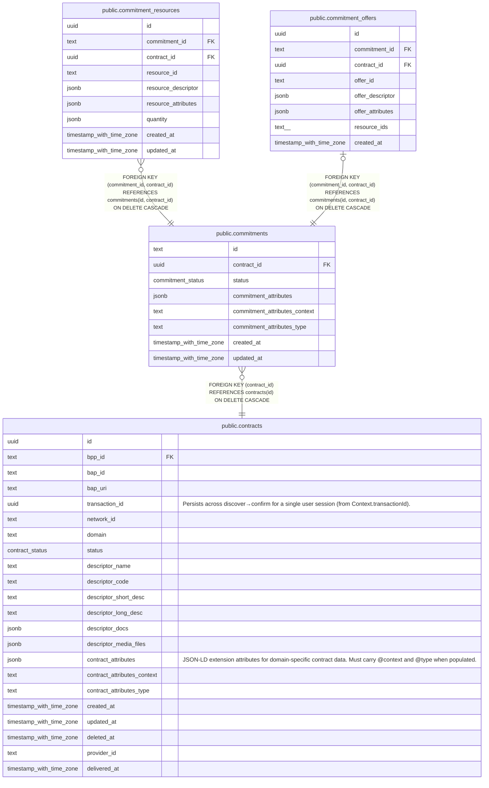

---

## public.commitment_resources

### Description

Resources selected within a commitment. Quantity is domain-agnostic JSONB.

### Columns

| Name                | Type                     | Default           | Nullable | Children | Parents                                     | Comment |
| ------------------- | ------------------------ | ----------------- | -------- | -------- | ------------------------------------------- | ------- |
| id                  | uuid                     | gen_random_uuid() | false    |          |                                             |         |
| commitment_id       | text                     |                   | false    |          | [public.commitments](#publiccommitments) |         |
| contract_id         | uuid                     |                   | false    |          | [public.commitments](#publiccommitments) |         |
| resource_id         | text                     |                   | false    |          |                                             |         |
| resource_descriptor | jsonb                    |                   | true     |          |                                             |         |
| resource_attributes | jsonb                    |                   | true     |          |                                             |         |
| quantity            | jsonb                    |                   | false    |          |                                             |         |
| created_at          | timestamp with time zone | now()             | false    |          |                                             |         |
| updated_at          | timestamp with time zone | now()             | false    |          |                                             |         |

### Constraints

| Name                                                | Type        | Definition                                                                                         |
| --------------------------------------------------- | ----------- | -------------------------------------------------------------------------------------------------- |
| commitment_resources_commitment_id_contract_id_fkey | FOREIGN KEY | FOREIGN KEY (commitment_id, contract_id) REFERENCES commitments(id, contract_id) ON DELETE CASCADE |
| commitment_resources_pkey                           | PRIMARY KEY | PRIMARY KEY (id)                                                                                   |

### Indexes

| Name                                | Definition                                                                                                               |
| ----------------------------------- | ------------------------------------------------------------------------------------------------------------------------ |
| commitment_resources_pkey           | CREATE UNIQUE INDEX commitment_resources_pkey ON public.commitment_resources USING btree (id)                            |
| idx_commitment_resources_commitment | CREATE INDEX idx_commitment_resources_commitment ON public.commitment_resources USING btree (commitment_id, contract_id) |
| idx_commitment_resources_resource   | CREATE INDEX idx_commitment_resources_resource ON public.commitment_resources USING btree (resource_id)                  |

### Triggers

| Name                                | Definition                                                                                                                                        |
| ----------------------------------- | ------------------------------------------------------------------------------------------------------------------------------------------------- |
| trg_commitment_resources_updated_at | CREATE TRIGGER trg_commitment_resources_updated_at BEFORE UPDATE ON public.commitment_resources FOR EACH ROW EXECUTE FUNCTION fn_set_updated_at() |

### Relations

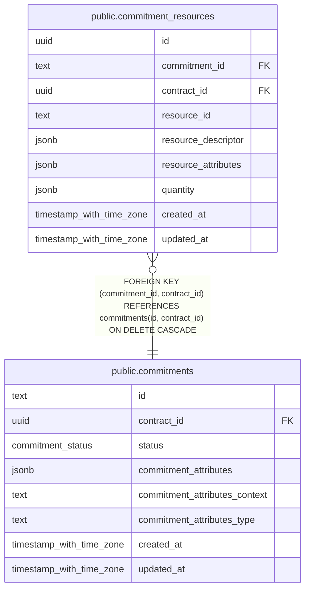

---

## public.commitment_offers

### Description

The single Offer selected for a commitment. Stored as a snapshot to preserve agreed terms.

### Columns

| Name             | Type                     | Default           | Nullable | Children | Parents                                     | Comment |
| ---------------- | ------------------------ | ----------------- | -------- | -------- | ------------------------------------------- | ------- |
| id               | uuid                     | gen_random_uuid() | false    |          |                                             |         |
| commitment_id    | text                     |                   | false    |          | [public.commitments](#publiccommitments) |         |
| contract_id      | uuid                     |                   | false    |          | [public.commitments](#publiccommitments) |         |
| offer_id         | text                     |                   | false    |          |                                             |         |
| offer_descriptor | jsonb                    |                   | true     |          |                                             |         |
| offer_attributes | jsonb                    |                   | true     |          |                                             |         |
| resource_ids     | text[]                   | '{}'::text[]      | false    |          |                                             |         |
| created_at       | timestamp with time zone | now()             | false    |          |                                             |         |

### Constraints

| Name                                             | Type        | Definition                                                                                         |
| ------------------------------------------------ | ----------- | -------------------------------------------------------------------------------------------------- |
| commitment_offers_commitment_id_contract_id_fkey | FOREIGN KEY | FOREIGN KEY (commitment_id, contract_id) REFERENCES commitments(id, contract_id) ON DELETE CASCADE |
| commitment_offers_pkey                           | PRIMARY KEY | PRIMARY KEY (id)                                                                                   |
| commitment_offers_commitment_id_contract_id_key  | UNIQUE      | UNIQUE (commitment_id, contract_id)                                                                |

### Indexes

| Name                                            | Definition                                                                                                                               |
| ----------------------------------------------- | ---------------------------------------------------------------------------------------------------------------------------------------- |
| commitment_offers_pkey                          | CREATE UNIQUE INDEX commitment_offers_pkey ON public.commitment_offers USING btree (id)                                                  |
| commitment_offers_commitment_id_contract_id_key | CREATE UNIQUE INDEX commitment_offers_commitment_id_contract_id_key ON public.commitment_offers USING btree (commitment_id, contract_id) |

### Triggers

| Name                          | Definition                                                                                                                                                                                   |
| ----------------------------- | -------------------------------------------------------------------------------------------------------------------------------------------------------------------------------------------- |
| trg_contracts_set_provider_id | CREATE TRIGGER trg_contracts_set_provider_id AFTER INSERT OR UPDATE OF resource_ids ON public.commitment_offers FOR EACH ROW EXECUTE FUNCTION fn_contracts_set_provider_id_from_commitment() |

### Relations

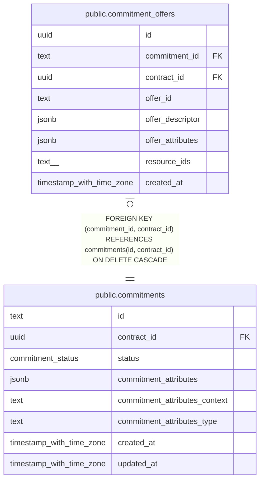

---

## public.considerations

### Description

Value promised to be exchanged under a Contract. Use PriceSpecification attributes for monetary; generic Attributes for other types.

### Columns

| Name                             | Type                     | Default | Nullable | Children | Parents                                 | Comment |
| -------------------------------- | ------------------------ | ------- | -------- | -------- | --------------------------------------- | ------- |
| id                               | text                     |         | false    |          |                                         |         |
| contract_id                      | uuid                     |         | false    |          | [public.contracts](#publiccontracts) |         |
| status_code                      | text                     |         | false    |          |                                         |         |
| status_name                      | text                     |         | true     |          |                                         |         |
| consideration_attributes         | jsonb                    |         | true     |          |                                         |         |
| consideration_attributes_context | text                     |         | true     |          |                                         |         |
| consideration_attributes_type    | text                     |         | true     |          |                                         |         |
| created_at                       | timestamp with time zone | now()   | false    |          |                                         |         |
| updated_at                       | timestamp with time zone | now()   | false    |          |                                         |         |

### Constraints

| Name                            | Type        | Definition                                                           |
| ------------------------------- | ----------- | -------------------------------------------------------------------- |
| considerations_contract_id_fkey | FOREIGN KEY | FOREIGN KEY (contract_id) REFERENCES contracts(id) ON DELETE CASCADE |
| considerations_pkey             | PRIMARY KEY | PRIMARY KEY (id, contract_id)                                        |

### Indexes

| Name                        | Definition                                                                                               |
| --------------------------- | -------------------------------------------------------------------------------------------------------- |
| considerations_pkey         | CREATE UNIQUE INDEX considerations_pkey ON public.considerations USING btree (id, contract_id)           |
| idx_considerations_contract | CREATE INDEX idx_considerations_contract ON public.considerations USING btree (contract_id, status_code) |

### Triggers

| Name                          | Definition                                                                                                                            |
| ----------------------------- | ------------------------------------------------------------------------------------------------------------------------------------- |
| trg_considerations_updated_at | CREATE TRIGGER trg_considerations_updated_at BEFORE UPDATE ON public.considerations FOR EACH ROW EXECUTE FUNCTION fn_set_updated_at() |

### Relations

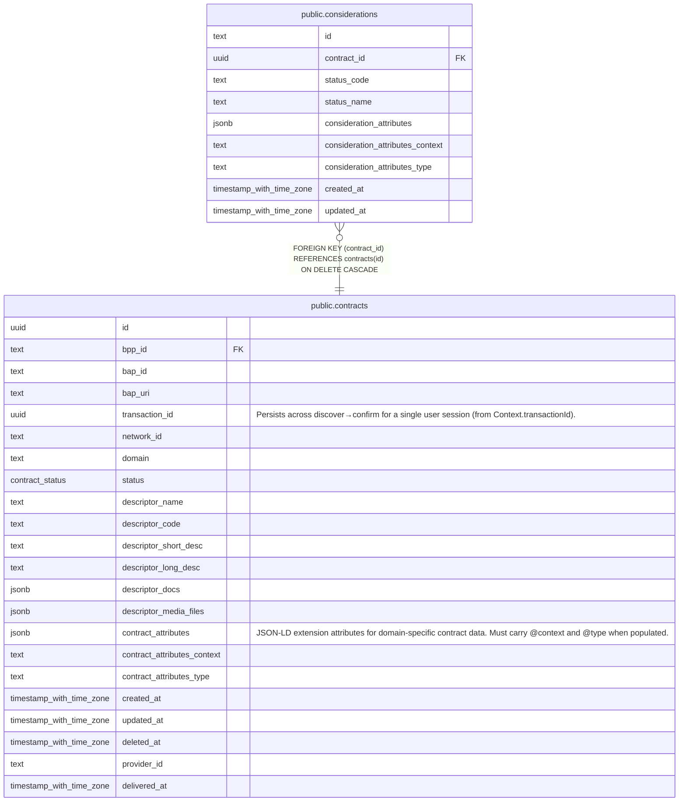

---

## public.contract_participants

### Description

Parties involved in a Contract. Role is expressed via participant_attributes @type.

### Columns

| Name                           | Type                     | Default | Nullable | Children | Parents                                 | Comment |
| ------------------------------ | ------------------------ | ------- | -------- | -------- | --------------------------------------- | ------- |
| id                             | text                     |         | false    |          |                                         |         |
| contract_id                    | uuid                     |         | false    |          | [public.contracts](#publiccontracts) |         |
| descriptor_name                | text                     |         | true     |          |                                         |         |
| descriptor_code                | text                     |         | true     |          |                                         |         |
| descriptor_short_desc          | text                     |         | true     |          |                                         |         |
| descriptor_long_desc           | text                     |         | true     |          |                                         |         |
| participant_attributes         | jsonb                    |         | true     |          |                                         |         |
| participant_attributes_context | text                     |         | true     |          |                                         |         |
| participant_attributes_type    | text                     |         | true     |          |                                         |         |
| created_at                     | timestamp with time zone | now()   | false    |          |                                         |         |
| updated_at                     | timestamp with time zone | now()   | false    |          |                                         |         |

### Constraints

| Name                                   | Type        | Definition                                                           |
| -------------------------------------- | ----------- | -------------------------------------------------------------------- |
| contract_participants_contract_id_fkey | FOREIGN KEY | FOREIGN KEY (contract_id) REFERENCES contracts(id) ON DELETE CASCADE |
| contract_participants_pkey             | PRIMARY KEY | PRIMARY KEY (id, contract_id)                                        |

### Indexes

| Name                               | Definition                                                                                                   |
| ---------------------------------- | ------------------------------------------------------------------------------------------------------------ |
| contract_participants_pkey         | CREATE UNIQUE INDEX contract_participants_pkey ON public.contract_participants USING btree (id, contract_id) |
| idx_contract_participants_contract | CREATE INDEX idx_contract_participants_contract ON public.contract_participants USING btree (contract_id)    |

### Triggers

| Name                                 | Definition                                                                                                                                          |
| ------------------------------------ | --------------------------------------------------------------------------------------------------------------------------------------------------- |
| trg_contract_participants_updated_at | CREATE TRIGGER trg_contract_participants_updated_at BEFORE UPDATE ON public.contract_participants FOR EACH ROW EXECUTE FUNCTION fn_set_updated_at() |

### Relations

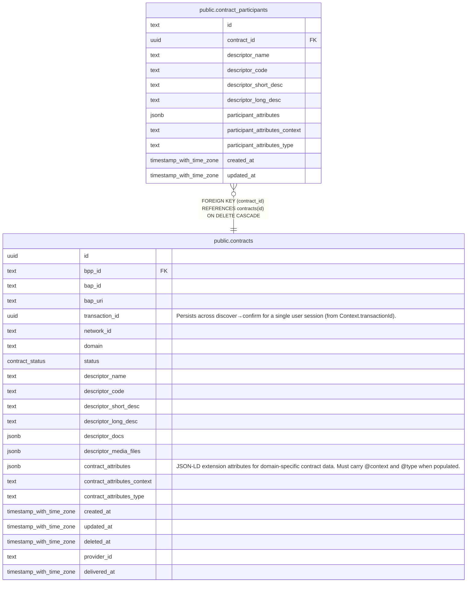

---

## public.contract_performances

### Description

Generalized fulfillment execution units for a Contract. Each row represents one delivery/service/activation plan. Tracking and support interactions link here.

### Columns

| Name                           | Type                     | Default      | Nullable | Children | Parents                                 | Comment                                                     |
| ------------------------------ | ------------------------ | ------------ | -------- | -------- | --------------------------------------- | ----------------------------------------------------------- |
| id                             | text                     |              | false    |          |                                         |                                                             |
| contract_id                    | uuid                     |              | false    |          | [public.contracts](#publiccontracts) |                                                             |
| status_code                    | text                     |              | true     |          |                                         |                                                             |
| status_name                    | text                     |              | true     |          |                                         |                                                             |
| status_short_desc              | text                     |              | true     |          |                                         |                                                             |
| commitment_ids                 | text[]                   | '{}'::text[] | false    |          |                                         | IDs of commitments being executed by this performance unit. |
| performance_attributes         | jsonb                    |              | true     |          |                                         |                                                             |
| performance_attributes_context | text                     |              | true     |          |                                         |                                                             |
| performance_attributes_type    | text                     |              | true     |          |                                         |                                                             |
| created_at                     | timestamp with time zone | now()        | false    |          |                                         |                                                             |
| updated_at                     | timestamp with time zone | now()        | false    |          |                                         |                                                             |

### Constraints

| Name                                   | Type        | Definition                                                           |
| -------------------------------------- | ----------- | -------------------------------------------------------------------- |
| contract_performances_contract_id_fkey | FOREIGN KEY | FOREIGN KEY (contract_id) REFERENCES contracts(id) ON DELETE CASCADE |
| contract_performances_pkey             | PRIMARY KEY | PRIMARY KEY (id, contract_id)                                        |

### Indexes

| Name                                     | Definition                                                                                                             |
| ---------------------------------------- | ---------------------------------------------------------------------------------------------------------------------- |
| contract_performances_pkey               | CREATE UNIQUE INDEX contract_performances_pkey ON public.contract_performances USING btree (id, contract_id)           |
| idx_contract_performances_contract       | CREATE INDEX idx_contract_performances_contract ON public.contract_performances USING btree (contract_id, status_code) |
| idx_contract_performances_commitment_ids | CREATE INDEX idx_contract_performances_commitment_ids ON public.contract_performances USING gin (commitment_ids)       |

### Triggers

| Name                                 | Definition                                                                                                                                          |
| ------------------------------------ | --------------------------------------------------------------------------------------------------------------------------------------------------- |
| trg_contract_performances_updated_at | CREATE TRIGGER trg_contract_performances_updated_at BEFORE UPDATE ON public.contract_performances FOR EACH ROW EXECUTE FUNCTION fn_set_updated_at() |

### Relations

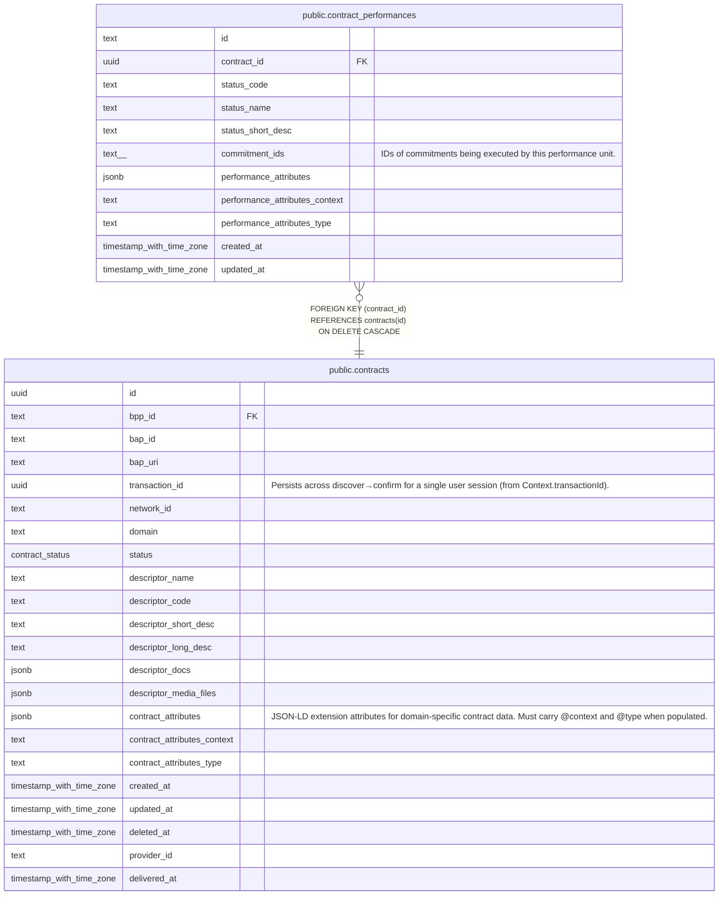

---

## public.settlements

### Description

Discharge records for consideration agreed in a Contract. Carries payment gateway references or other proof of value transfer.

### Columns

| Name                          | Type                     | Default                    | Nullable | Children | Parents                                 | Comment |
| ----------------------------- | ------------------------ | -------------------------- | -------- | -------- | --------------------------------------- | ------- |
| id                            | text                     |                            | false    |          |                                         |         |
| contract_id                   | uuid                     |                            | false    |          | [public.contracts](#publiccontracts) |         |
| consideration_id              | text                     |                            | false    |          |                                         |         |
| status                        | settlement_status        | 'DRAFT'::settlement_status | false    |          |                                         |         |
| settlement_attributes         | jsonb                    |                            | true     |          |                                         |         |
| settlement_attributes_context | text                     |                            | true     |          |                                         |         |
| settlement_attributes_type    | text                     |                            | true     |          |                                         |         |
| created_at                    | timestamp with time zone | now()                      | false    |          |                                         |         |
| updated_at                    | timestamp with time zone | now()                      | false    |          |                                         |         |

### Constraints

| Name                         | Type        | Definition                                                           |
| ---------------------------- | ----------- | -------------------------------------------------------------------- |
| settlements_contract_id_fkey | FOREIGN KEY | FOREIGN KEY (contract_id) REFERENCES contracts(id) ON DELETE CASCADE |
| settlements_pkey             | PRIMARY KEY | PRIMARY KEY (id, contract_id)                                        |

### Indexes

| Name                          | Definition                                                                                                   |
| ----------------------------- | ------------------------------------------------------------------------------------------------------------ |
| settlements_pkey              | CREATE UNIQUE INDEX settlements_pkey ON public.settlements USING btree (id, contract_id)                     |
| idx_settlements_contract      | CREATE INDEX idx_settlements_contract ON public.settlements USING btree (contract_id, status)                |
| idx_settlements_consideration | CREATE INDEX idx_settlements_consideration ON public.settlements USING btree (consideration_id, contract_id) |

### Triggers

| Name                       | Definition                                                                                                                      |
| -------------------------- | ------------------------------------------------------------------------------------------------------------------------------- |
| trg_settlements_updated_at | CREATE TRIGGER trg_settlements_updated_at BEFORE UPDATE ON public.settlements FOR EACH ROW EXECUTE FUNCTION fn_set_updated_at() |

### Relations

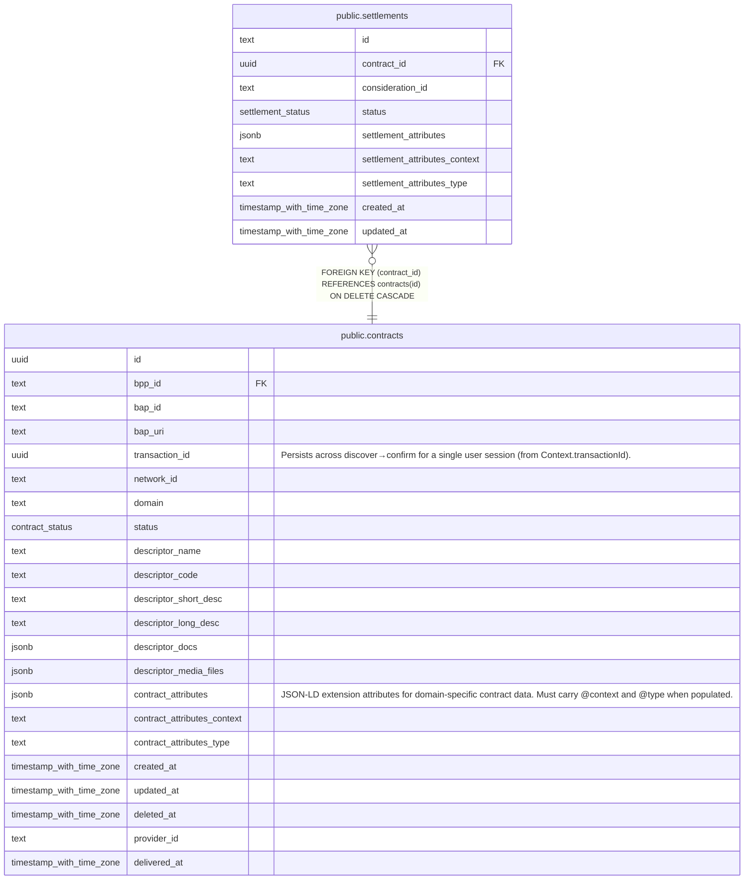

---

## public.ratings

### Description

Rating inputs from BAPs for any ratable entity within a completed contract.

### Columns

| Name                     | Type                     | Default           | Nullable | Children | Parents                                 | Comment                                                                           |
| ------------------------ | ------------------------ | ----------------- | -------- | -------- | --------------------------------------- | --------------------------------------------------------------------------------- |
| id                       | uuid                     | gen_random_uuid() | false    |          |                                         |                                                                                   |
| contract_id              | uuid                     |                   | false    |          | [public.contracts](#publiccontracts) |                                                                                   |
| bap_id                   | text                     |                   | false    |          |                                         |                                                                                   |
| bap_uri                  | text                     |                   | false    |          |                                         |                                                                                   |
| target_id                | text                     |                   | false    |          |                                         |                                                                                   |
| target_descriptor        | jsonb                    |                   | true     |          |                                         |                                                                                   |
| target_attributes        | jsonb                    |                   | true     |          |                                         |                                                                                   |
| range                    | jsonb                    |                   | false    |          |                                         | Score expressed as JSONB (min, max, value) to support any rating scale.           |
| feedback_form_submission | jsonb                    |                   | true     |          |                                         | Serialized FormSubmission including form URI, submission ID, and field responses. |
| is_preview               | boolean                  | false             | false    |          |                                         |                                                                                   |
| created_at               | timestamp with time zone | now()             | false    |          |                                         |                                                                                   |

### Constraints

| Name                     | Type        | Definition                                         |
| ------------------------ | ----------- | -------------------------------------------------- |
| ratings_contract_id_fkey | FOREIGN KEY | FOREIGN KEY (contract_id) REFERENCES contracts(id) |
| ratings_pkey             | PRIMARY KEY | PRIMARY KEY (id)                                   |

### Indexes

| Name                 | Definition                                                                                     |
| -------------------- | ---------------------------------------------------------------------------------------------- |
| ratings_pkey         | CREATE UNIQUE INDEX ratings_pkey ON public.ratings USING btree (id)                            |
| idx_ratings_contract | CREATE INDEX idx_ratings_contract ON public.ratings USING btree (contract_id, created_at DESC) |
| idx_ratings_target   | CREATE INDEX idx_ratings_target ON public.ratings USING btree (target_id, created_at DESC)     |
| idx_ratings_bap      | CREATE INDEX idx_ratings_bap ON public.ratings USING btree (bap_id, created_at DESC)           |

### Relations

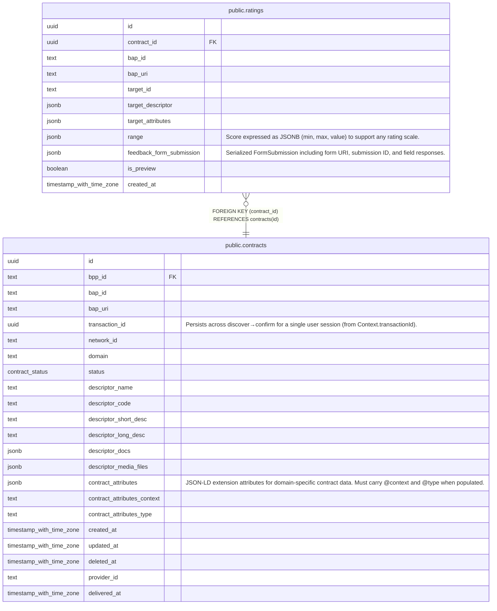

---

## public.support_tickets

### Description

Support tickets raised by BAPs against contracts or other entities. Channels carry JSON-LD contact descriptors (email, phone, chat, etc.).

### Columns

| Name                  | Type                     | Default                       | Nullable | Children | Parents                                 | Comment |
| --------------------- | ------------------------ | ----------------------------- | -------- | -------- | --------------------------------------- | ------- |
| id                    | uuid                     | gen_random_uuid()             | false    |          |                                         |         |
| contract_id           | uuid                     |                               | true     |          | [public.contracts](#publiccontracts) |         |
| bap_id                | text                     |                               | false    |          |                                         |         |
| bap_uri               | text                     |                               | false    |          |                                         |         |
| descriptor_name       | text                     |                               | true     |          |                                         |         |
| descriptor_code       | text                     |                               | true     |          |                                         |         |
| descriptor_short_desc | text                     |                               | true     |          |                                         |         |
| descriptor_long_desc  | text                     |                               | true     |          |                                         |         |
| channels              | jsonb                    | '[]'::jsonb                   | false    |          |                                         |         |
| status                | support_ticket_status    | 'OPEN'::support_ticket_status | false    |          |                                         |         |
| resolved_at           | timestamp with time zone |                               | true     |          |                                         |         |
| is_preview            | boolean                  | false                         | false    |          |                                         |         |
| created_at            | timestamp with time zone | now()                         | false    |          |                                         |         |
| updated_at            | timestamp with time zone | now()                         | false    |          |                                         |         |

### Constraints

| Name                             | Type        | Definition                                         |
| -------------------------------- | ----------- | -------------------------------------------------- |
| support_tickets_contract_id_fkey | FOREIGN KEY | FOREIGN KEY (contract_id) REFERENCES contracts(id) |
| support_tickets_pkey             | PRIMARY KEY | PRIMARY KEY (id)                                   |

### Indexes

| Name                           | Definition                                                                                                                                                                                                |
| ------------------------------ | --------------------------------------------------------------------------------------------------------------------------------------------------------------------------------------------------------- |
| support_tickets_pkey           | CREATE UNIQUE INDEX support_tickets_pkey ON public.support_tickets USING btree (id)                                                                                                                       |
| idx_support_tickets_contract   | CREATE INDEX idx_support_tickets_contract ON public.support_tickets USING btree (contract_id) WHERE (contract_id IS NOT NULL)                                                                             |
| idx_support_tickets_bap_status | CREATE INDEX idx_support_tickets_bap_status ON public.support_tickets USING btree (bap_id, status)                                                                                                        |
| idx_support_tickets_status     | CREATE INDEX idx_support_tickets_status ON public.support_tickets USING btree (status, created_at DESC) WHERE (status = ANY (ARRAY['OPEN'::support_ticket_status, 'IN_PROGRESS'::support_ticket_status])) |

### Triggers

| Name                           | Definition                                                                                                                              |
| ------------------------------ | --------------------------------------------------------------------------------------------------------------------------------------- |
| trg_support_tickets_updated_at | CREATE TRIGGER trg_support_tickets_updated_at BEFORE UPDATE ON public.support_tickets FOR EACH ROW EXECUTE FUNCTION fn_set_updated_at() |

### Relations

```mermaid
erDiagram

"public.support_tickets" }o--o| "public.contracts" : "FOREIGN KEY (contract_id) REFERENCES contracts(id)"

"public.support_tickets" {
  uuid id ""
  uuid contract_id FK ""
  text bap_id ""
  text bap_uri ""
  text descriptor_name ""
  text descriptor_code ""
  text descriptor_short_desc ""
  text descriptor_long_desc ""
  jsonb channels ""
  support_ticket_status status ""
  timestamp_with_time_zone resolved_at ""
  boolean is_preview ""
  timestamp_with_time_zone created_at ""
  timestamp_with_time_zone updated_at ""
}
"public.contracts" {
  uuid id ""
  text bpp_id FK ""
  text bap_id ""
  text bap_uri ""
  uuid transaction_id "Persists across discover→confirm for a single user session (from Context.transactionId)."
  text network_id ""
  text domain ""
  contract_status status ""
  text descriptor_name ""
  text descriptor_code ""
  text descriptor_short_desc ""
  text descriptor_long_desc ""
  jsonb descriptor_docs ""
  jsonb descriptor_media_files ""
  jsonb contract_attributes "JSON-LD extension attributes for domain-specific contract data. Must carry @context and @type when populated."
  text contract_attributes_context ""
  text contract_attributes_type ""
  timestamp_with_time_zone created_at ""
  timestamp_with_time_zone updated_at ""
  timestamp_with_time_zone deleted_at ""
  text provider_id ""
  timestamp_with_time_zone delivered_at ""
}
```

---

## public.contract_tracking

### Description

Real-time tracking handles for active contract fulfillment. Not for contract state changes (use on_status for that).

### Columns

| Name                        | Type                     | Default                   | Nullable | Children | Parents                                 | Comment |
| --------------------------- | ------------------------ | ------------------------- | -------- | -------- | --------------------------------------- | ------- |
| id                          | uuid                     | gen_random_uuid()         | false    |          |                                         |         |
| contract_id                 | uuid                     |                           | false    |          | [public.contracts](#publiccontracts) |         |
| performance_id              | text                     |                           | true     |          |                                         |         |
| status                      | tracking_status          | 'ACTIVE'::tracking_status | false    |          |                                         |         |
| url                         | text                     |                           | false    |          |                                         |         |
| tracking_attributes         | jsonb                    |                           | true     |          |                                         |         |
| tracking_attributes_context | text                     |                           | true     |          |                                         |         |
| tracking_attributes_type    | text                     |                           | true     |          |                                         |         |
| expires_at                  | timestamp with time zone |                           | true     |          |                                         |         |
| created_at                  | timestamp with time zone | now()                     | false    |          |                                         |         |
| updated_at                  | timestamp with time zone | now()                     | false    |          |                                         |         |

### Constraints

| Name                               | Type        | Definition                                                           |
| ---------------------------------- | ----------- | -------------------------------------------------------------------- |
| contract_tracking_contract_id_fkey | FOREIGN KEY | FOREIGN KEY (contract_id) REFERENCES contracts(id) ON DELETE CASCADE |
| contract_tracking_pkey             | PRIMARY KEY | PRIMARY KEY (id)                                                     |

### Indexes

| Name                           | Definition                                                                                                                                           |
| ------------------------------ | ---------------------------------------------------------------------------------------------------------------------------------------------------- |
| contract_tracking_pkey         | CREATE UNIQUE INDEX contract_tracking_pkey ON public.contract_tracking USING btree (id)                                                              |
| idx_contract_tracking_contract | CREATE INDEX idx_contract_tracking_contract ON public.contract_tracking USING btree (contract_id, status) WHERE (status = 'ACTIVE'::tracking_status) |

### Triggers

| Name                             | Definition                                                                                                                                  |
| -------------------------------- | ------------------------------------------------------------------------------------------------------------------------------------------- |
| trg_contract_tracking_updated_at | CREATE TRIGGER trg_contract_tracking_updated_at BEFORE UPDATE ON public.contract_tracking FOR EACH ROW EXECUTE FUNCTION fn_set_updated_at() |

### Relations

```mermaid
erDiagram

"public.contract_tracking" }o--|| "public.contracts" : "FOREIGN KEY (contract_id) REFERENCES contracts(id) ON DELETE CASCADE"

"public.contract_tracking" {
  uuid id ""
  uuid contract_id FK ""
  text performance_id ""
  tracking_status status ""
  text url ""
  jsonb tracking_attributes ""
  text tracking_attributes_context ""
  text tracking_attributes_type ""
  timestamp_with_time_zone expires_at ""
  timestamp_with_time_zone created_at ""
  timestamp_with_time_zone updated_at ""
}
"public.contracts" {
  uuid id ""
  text bpp_id FK ""
  text bap_id ""
  text bap_uri ""
  uuid transaction_id "Persists across discover→confirm for a single user session (from Context.transactionId)."
  text network_id ""
  text domain ""
  contract_status status ""
  text descriptor_name ""
  text descriptor_code ""
  text descriptor_short_desc ""
  text descriptor_long_desc ""
  jsonb descriptor_docs ""
  jsonb descriptor_media_files ""
  jsonb contract_attributes "JSON-LD extension attributes for domain-specific contract data. Must carry @context and @type when populated."
  text contract_attributes_context ""
  text contract_attributes_type ""
  timestamp_with_time_zone created_at ""
  timestamp_with_time_zone updated_at ""
  timestamp_with_time_zone deleted_at ""
  text provider_id ""
  timestamp_with_time_zone delivered_at ""
}
```

---

## public.beckn_message_log

### Description

Immutable, partitioned audit log of all Beckn protocol messages. Provides non-repudiation — never update or delete rows.

### Columns

| Name                   | Type                     | Default           | Nullable | Children | Parents | Comment                                                        |
| ---------------------- | ------------------------ | ----------------- | -------- | -------- | ------- | -------------------------------------------------------------- |
| id                     | uuid                     | gen_random_uuid() | false    |          |         |                                                                |
| transaction_id         | uuid                     |                   | true     |          |         |                                                                |
| message_id             | uuid                     |                   | false    |          |         |                                                                |
| action                 | beckn_action             |                   | false    |          |         |                                                                |
| direction              | message_direction        |                   | false    |          |         |                                                                |
| bap_id                 | text                     |                   | true     |          |         |                                                                |
| bap_uri                | text                     |                   | true     |          |         |                                                                |
| bpp_id                 | text                     |                   | true     |          |         |                                                                |
| bpp_uri                | text                     |                   | true     |          |         |                                                                |
| network_id             | text                     |                   | true     |          |         |                                                                |
| domain                 | text                     |                   | true     |          |         |                                                                |
| ack_status             | ack_status               |                   | true     |          |         |                                                                |
| request_payload        | jsonb                    |                   | true     |          |         | Full JSON request body. Enables replay and dispute resolution. |
| response_payload       | jsonb                    |                   | true     |          |         |                                                                |
| error_code             | text                     |                   | true     |          |         |                                                                |
| error_message          | text                     |                   | true     |          |         |                                                                |
| processing_duration_ms | integer                  |                   | true     |          |         |                                                                |
| request_signature      | text                     |                   | true     |          |         | Raw Authorization header value for signature re-verification.  |
| created_at             | timestamp with time zone | now()             | false    |          |         |                                                                |
| url                    | text                     |                   | true     |          |         |                                                                |

### Constraints

| Name                   | Type        | Definition                   |
| ---------------------- | ----------- | ---------------------------- |
| beckn_message_log_pkey | PRIMARY KEY | PRIMARY KEY (id, created_at) |

### Indexes

| Name                                   | Definition                                                                                                                                         |
| -------------------------------------- | -------------------------------------------------------------------------------------------------------------------------------------------------- |
| beckn_message_log_pkey                 | CREATE UNIQUE INDEX beckn_message_log_pkey ON ONLY public.beckn_message_log USING btree (id, created_at)                                           |
| idx_beckn_message_log_transaction_id   | CREATE INDEX idx_beckn_message_log_transaction_id ON ONLY public.beckn_message_log USING btree (transaction_id) WHERE (transaction_id IS NOT NULL) |
| idx_beckn_message_log_message_id       | CREATE INDEX idx_beckn_message_log_message_id ON ONLY public.beckn_message_log USING btree (message_id)                                            |
| idx_beckn_message_log_action_direction | CREATE INDEX idx_beckn_message_log_action_direction ON ONLY public.beckn_message_log USING btree (action, direction, created_at DESC)              |
| idx_beckn_message_log_created_at_brin  | CREATE INDEX idx_beckn_message_log_created_at_brin ON ONLY public.beckn_message_log USING brin (created_at)                                        |

### Relations

```mermaid
erDiagram

"public.beckn_message_log" {
  uuid id ""
  uuid transaction_id ""
  uuid message_id ""
  beckn_action action ""
  message_direction direction ""
  text bap_id ""
  text bap_uri ""
  text bpp_id ""
  text bpp_uri ""
  text network_id ""
  text domain ""
  ack_status ack_status ""
  jsonb request_payload "Full JSON request body. Enables replay and dispute resolution."
  jsonb response_payload ""
  text error_code ""
  text error_message ""
  integer processing_duration_ms ""
  text request_signature "Raw Authorization header value for signature re-verification."
  timestamp_with_time_zone created_at ""
  text url ""
}
```

---

## public.outbox_events

### Description

Transactional outbox for reliable Beckn callback delivery. Written in the same transaction as state changes; consumed by the async delivery worker.

### Columns

| Name              | Type                     | Default                  | Nullable | Children | Parents                                 | Comment                                                                                                     |
| ----------------- | ------------------------ | ------------------------ | -------- | -------- | --------------------------------------- | ----------------------------------------------------------------------------------------------------------- |
| id                | uuid                     | gen_random_uuid()        | false    |          |                                         |                                                                                                             |
| action            | beckn_action             |                          | false    |          |                                         |                                                                                                             |
| transaction_id    | uuid                     |                          | true     |          |                                         |                                                                                                             |
| message_id        | uuid                     | gen_random_uuid()        | false    |          |                                         |                                                                                                             |
| target_url        | text                     |                          | false    |          |                                         |                                                                                                             |
| bap_id            | text                     |                          | true     |          |                                         |                                                                                                             |
| bap_uri           | text                     |                          | true     |          |                                         |                                                                                                             |
| payload           | jsonb                    |                          | false    |          |                                         |                                                                                                             |
| status            | outbox_status            | 'PENDING'::outbox_status | false    |          |                                         |                                                                                                             |
| attempt_count     | integer                  | 0                        | false    |          |                                         |                                                                                                             |
| max_attempts      | integer                  | 5                        | false    |          |                                         |                                                                                                             |
| next_attempt_at   | timestamp with time zone | now()                    | false    |          |                                         | Earliest time the worker should next attempt delivery. Backoff is applied by the worker after each failure. |
| last_attempted_at | timestamp with time zone |                          | true     |          |                                         |                                                                                                             |
| last_error        | text                     |                          | true     |          |                                         |                                                                                                             |
| contract_id       | uuid                     |                          | true     |          | [public.contracts](#publiccontracts) |                                                                                                             |
| created_at        | timestamp with time zone | now()                    | false    |          |                                         |                                                                                                             |
| updated_at        | timestamp with time zone | now()                    | false    |          |                                         |                                                                                                             |

### Constraints

| Name                           | Type        | Definition                                         |
| ------------------------------ | ----------- | -------------------------------------------------- |
| outbox_events_contract_id_fkey | FOREIGN KEY | FOREIGN KEY (contract_id) REFERENCES contracts(id) |
| outbox_events_pkey             | PRIMARY KEY | PRIMARY KEY (id)                                   |

### Indexes

| Name                       | Definition                                                                                                                                                                           |
| -------------------------- | ------------------------------------------------------------------------------------------------------------------------------------------------------------------------------------ |
| outbox_events_pkey         | CREATE UNIQUE INDEX outbox_events_pkey ON public.outbox_events USING btree (id)                                                                                                      |
| idx_outbox_events_pending  | CREATE INDEX idx_outbox_events_pending ON public.outbox_events USING btree (next_attempt_at, status) WHERE (status = ANY (ARRAY['PENDING'::outbox_status, 'FAILED'::outbox_status])) |
| idx_outbox_events_contract | CREATE INDEX idx_outbox_events_contract ON public.outbox_events USING btree (contract_id) WHERE (contract_id IS NOT NULL)                                                            |

### Triggers

| Name                         | Definition                                                                                                                          |
| ---------------------------- | ----------------------------------------------------------------------------------------------------------------------------------- |
| trg_outbox_events_updated_at | CREATE TRIGGER trg_outbox_events_updated_at BEFORE UPDATE ON public.outbox_events FOR EACH ROW EXECUTE FUNCTION fn_set_updated_at() |

### Relations

```mermaid
erDiagram

"public.outbox_events" }o--o| "public.contracts" : "FOREIGN KEY (contract_id) REFERENCES contracts(id)"

"public.outbox_events" {
  uuid id ""
  beckn_action action ""
  uuid transaction_id ""
  uuid message_id ""
  text target_url ""
  text bap_id ""
  text bap_uri ""
  jsonb payload ""
  outbox_status status ""
  integer attempt_count ""
  integer max_attempts ""
  timestamp_with_time_zone next_attempt_at "Earliest time the worker should next attempt delivery. Backoff is applied by the worker after each failure."
  timestamp_with_time_zone last_attempted_at ""
  text last_error ""
  uuid contract_id FK ""
  timestamp_with_time_zone created_at ""
  timestamp_with_time_zone updated_at ""
}
"public.contracts" {
  uuid id ""
  text bpp_id FK ""
  text bap_id ""
  text bap_uri ""
  uuid transaction_id "Persists across discover→confirm for a single user session (from Context.transactionId)."
  text network_id ""
  text domain ""
  contract_status status ""
  text descriptor_name ""
  text descriptor_code ""
  text descriptor_short_desc ""
  text descriptor_long_desc ""
  jsonb descriptor_docs ""
  jsonb descriptor_media_files ""
  jsonb contract_attributes "JSON-LD extension attributes for domain-specific contract data. Must carry @context and @type when populated."
  text contract_attributes_context ""
  text contract_attributes_type ""
  timestamp_with_time_zone created_at ""
  timestamp_with_time_zone updated_at ""
  timestamp_with_time_zone deleted_at ""
  text provider_id ""
  timestamp_with_time_zone delivered_at ""
}
```

---

## public.dead_letter_events

### Description

Beckn callbacks that exhausted the retry budget. Requires manual review and replay by the operations team.

### Columns

| Name            | Type                     | Default           | Nullable | Children | Parents                                 | Comment |
| --------------- | ------------------------ | ----------------- | -------- | -------- | --------------------------------------- | ------- |
| id              | uuid                     | gen_random_uuid() | false    |          |                                         |         |
| outbox_event_id | uuid                     |                   | false    |          |                                         |         |
| action          | beckn_action             |                   | false    |          |                                         |         |
| transaction_id  | uuid                     |                   | true     |          |                                         |         |
| message_id      | uuid                     |                   | true     |          |                                         |         |
| target_url      | text                     |                   | false    |          |                                         |         |
| bap_id          | text                     |                   | true     |          |                                         |         |
| payload         | jsonb                    |                   | false    |          |                                         |         |
| total_attempts  | integer                  |                   | false    |          |                                         |         |
| last_error      | text                     |                   | true     |          |                                         |         |
| contract_id     | uuid                     |                   | true     |          | [public.contracts](#publiccontracts) |         |
| reviewed        | boolean                  | false             | false    |          |                                         |         |
| reviewed_at     | timestamp with time zone |                   | true     |          |                                         |         |
| reviewed_by     | text                     |                   | true     |          |                                         |         |
| resolution_note | text                     |                   | true     |          |                                         |         |
| created_at      | timestamp with time zone | now()             | false    |          |                                         |         |

### Constraints

| Name                                | Type        | Definition                                         |
| ----------------------------------- | ----------- | -------------------------------------------------- |
| dead_letter_events_contract_id_fkey | FOREIGN KEY | FOREIGN KEY (contract_id) REFERENCES contracts(id) |
| dead_letter_events_pkey             | PRIMARY KEY | PRIMARY KEY (id)                                   |

### Indexes

| Name                    | Definition                                                                                |
| ----------------------- | ----------------------------------------------------------------------------------------- |
| dead_letter_events_pkey | CREATE UNIQUE INDEX dead_letter_events_pkey ON public.dead_letter_events USING btree (id) |

### Relations

```mermaid
erDiagram

"public.dead_letter_events" }o--o| "public.contracts" : "FOREIGN KEY (contract_id) REFERENCES contracts(id)"

"public.dead_letter_events" {
  uuid id ""
  uuid outbox_event_id ""
  beckn_action action ""
  uuid transaction_id ""
  uuid message_id ""
  text target_url ""
  text bap_id ""
  jsonb payload ""
  integer total_attempts ""
  text last_error ""
  uuid contract_id FK ""
  boolean reviewed ""
  timestamp_with_time_zone reviewed_at ""
  text reviewed_by ""
  text resolution_note ""
  timestamp_with_time_zone created_at ""
}
"public.contracts" {
  uuid id ""
  text bpp_id FK ""
  text bap_id ""
  text bap_uri ""
  uuid transaction_id "Persists across discover→confirm for a single user session (from Context.transactionId)."
  text network_id ""
  text domain ""
  contract_status status ""
  text descriptor_name ""
  text descriptor_code ""
  text descriptor_short_desc ""
  text descriptor_long_desc ""
  jsonb descriptor_docs ""
  jsonb descriptor_media_files ""
  jsonb contract_attributes "JSON-LD extension attributes for domain-specific contract data. Must carry @context and @type when populated."
  text contract_attributes_context ""
  text contract_attributes_type ""
  timestamp_with_time_zone created_at ""
  timestamp_with_time_zone updated_at ""
  timestamp_with_time_zone deleted_at ""
  text provider_id ""
  timestamp_with_time_zone delivered_at ""
}
```

---

## public.catalog_subscriptions

### Description

BAP subscriptions to catalog update events. Drives which on_discover callbacks are pushed when catalogs are published or updated.

### Columns

| Name            | Type                     | Default                       | Nullable | Children | Parents | Comment                                                                     |
| --------------- | ------------------------ | ----------------------------- | -------- | -------- | ------- | --------------------------------------------------------------------------- |
| id              | uuid                     | gen_random_uuid()             | false    |          |         |                                                                             |
| subscriber_id   | text                     |                               | false    |          |         |                                                                             |
| bap_id          | text                     |                               | false    |          |         |                                                                             |
| bap_uri         | text                     |                               | false    |          |         |                                                                             |
| network_ids     | text[]                   | '{}'::text[]                  | false    |          |         |                                                                             |
| schema_types    | text[]                   | '{}'::text[]                  | false    |          |         | JSON-LD schema type URIs for filtering. Empty array is treated as wildcard. |
| callback_url    | text                     |                               | false    |          |         |                                                                             |
| status          | subscription_status      | 'ACTIVE'::subscription_status | false    |          |         |                                                                             |
| delivery_policy | jsonb                    |                               | true     |          |         | Retry and timeout policy per Beckn DeliveryPolicy schema.                   |
| created_at      | timestamp with time zone | now()                         | false    |          |         |                                                                             |
| updated_at      | timestamp with time zone | now()                         | false    |          |         |                                                                             |

### Constraints

| Name                       | Type        | Definition       |
| -------------------------- | ----------- | ---------------- |
| catalog_subscriptions_pkey | PRIMARY KEY | PRIMARY KEY (id) |

### Indexes

| Name                                   | Definition                                                                                                                                        |
| -------------------------------------- | ------------------------------------------------------------------------------------------------------------------------------------------------- |
| catalog_subscriptions_pkey             | CREATE UNIQUE INDEX catalog_subscriptions_pkey ON public.catalog_subscriptions USING btree (id)                                                   |
| idx_catalog_subscriptions_network_ids  | CREATE INDEX idx_catalog_subscriptions_network_ids ON public.catalog_subscriptions USING gin (network_ids)                                        |
| idx_catalog_subscriptions_schema_types | CREATE INDEX idx_catalog_subscriptions_schema_types ON public.catalog_subscriptions USING gin (schema_types)                                      |
| idx_catalog_subscriptions_subscriber   | CREATE INDEX idx_catalog_subscriptions_subscriber ON public.catalog_subscriptions USING btree (subscriber_id, status)                             |
| idx_catalog_subscriptions_active       | CREATE INDEX idx_catalog_subscriptions_active ON public.catalog_subscriptions USING btree (status) WHERE (status = 'ACTIVE'::subscription_status) |

### Triggers

| Name                                 | Definition                                                                                                                                          |
| ------------------------------------ | --------------------------------------------------------------------------------------------------------------------------------------------------- |
| trg_catalog_subscriptions_updated_at | CREATE TRIGGER trg_catalog_subscriptions_updated_at BEFORE UPDATE ON public.catalog_subscriptions FOR EACH ROW EXECUTE FUNCTION fn_set_updated_at() |

### Relations

```mermaid
erDiagram

"public.catalog_subscriptions" {
  uuid id ""
  text subscriber_id ""
  text bap_id ""
  text bap_uri ""
  text__ network_ids ""
  text__ schema_types "JSON-LD schema type URIs for filtering. Empty array is treated as wildcard."
  text callback_url ""
  subscription_status status ""
  jsonb delivery_policy "Retry and timeout policy per Beckn DeliveryPolicy schema."
  timestamp_with_time_zone created_at ""
  timestamp_with_time_zone updated_at ""
}
```

---

## public.users

### Description

Seller login accounts. One user owns exactly one provider (self-service registration).

### Columns

| Name            | Type                     | Default           | Nullable | Children | Parents                                 | Comment                                                                                            |
| --------------- | ------------------------ | ----------------- | -------- | -------- | --------------------------------------- | -------------------------------------------------------------------------------------------------- |
| id              | uuid                     | gen_random_uuid() | false    |          |                                         |                                                                                                    |
| zitadel_subject | text                     |                   | false    |          |                                         | The "sub" claim from Zitadel-issued tokens — resolves an authenticated request to its provider_id. |
| email           | text                     |                   | false    |          |                                         |                                                                                                    |
| provider_id     | text                     |                   | false    |          | [public.providers](#publicproviders) |                                                                                                    |
| bpp_id          | text                     |                   | false    |          | [public.providers](#publicproviders) |                                                                                                    |
| created_at      | timestamp with time zone | now()             | false    |          |                                         |                                                                                                    |
| updated_at      | timestamp with time zone | now()             | false    |          |                                         |                                                                                                    |

### Constraints

| Name                          | Type        | Definition                                                         |
| ----------------------------- | ----------- | ------------------------------------------------------------------ |
| users_provider_id_bpp_id_fkey | FOREIGN KEY | FOREIGN KEY (provider_id, bpp_id) REFERENCES providers(id, bpp_id) |
| users_pkey                    | PRIMARY KEY | PRIMARY KEY (id)                                                   |
| users_zitadel_subject_key     | UNIQUE      | UNIQUE (zitadel_subject)                                           |
| users_provider_id_bpp_id_key  | UNIQUE      | UNIQUE (provider_id, bpp_id)                                       |

### Indexes

| Name                         | Definition                                                                                         |
| ---------------------------- | -------------------------------------------------------------------------------------------------- |
| users_pkey                   | CREATE UNIQUE INDEX users_pkey ON public.users USING btree (id)                                    |
| users_zitadel_subject_key    | CREATE UNIQUE INDEX users_zitadel_subject_key ON public.users USING btree (zitadel_subject)        |
| users_provider_id_bpp_id_key | CREATE UNIQUE INDEX users_provider_id_bpp_id_key ON public.users USING btree (provider_id, bpp_id) |

### Triggers

| Name                 | Definition                                                                                                          |
| -------------------- | ------------------------------------------------------------------------------------------------------------------- |
| trg_users_updated_at | CREATE TRIGGER trg_users_updated_at BEFORE UPDATE ON public.users FOR EACH ROW EXECUTE FUNCTION fn_set_updated_at() |

### Relations

```mermaid
erDiagram

"public.users" |o--|| "public.providers" : "FOREIGN KEY (provider_id, bpp_id) REFERENCES providers(id, bpp_id)"

"public.users" {
  uuid id ""
  text zitadel_subject "The #quot;sub#quot; claim from Zitadel-issued tokens — resolves an authenticated request to its provider_id."
  text email ""
  text provider_id FK ""
  text bpp_id FK ""
  timestamp_with_time_zone created_at ""
  timestamp_with_time_zone updated_at ""
}
"public.providers" {
  text id ""
  text bpp_id FK ""
  text descriptor_name ""
  text descriptor_code ""
  text descriptor_short_desc ""
  text descriptor_long_desc ""
  text descriptor_thumbnail_image ""
  jsonb descriptor_docs ""
  jsonb descriptor_media_files ""
  jsonb provider_attributes "JSON-LD attributes bag for domain-specific provider extensions. Must include @context and @type."
  text provider_attributes_context ""
  text provider_attributes_type ""
  boolean is_active ""
  timestamp_with_time_zone created_at ""
  timestamp_with_time_zone updated_at ""
  timestamp_with_time_zone deleted_at ""
}
```

---

## public.reconciliations

### Columns

| Name               | Type                     | Default          | Nullable | Children | Parents | Comment |
| ------------------ | ------------------------ | ---------------- | -------- | -------- | ------- | ------- |
| id                 | text                     |                  | false    |          |         |         |
| bpp_id             | text                     |                  | false    |          |         |         |
| bap_id             | text                     |                  | false    |          |         |         |
| provider_id        | text                     |                  | true     |          |         |         |
| settlement_date    | date                     |                  | false    |          |         |         |
| status             | text                     |                  | false    |          |         |         |
| contract_ids       | uuid[]                   |                  | false    |          |         |         |
| summary            | jsonb                    |                  | false    |          |         |         |
| request_message_id | uuid                     |                  | false    |          |         |         |
| request_payload    | jsonb                    |                  | true     |          |         |         |
| response_payload   | jsonb                    |                  | true     |          |         |         |
| error_message      | text                     |                  | true     |          |         |         |
| created_at         | timestamp with time zone | now()            | false    |          |         |         |
| updated_at         | timestamp with time zone | now()            | false    |          |         |         |
| direction          | text                     | 'OUTBOUND'::text | false    |          |         |         |

### Constraints

| Name                 | Type        | Definition       |
| -------------------- | ----------- | ---------------- |
| reconciliations_pkey | PRIMARY KEY | PRIMARY KEY (id) |

### Indexes

| Name                            | Definition                                                                                                   |
| ------------------------------- | ------------------------------------------------------------------------------------------------------------ |
| reconciliations_pkey            | CREATE UNIQUE INDEX reconciliations_pkey ON public.reconciliations USING btree (id)                          |
| idx_reconciliations_bpp_created | CREATE INDEX idx_reconciliations_bpp_created ON public.reconciliations USING btree (bpp_id, created_at DESC) |

### Relations

```mermaid
erDiagram

"public.reconciliations" {
  text id ""
  text bpp_id ""
  text bap_id ""
  text provider_id ""
  date settlement_date ""
  text status ""
  uuid__ contract_ids ""
  jsonb summary ""
  uuid request_message_id ""
  jsonb request_payload ""
  jsonb response_payload ""
  text error_message ""
  timestamp_with_time_zone created_at ""
  timestamp_with_time_zone updated_at ""
  text direction ""
}
```

---

---

> Generated by [tbls](https://github.com/k1LoW/tbls)
